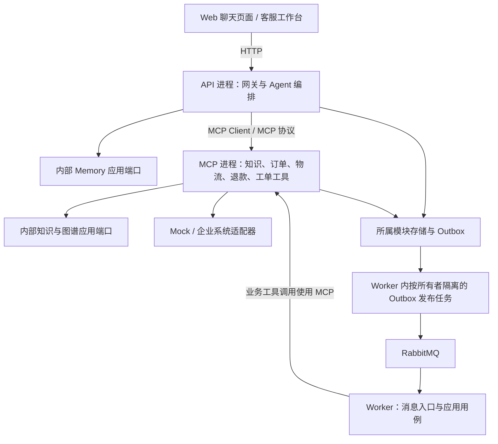

# 企业智能售后服务 Agent

> 本文保留实现契约和架构细节。阅读入口为[技术文档摘要](技术文档.md)。业务基线以需求 v1.8 为准；本体、仓储、支付、分析和异常追查的条款按对应领域章节与附录理解。代码与配置已清理待重建。

> 状态语义：退款申请与审核见第二十五章，完整生命周期见第二十八章；新申请的资金状态为 `not_executed`。项目当前状态见[文档导航](README.md)。


文档使用方式：业务与验收以[需求文档](需求文档.md)为准；实现设计见[技术文档](技术文档.md)，完整目录见[项目目录结构](项目目录结构.md)，三段原提示词见[Prompt设计](Prompt设计.md)，环境、安装、配置、启动及排障见[开发运行指南](开发运行指南.md)。


| 文档状态 | 当前开发技术基线 |
| --- | --- |
| 对应需求文档 | `需求文档.md`当前内容 |
| 实现状态 | 2026-10-19 清理代码后重新开发；仅保留 docs 与 data，本文为目标技术基线 |

## 一、项目技术总览

### 1.1 项目定位

企业智能售后服务 Agent 面向客户、客服人员、售后主管、人工客服和系统管理员，负责处理产品咨询、售后政策、订单、物流、退款、工单和人工转接问题。

用户请求进入 Gateway Service（网关服务）后，由 Agent Service（智能体服务）读取 State（工作流状态），通过 LangGraph（大模型工作流编排框架）协调执行。智能体不得直接访问业务数据库。工具调用通过 MCP（模型上下文协议）客户端访问独立工具服务器，具体客户端与适配器在首次开发时按本文档实现。

### 1.2 核心技术链路

知识服务计划采用 Chroma（开发环境向量数据库）、Milvus（生产环境向量数据库）、BM25（关键词检索算法）和 Neo4j（图数据库），向量与关键词检索按本文档基线使用加权融合。RabbitMQ（消息队列中间件）负责异步事件。第 2.2 节描述首次开发的目标拓扑，各项能力需在实现后验收。

### 1.3 一期核心指标

业务目标及指标口径见[需求文档](需求文档.md)第四、十四章；技术参数与目标分类集中在下表，不重复设置另一份指标表。

### 1.4 全局参数表（唯一参数源）

本表是工程运行参数的唯一数值定义源；业务目标、安全门槛和评测目标以需求文档第十四章为准。其他技术章节说明算法/行为并引用本表，不另设默认值；请求样例及固定验收输入中的数字是示例，不是新配置。调参须同步契约样例与回归验证。

| 参数/配置键 | 一期基线 | 适用范围 | 分类与测量口径 |
| --- | ---: | --- | --- |
| `AGENT_MAX_STEPS` | 8个`agent_step`周期 | 单次用户请求 | 硬约束；一个周期最多一次工具调用，Reflection不额外计步 |
| 简单同步请求硬超时 | 15秒 | Gateway/Agent | 硬约束；超时返回结构化错误或转人工 |
| 复杂任务硬超时 | 30秒 | Plan-and-Execute | 硬约束；返回`async_task_id`，不得继续阻塞同步请求 |
| 后台任务总期限 | 3600秒 | agent_task | 从持久化受理起计算；超期未领取则失败，不与同步等待时限混同 |
| 后台任务领取租约 | 60秒 | Worker | 单次执行须受30秒请求时限约束；过期后新Worker递增fencing_token领取 |
| `TICKET_CONFIRM_TTL_SECONDS` | 300 秒 | 普通工单创建/更新的内容绑定确认 | 用户明确确认后签发，过期重确认 |
| `REFUND_CONFIRM_TTL_SECONDS` | 300 秒 | 退款报价绑定确认 | 开发基线；报价与确认同过期，变更须重新确认 |
| `ADDRESS_CHANGE_CONFIRM_TTL_SECONDS` | 300 秒 | 收货地址绑定确认 | 开发基线；过期必须重新确认 |
| `TOOL_MAX_RETRIES` | 1次 | 只读瞬态失败 | 不含首次调用；总尝试次数最多2次；认证、参数、业务规则错误不重试，高风险写操作不自动重试 |
| 只读重试退避 | 100ms + 随机抖动 | 唯一一次只读重试 | 实现参数；须在剩余请求时限内执行，高风险写操作只按幂等键查询状态 |
| 模型服务连接/读取超时 | 1秒/8秒 | LLM调用 | 实现参数 |
| MCP连接/读取超时 | 1秒/3秒 | MCP Client | 实现参数 |
| Redis连接/读取超时 | 0.5秒/1秒 | 会话记忆 | 实现参数 |
| MySQL连接/读取超时 | 1秒/2秒 | 记忆、Checkpoint、Outbox | 实现参数 |
| Neo4j连接/读取超时 | 1秒/2秒 | 图谱查询 | 实现参数 |
| 检索连接/读取超时 | 0.5秒/2秒 | Milvus/Chroma/BM25 | 实现参数 |
| RabbitMQ发布确认超时 | 1秒/2秒 | 事件发布 | 实现参数 |
| 熔断失败窗口 | 30秒内5次失败 | 外部依赖 | 实现参数；状态机为`closed→open→half_open` |
| 熔断失败率阈值 | 20次请求中失败率≥50% | 外部依赖 | 实现参数；满足次数和比例任一条件即打开 |
| 熔断打开时间 | 30秒 | 外部依赖 | 实现参数；到期进入`half_open` |
| 半开探测次数 | 3次 | 外部依赖 | 实现参数；全通过恢复`closed`，任一失败回`open` |
| Redis会话TTL | 259200秒（3天） | `session:{tenant_id}:{thread_id}` | 业务约束；读写成功刷新TTL |
| `MEMORY_FALLBACK_ENABLED` | 生产`false`；开发/测试可显式`true` | Redis不可用 | 环境开关；降级时健康状态必须为`degraded`且不承诺持久化 |
| Embedding模型 | `BAAI/bge-small-zh-v1.5` | RAG向量索引 | 开发基线；模型文件需在受控构建中提供 |
| Embedding维度 | 512 | Milvus/Chroma collection | 硬契约；模型、索引和查询向量必须一致 |
| Embedding数据类型 | 归一化`float32` | 向量存储 | 硬契约 |
| 向量距离 | `COSINE` | Milvus/Chroma | 硬契约 |
| 向量召回Top-K | 20 | 单路RAG候选召回 | 初始基线；以冻结评测集验证召回和延迟后再定版 |
| BM25召回Top-K | 20 | 单路RAG候选召回 | 初始基线；以冻结评测集验证召回和延迟后再定版 |
| 融合结果Top-K | 3 | 交给Knowledge Agent | 实现参数 |
| 向量/BM25融合权重 | 待校准 | `final_score` | 按冻结开发集校准并版本化；不能作为未经验证的常量 |
| 图谱查询默认limit | 10 | query_knowledge_graph | 工具Schema默认值；只返回已授权且有证据的关系 |
| 最低相关性阈值 | 待校准 | 各召回路及融合结果 | 分路配置并版本化；按冻结开发集校准，保留集只用于验收 |
| HNSW `M` | 16 | Milvus/Chroma索引 | 实现参数 |
| HNSW `efConstruction` | 200 | 建索引 | 实现参数 |
| HNSW `ef` | 64 | 查询，必须≥最终Top-K | 实现参数 |
| 知识更新可检索窗口 | 60秒内 | `knowledge.updated` | 目标值；向量、BM25、Neo4j均完成版本校验后才可用 |
| RabbitMQ消费者最大重试 | 3次 | 所有异步消费者 | 硬约束；之后进入DLQ，消息不丢弃 |
| Agent上下文上限 | 32000 Token | 工作记忆 | 实现参数；按 UTF-8 字节数保守计数，超限裁剪或摘要；保留现有提示词原文及工具 Schema |
| 摘要触发阈值 | 连续对话超过6轮 | 工作记忆 | 压缩旧消息；保留窗口使用下行参数，触发及超限处理见11.2 |
| 摘要原文保留窗口 | 最近4轮 | 工作记忆 | 正常保留窗口，超限仍按Token预算裁剪 |

## 二、系统架构设计

### 2.1 架构组合说明

下表及第 2.2、2.3 节为首次开发的目标职责与部署设计。项目尚未开始开发，代码从初始化起按src/ 下四层及业务模块组织，依赖约束以第 3.1 节为准。

| 架构                | 应用位置                                                                                     |
| ----------------- | ---------------------------------------------------------------------------------------- |
| 统一代码包、多进程部署 | 四层代码集中维护；API、MCP、Worker 按入口分别运行，Memory 和 Graph 为内部能力模块 |
| Clean Architecture 四层 + DDD 战术设计 | 各服务采用 Interface、Application、Domain、Infrastructure 四层，并按业务需要使用聚合、实体、值对象、领域服务、仓储和领域事件 |
| LangGraph Agent架构 | Agent Service负责State、Node、Edge、Checkpoint                                                |
| ReAct架构           | Agent根据问题自主选择工具并循环执行                                                                     |
| Plan-and-Execute  | 复杂售后任务先规划，再执行                                                                            |
| Reflection        | 每次工具返回均执行确定性守卫；冲突、低置信、异常或高风险状态时才调用LLM反思 |
| MCP架构             | Agent通过MCP Client调用订单、物流、退款、工单和知识库工具                                                     |
| 事件驱动架构            | RabbitMQ传递工单、退款、知识更新和审计事件                                                                |
| RAG架构             | Milvus/Chroma向量检索加BM25关键词检索                                                              |
| KG架构              | Graph Service负责Neo4j实体关系查询                                                               |
| RAG+KG架构          | 知识库MCP同时调用RAG和Neo4j                                                                      |
| MVP               | 第一阶段交付完整可运行版本，不是独立代码层                                                                    |

### 2.2 项目架构图



### 2.3 进程、模块与数据边界

源码集中于 `src/`，四层是代码职责，进程是运行部署单元。旧文档中的 Gateway Service、Agent Service、Memory Service、Graph Service 与业务 MCP Server 名称表示逻辑能力，除下表明确进程外不要求各自建立服务目录或独立部署。

| 运行单元 | 入口 | 责任与通信方式 |
| --- | --- | --- |
| 前端 | `frontend/` | 提供聊天、客服工作台、退款确认与任务状态展示；只通过 HTTP 调用 API |
| API 进程 | `bootstrap/api_main.py` | 网关认证、Agent 编排、Memory 和任务状态查询；Memory 通过注入的应用端口进程内调用，业务工具必须通过 MCP 客户端调用 |
| MCP 进程 | `bootstrap/mcp_main.py` | 一期集中注册知识、订单、物流、退款、工单工具；各工具仍有独立 Schema、权限和用例，服务端逐次二次授权；图谱通过内部知识应用端口调用 |
| Worker 进程 | `bootstrap/worker_main.py` | 消费消息、执行后台任务和按所有者发布 Outbox；本地任务调用公开应用入口，业务工具调用经 MCP，不直接访问其他模块业务表 |
| 基础设施 | 部署配置 | MySQL、Redis、RabbitMQ、Neo4j、Milvus/Chroma 的存储和协议实现 |

API、MCP、Worker 复用同一代码包，通过启动组装仅加载各自所需的适配器与凭证，可以分别扩容。Supervisor和领域用例不能绕过MCP直接调用业务仓储；Memory 和图谱的进程内调用通过应用端口及 Bootstrap 组装，不跨模块导入私有实现。后续如需拆分 MCP 实例，使用工具注册配置选择工具集，不改变四层结构与业务契约。

数据所有权按能力划分：退款拥有申请/确认/幂等，工单拥有工单/转接，知识拥有发布/索引任务，通知和审计拥有各自记录，Agent 拥有 Checkpoint 与执行任务，Memory 拥有会话和长期事实。可共用 MySQL 实例，但使用模块表前缀或独立 Schema 及最小权限账号；禁止模块直接读写其他模块业务表。订单、支付、物流主数据仍由企业系统拥有。

Outbox 按能力所有者隔离，业务写入与本模块 Outbox 同事务提交。共用 Worker 只复用发布实现，发布任务必须显式限定所有者、租户及领取租约；不能无范围扫描所有模块记录。聚合事务不因共用数据库而跨模块扩大，远程企业操作通过幂等和对账恢复。

#### MCP 注册与部署口径

一期部署一个独立 MCP 服务，入口为根目录 `bootstrap/mcp_main.py`，同一注册表完整注册 knowledge、order、logistics、refund、ticket 五类工具组。工具组是职责和权限组织方式，不是五个服务目录、五个端口或五个容器；收货地址修改属于 order 工具组，不增加第六类专业 Agent。

API 和 Worker 通过注入的 MCP 客户端，使用同一 `MCP_SERVER_URL` 访问该服务。默认本地与生产均使用 HTTP；STDIO 仅用于隔离测试，测试启动的子进程不计为默认部署形态。MCP 服务须按每次调用独立验证可信租户、最终用户主体、权限及业务归属，不能以共用服务连接替代用户授权。

注册验收须检查五类工具全部可发现、名称唯一、Schema 及权限配置正确；客户端仅向模型暴露当前 Agent 被授权的工具。工具组仍按第 2.3 节保持数据、事务和 Outbox 所有权隔离。后续如需多副本扩容，副本提供同一套工具契约，不改为按工具组拆服务；没有明确拆分需求时不增加部署单元。

### 2.4 依赖倒置与四层治理规则

四层职责、端口归属与依赖约束集中在第 3.1、3.3 节；首次开发从该结构开始，不涉及旧代码迁移。

## 三、目录与模块职责

### 3.1 四层职责与依赖方向

项目采用 **Clean Architecture 四层 + DDD 战术设计**，在src/ 源码目录下划分四层，再在每层内部按业务模块组织。以下目录为首次开发的目标设计，当前尚未创建业务代码。

| 架构层 | 中文名称 | 目录 | 核心职责 |
| --- | --- | --- | --- |
| Interface | 接口层 | `interface/` | HTTP、MCP 和消息消费入口；传输格式校验、请求响应转换，调用应用用例 |
| Application | 应用层 | `application/` | 用例编排、授权与归属检查、事务、一次性确认、幂等及外部能力端口 |
| Domain | 领域层 | `domain/` | 聚合、实体、值对象、领域服务、业务不变量、仓储抽象和领域事件 |
| Infrastructure | 基础设施层 | `infrastructure/` | 数据库、缓存、消息、检索、模型、协议客户端及企业系统适配器 |

```text
Interface（接口层） → Application（应用层） → Domain（领域层）
Infrastructure（基础设施层） → Application / Domain 定义的抽象
Bootstrap → 四层的对象组装与注入
```

箭头表示源码依赖。Domain 不依赖其他三层；Application 不导入 Interface 或 Infrastructure；Interface 不直接访问数据库、不创建具体适配器、不绕过用例执行业务规则。基础设施通过依赖注入实现内层端口。`bootstrap/` 仅负责配置、组装、启动和资源生命周期，不是第五个业务层。

领域对象使用纯 Python 对象，不依赖 HTTP/MCP Schema、Pydantic 传输模型、ORM、LangGraph、数据库驱动、环境配置或完整认证上下文。应用用例从可信 `AuthContext` 提取必要的租户、主体及业务标识再调用领域对象。

LangGraph 是明确限定在 Agent `application/agent/workflow/` 的框架依赖例外；领域模型和通用用例 DTO 保持框架无关。具体 `MySQLCheckpointSaver` 位于基础设施层，应用层仅依赖 `CheckpointRepositoryPort`。

### 3.2 项目目录

完整目录与逐项中文注释集中维护在[项目目录结构.md](项目目录结构.md)。src/ 源码目录下划分 Interface、Application、Domain、Infrastructure，层内按业务模块组织；项目根目录的 bootstrap/ 只做启动组装，前端和评测资产分别位于 frontend/ 与 evals/。

### 3.3 DDD 战术设计

进程是运行边界，限界上下文是模型语义边界，两者不要求一一对应。知识检索和图谱模块通过知识版本与证据契约协作，不跨模块修改聚合或共享业务事务。Agent 是应用编排角色，不将每个 Agent 机械建模为聚合。

| 模式 | 项目示例 | 职责 |
| --- | --- | --- |
| 聚合与聚合根 | `RefundRequest`、`Ticket`、`KnowledgeRelease`、长期记忆 `MemoryProfile` | 通过聚合根改变内部状态，维护本地事务内的不变量 |
| 实体 | 工单内的 `TicketMessage`、知识版本内的文档元数据 | 具有稳定标识与生命周期，不等同于 ORM 表或 Neo4j 节点 |
| 值对象 | `Money`、`OrderId`、`RefundReason`、`KnowledgeVersion`、`EvidenceReference` | 构造时校验有效性；金额和币种共同构成 `Money` |
| 领域服务 | 退款资格、退款金额、物流异常、证据版本一致性规则 | 对输入的业务事实执行确定性计算，不调用网络、数据库或 LLM |
| 仓储 | `RefundRequestRepository`、`TicketRepository`、`KnowledgeReleaseRepository` | 在领域层定义按聚合加载/保存的接口，在基础设施层实现 |
| 领域事件 | 退款确认事实、工单创建事实、知识版本可用事实 | 表达领域内已发生事实，不携带 RabbitMQ 对象、不直接发布消息 |
| 应用用例 | `CreateRefundRequest`、`CreateTicket`、`SearchHybridKnowledge` | 获取事实、授权、调用领域对象并协调事务和外部端口 |
| 防腐层 | `EnterpriseOrderAdapter`、`EnterpriseRefundAdapter` 等 | 将企业字段、状态码及错误转换为本地模型，隔离外部语义 |

订单查询、支付和物流一期以只读快照及查询端口建模；地址更新作为订单模块的独立受控命令处理。查询侧不在本系统重建企业业务主数据聚合。领域规则与存储模型分开；实体不直接执行数据库操作。

聚合仓储抽象位于 `domain/<业务模块>/repositories.py`。查询与用例能力端口位于 `application/<业务模块>/ports/`，包括既有 `OrderQueryPort`、`OrderAddressCommandPort`、`LogisticsQueryPort`、`RefundServicePort`、`TicketServicePort`、`SessionRepositoryPort`、`CheckpointRepositoryPort`、`VectorSearchPort`、`KeywordSearchPort` 和 `GraphSearchPort`，保留名称和契约。外部服务端口不等同于本地聚合仓储；Unit of Work、Outbox 和消息发布抽象也由应用层定义。

退款应用用例负责二次授权、归属、确认和幂等检查，聚合负责退款申请的业务状态转移。一次性确认消耗、申请写入、幂等记录和所属模块 Outbox 必须在同一可保证原子性的本地事务内完成；资格、金额与状态按需求 FR-07.1、FR-07.2 及第二十五章执行；一期支持申请、审核、仓储验收和支付执行，执行契约见第二十八章。企业远程写入无法加入本地事务时，使用企业幂等键、状态查询、补偿或对账协调，不假设本地回滚能撤销远程副作用。

应用层将领域事件转换为第 8.3 节版本化集成事件，沿用 `refund.confirmed`、`ticket.created` 等事件名和 Schema。各业务所有者在业务事务内写入自己的 Outbox，由按所属模块隔离的发布任务领取和发布。消费者在业务结果与持久化消费幂等记录成功提交后 ACK；失败执行既有重试和死信策略。跨模块事件采用最终一致性；知识版本仍须等待向量、BM25、图谱全部校验完成才可检索，失败保持 `indexing_failed`。

### 3.4 模块协作与执行保障

模块职责按第 3.2 节中文注释目录划分，运行归属与通信方式按第 2.3 节执行。领域事件保留在各领域内，集成事件契约与转换放在 `application/common/events/`，HTTP/MCP Schema 留在接口层；不另设顶层共享业务模型。

- `application/common/execution/` 负责超时预算、可重试判断与熔断策略；具体状态存储和任务投递在 `infrastructure/resilience/`。参数引用第 1.4 节，不在目录中另设阈值；写操作和认证/参数/业务错误沿用禁止盲重试约束。
- `application/common/tasks/` 定义任务状态 `pending/running/succeeded/failed`、可靠调度、查询与恢复；持久化记录包含租户、主体、任务 ID、幂等键、状态、租约及结果引用。查询必须验证调用主体的数据范围，Worker 用租约防止并发执行，崩溃后按幂等键和 Checkpoint 恢复。任务与待投递事件同事务提交，API 超时不代表重复创建或盲目重执行；复杂任务只在成功持久化后返回 `async_task_id`，之后由 Worker 继续执行。
- `application/knowledge/indexing/` 按租户与 `knowledge_release_id` 协调向量、BM25、图谱状态。状态由 MySQL 持久化，各路完成通知可幂等重放，全部通过版本校验才标记可检索；任一路失败标记 `indexing_failed`，不对外发布部分版本。
- `frontend/` 展示后端状态、证据、追问、确认和人工转接结果，退款确认内容与服务端绑定一致，不自行决定资格、金额或权限。客服代客请求必须保留真实客服主体和明确授权的客户范围，不能仅修改 `user_id`。
- `evals/` 独立维护人工智能评测资产，固定数据集、知识发布、模型、提示词与工具 Schema 版本。与 `tests/` 工程正确性检查配合，按第 17 章记录分子、分母、统计窗口及实测结果，未测指标不得标记已达标。

### 3.5 首次开发落地与验收

1. 按第 3.2 节初始化 src/ 下四层业务模块和前端/评测目录，按需创建四层模块和启动组装入口。
2. 优先完成订单查询业务切片，依次实现领域模型、应用用例与端口、基础设施适配器、接口处理器及依赖注入。
3. 按同一结构扩展物流、知识、退款、工单和记忆能力；以文档定义的 API、MCP工具注册表、公共 State 及事件契约为开发基线。
4. 建立架构依赖检查，验证领域规则可脱离框架运行、应用用例可注入 Fake 端口、Mock/Enterprise 适配器可替换。
5. 按业务能力验证租户隔离、退款确认、Outbox、消费幂等和 Checkpoint 恢复；实现完成后分别执行契约、集成及端到端验收。

## 四、技术选型说明

| 技术             | 使用位置          | 选择原因                         |
| -------------- | ------------- | ---------------------------- |
| Python         | 全部后端服务        | 适合AI、Agent和数据处理开发            |
| 私有模型适配器（默认） | Agent Service | 承担受限意图识别、答案整理；具体模型由部署配置选择，云模型须通过安全与数据评估 |
| LangGraph      | Agent Service | 管理State、Node、Edge和Checkpoint |
| MCP            | Agent与外部工具之间  | 统一工具发现、调用和权限边界               |
| RabbitMQ       | 异步事件          | 支持至少一次投递、重试和死信队列             |
| Redis          | 会话记忆          | 保存3天短期会话，支持多实例共享             |
| MySQL          | 长期记忆和系统数据     | 保存用户画像、长期事实、Checkpoint和审计索引  |
| Milvus         | 生产向量检索        | 保存知识Embedding并执行HNSW检索       |
| Chroma         | 开发与测试环境       | 作为Milvus的本地替代方案，生产环境使用Milvus |
| BM25           | 关键词检索         | 提高订单号、型号、政策名称和错误码的命中率        |
| Neo4j          | 知识图谱          | 保存产品、配件、政策、故障和兼容关系           |
| Docker Compose | 本地部署          | 一键启动项目依赖                     |
| Kubernetes     | 生产部署          | 支持服务独立扩缩容                    |

索引选择固定为：生产环境Milvus使用HNSW，本地Chroma使用HNSW，BM25作为独立关键词索引，Neo4j使用图关系和属性索引。

### 4.1 Python依赖与版本

项目依赖在 `pyproject.toml` 声明，兼容性验证后在 `requirements.lock` 锁定。原环境版本记录、Conda、安装命令和环境检查集中于[开发运行指南](开发运行指南.md)，不作为本项目已经实现或验证的证据。

### 4.2 Milvus索引参数

Milvus 与 Chroma 使用 HNSW，开发/生产保持相同检索端口和维度契约。Embedding 模型、维度、数据类型、距离、HNSW M/efConstruction/ef 及召回数量全部读取1.4，不在此复制默认参数表。

M 控制节点连接数，efConstruction 控制建索引搜索范围，ef 控制查询搜索范围且必须满足最终召回数量约束。集合保存 tenant_id、knowledge_release_id、chunk_id、document_id、version、source 与 Embedding；创建/发布前校验模型、向量维度及 BM25 版本一致性。CPU吞吐、内存及并发可用性须按需求目标压测，不把配置完成等同于指标达成。

## 五、模型接入设计

### 5.1 大模型职责

经配置的LLM适配器只负责以下任务：

- 识别用户意图；
- 判断是否需要调用工具；
- 在服务端提供的授权能力中选择工具；
- 生成复杂任务计划；
- 读取工具Observation并决定下一步；
- 根据经过校验的证据生成最终回答。

### 5.2 模型配置

模型供应商不写入业务契约。生产默认连接企业批准的私有模型端点；开发若选用云API，只允许合成数据，且须经数据分类、委托处理/跨境评估、DPA和安全批准后才可处理任何真实数据。模型名、端点、密钥、区域和版本由受控部署配置注入并记录到评测清单。

```env
# 模型适配器配置
LLM_PROVIDER=private
LLM_BASE_URL=https://approved-private-model.example
LLM_MODEL=approved-model-id
LLM_TOOL_CHOICE=auto

# Agent安全边界
AGENT_MAX_STEPS=8
TOOL_MAX_RETRIES=1
```

模型客户端由Provider Port注入；以下仅示意兼容OpenAI协议的受控端点，不指定厂商：

```python
import os

from langchain_openai import ChatOpenAI

llm = ChatOpenAI(
    model=os.environ["LLM_MODEL"],
    api_key=os.environ["LLM_API_KEY"],
    base_url=os.environ["LLM_BASE_URL"],
    temperature=0.2,  # 工具选择和业务回答保持稳定
)
```

生产环境默认使用非Thinking模式，以控制工具调用延迟、请求成本和链路复杂度。若业务评测确认需要启用Thinking模式，必须在每次后续工具请求中完整传递上一轮返回的`reasoning_content`，并完成工具调用、State恢复、超时、重试和回滚测试后才能上线。Thinking模式下不能使用指定工具名的`required`或命名工具选择；本项目统一使用`tool_choice=auto`。

### 5.3 工具选择

调用兼容API时使用`tool_choice=auto`，模型仅可在当前请求授权的能力中选择：

- 直接回答；
- 调用知识库工具；
- 调用订单工具；
- 调用物流工具；
- 调用退款工具；
- 调用工单工具；
- 继续调用其他工具。

### 5.4 模型调用边界

- 模型不能直接访问MySQL、Redis、Neo4j或Milvus；
- 模型不能执行原始Cypher；
- 模型不能执行真实退款或取消订单；收货地址修改仅按需求 FR-18 的服务端验证与绑定确认执行，模型不得直接修改地址；
- 高风险操作必须先向用户展示结果并获得明确确认；
- 模型不能向用户展示Prompt、内部推理和技术堆栈。

## 六、Prompt设计

系统提示词、工具调用提示词和最终回答提示词由[Prompt设计.md](Prompt设计.md)维护；提示词必须遵守本章确定性守卫、受限路由和工具权限边界。

## 七、Agent设计

### 7.1 Supervisor与领域能力

| 组件 | 职责 |
| --- | --- |
| 售后Supervisor | 识别问题、按白名单路由用例/工具、汇总有证据结果并判断结束 |
| 确定性领域用例 | 执行订单、物流、退款、工单、仓储、支付、指标和异常调查规则；不自主选择额外权限 |
| 知识能力 | 按Supervisor选定的RAG、KG或混合工具检索同版本证据 |

### 7.2 ReAct流程

本项目将一个`agent_step`定义为一次Supervisor或计划执行决策周期，最多包含一次MCP工具调用。工具返回后先执行确定性守卫；仅在冲突、低置信、异常或高风险条件下进入LLM Reflection，Reflection属于该周期的可选节点且不额外增加`step_count`。单次请求周期上限和硬超时读取1.4，简单只读性能目标引用需求第十四章；复杂任务在持久化后返回 async_task_id。

```text
读取问题和State
  ↓
Reason：判断缺少什么信息
  ↓
Act：选择Agent或工具
  ↓
Observation：获得工具结果
  ↓
更新State
  ↓
Reflection：决定继续、重试、询问、转人工或结束
  ↓
生成最终回答
```

### 7.3 Plan-and-Execute

适用于订单、物流、退款连续处理的复杂问题。

```text
用户问题
  ↓
Planner生成计划
  ↓
Executor执行计划
  ↓
Reflection检查每个任务
  ↓
计划完成或重新规划
```

### 7.4 Agent State核心字段

```json
{
  "user_id": "user-10001",
  "thread_id": "thread-10001",
  "trace_id": "trace-10001",
  "user_question": "我的订单到哪了？",
  "intent": "logistics_query",
  "current_agent": "logistics_agent",
  "tool_calls": [],
  "observations": [],
  "plan": [],
  "knowledge_route": "rag|kg|hybrid",
  "rag_evidence": [],
  "kg_evidence": [],
  "next_action": "finish",
  "step_count": 1,
  "retry_count": 0,
  "handoff_required": false
}
```

### 7.5 LangGraph节点、边与Checkpoint

| 节点           | 输入                | 输出/下一步                                        |
| ------------ | ----------------- | --------------------------------------------- |
| `memory`     | user_id、thread_id | 会话历史、长期事实                                     |
| `supervisor` | 用户问题、State        | 直接回答、选择Agent或进入planner                        |
| `planner`    | 复杂任务目标            | 有序任务计划                                        |
| `executor`   | 当前任务              | 工具调用请求或任务结果                                   |
| `tool`       | 已授权工具和Schema参数    | Observation                                   |
| `reflection` | Observation、State | continue、retry、replan、ask_user、handoff或finish |
| `checkpoint` | State、当前节点        | 持久化结果                                         |
| `finish`     | 已校验证据             | 最终回答                                          |

核心边为：`memory→supervisor`；主管判断后进入`tool`、`planner`、`ask_user`或`finish`；`tool→reflection`；Reflection根据结果回到`tool`、`planner`、`ask_user`、`handoff`或`finish`。持久化时机、恢复内容及写失败处理集中见11.1；达到步骤上限后禁止继续调用工具，按需求执行人工处理或返回已持久化任务状态。

Checkpoint 字段、父子版本、并发冲突和中间写入持久化规则集中见11.1，不在工作流章节重复定义。

## 八、Agent编排与通信

### 8.1 同步调用

用户问题、订单查询、物流查询、知识检索和退款资格判断采用同步调用：

```text
Gateway → Agent → MCP Client → MCP Server → Tool Result → Agent
```

### 8.2 异步调用

需要异步处理的事件、队列、生产者、消费者和必填payload唯一维护在机器可读的[`event-catalog.json`](../data/contracts/event-catalog.json)。目录中的每个事件都引用`events.schema.json`内按`event_type`选择的payload Schema；新增或变更事件必须先更新该目录和payload Schema，再由实现侧生成或校验绑定与契约测试；本章不维护第二份事件清单。

### 8.3 消息要求

- 至少一次投递；
- 消费者必须幂等；
- 单条消息最多重试3次；
- 失败后进入死信队列；
- 消息必须包含`schema_version`、`event_version`、`event_id`、`request_id`、`correlation_id`、`trace_id`、`tenant_id`、`producer`和业务幂等键；
- 敏感字段必须脱敏。

所有事件初始`event_version=1`；破坏兼容的载荷变更必须升级版本并通过契约测试。`data/contracts/event-catalog.json`是事件名、生产者、队列、消费者和payload必填字段的唯一目录；`events.schema.json`既校验共同事件信封，也按`event_type`选择严格的payload Schema。跨服务事件还必须含`operation_id`、`causation_id`及父事件引用。

统一交换机、队列和重试上限以事件目录为准，失败进入`after_sales.dlq`。事件信封字段以`events.schema.json`为准。业务数据库变更与事件写入同一Outbox事务；Outbox由实际写入业务状态的能力服务拥有并轮询；RabbitMQ发布确认成功后才标记已发布，失败记录保留待重试。审计记录先持久化再异步发布。事件消费者按`event_id`和业务幂等键幂等；退款和写操作不得因消息重放重复执行。

## 九、工具调用设计

### 9.1 知识库工具

知识工具组对Supervisor暴露以下四个只读 MCP 工具。向量与 BM25 是 RAG 内部独立模块，不注册为模型可见工具；Supervisor不得通过选择其中一路代替需求规定的双路召回。

| 工具 | 输入 | 内部执行与输出 |
| --- | --- | --- |
| `search_knowledge_base` | `query, top_k`（默认见1.4） | 并行执行向量与 BM25 → 按 chunk_id 去重、归一化和融合排序 → 返回文档证据、来源与版本 |
| `query_knowledge_graph` | `entity_names, relation_types, limit`（默认见1.4） | 查询预定义参数化图谱模板 → 返回实体、关系、版本及 evidence_id，不接受任意 Cypher |
| `search_hybrid_knowledge` | `query, entity_names, relation_types` | 并行执行完整 RAG 双路链路与 KG 查询 → 校验发布版本及证据冲突 → 返回分路证据、合并证据和冲突状态 |
| `get_policy_detail` | `policy_name` | 查询当前授权范围和有效知识版本内的指定政策详情 → 返回条款、适用条件、有效期和证据来源；名称歧义时返回候选供澄清，不擅自选择 |

#### RAG 双路召回

`VectorSearchPort` 与 `KeywordSearchPort` 分别注入向量、关键词适配器，必须并行调用并分别记录命中数量、耗时、状态和召回来源。向量库类型及 HNSW 参数见4.2，Top-K、融合权重及阈值见1.4：每路召回数量及融合结果上限均读取参数表；外部 top_k 不得超过该结果上限。

以租户、knowledge_release_id 和 chunk_id 识别同一片段；同一文档的不同片段不得仅因 document_id 相同被删除。候选保留两路分数及 retrieval_source，缺失一路命中与该路后端故障必须区分。

适配层必须把 Chroma 距离和 Milvus 相似度转换为同一、经校准的向量相关性分数；BM25不得按单次查询候选做 min-max 归一化，以免单条命中被人为变成满分。两路分数校准映射、权重和阈值均带版本，并只用冻结开发集选择。融合时对每个候选仅使用实际命中的召回路，并按该候选命中路的权重重新归一化；因此仅 BM25 命中或仅向量命中仍可进入后续排序。分路阈值分别决定候选是否有效，融合阈值不能替代单路门槛。候选按融合分排序后交给独立 `RerankPort`（Cross-Encoder）重排；若该端口未配置，不得把分数排序称为重排序，也不得通过相关性验收。两路成功执行但无命中属于正常空结果；任一路故障须返回 partial/degraded 和分路错误，不得宣称完整双路成功或伪装成无结果。

#### KG 与混合检索

Supervisor根据问题选择 rag、kg 或 hybrid，分别调用对应只读能力；已知政策详情可调用 get_policy_detail。GraphSearchPort 对接 Neo4j，知识查询始终受租户、授权范围、关系白名单和证据校验约束，不保存或查询动态订单、支付、物流、退款主数据。

混合检索在入口解析当前授权可用的 knowledge_release_id 并固定本次版本，RAG 的向量/BM25和 KG 均使用该版本。应用层调用共享检索用例，不通过再次发起模型工具选择来执行内部步骤，也不重复串行调用两个已完成的检索工具。合并时保留 rag_evidence、kg_evidence、evidence_id、来源、版本和 conflicts，不把不可比较的 KG 置信度与 RAG 融合分数直接相加。

同一发布版本内部冲突须标记 indexing_failed；有效版本之间的矛盾按 hard_conflict 处理，不生成确定性结论。检索故障、空结果与证据冲突必须分别返回；KG 故障但 RAG 可用时只能明确提供剩余 RAG 证据，不宣称关系已核实。纯 KG 问题没有可验证关系时不得用文档猜测代替。版本发布原子性要求仍按第十四章和需求 FR-04.2 执行。

四个工具统一采用第9.4节版本化信封和错误格式，结果至少包含实际 route、knowledge_release_id、evidence、分路状态及 conflicts；RAG证据增加 chunk_id、document_id、vector_score、bm25_score、final_score、retrieval_source。调用链与观测数据进入脱敏审计，不向用户展示内部检索分数。内部并行调用受第9.3节统一时限与重试预算约束，不叠加 SDK 隐式重试。

### 9.2 业务工具

模型可见工具名称、输入Schema、权限范围和副作用以`data/contracts/mcp-tools.json`为唯一事实源，并由`mcp-tools.schema.json`校验。本文后续示例仅解释调用约束，不代表注册表之外的工具可调用。确认凭证、幂等键、租户、主体、权限和预期版本由Gateway/MCP服务端从可信上下文注入，不作为模型可控参数。

订单归属校验由MCP Server内部`ownership_guard`执行，不注册为模型可见工具；它只读取服务端`AuthContext`，并将未授权与不存在统一为安全错误语义，避免泄露订单存在性。

### 9.3 工具调用规则

- 工具参数必须通过Schema校验；
- 订单归属、租户和权限必须由服务端认证上下文校验，`user_id`不得作为模型可信参数；
- 高风险退款写操作必须携带一次性、短时有效且绑定订单、退款原因、退款金额和币种的`confirmation_id`以及`idempotency_key`；Prompt或`confirmed=true`不能单独授权；
- 只读瞬态错误最多自动重试1次（含首次调用最多尝试2次）；高风险写操作禁止盲目重试，只能按幂等键查询状态；
- 连续失败或超过8步后转人工；
- 所有工具调用必须记录审计日志。

#### 重试计数与执行边界

- `attempt_count` 包含首次调用，最大为2；`retry_count` 不包含首次调用，最大为1。首次成功不重试；首次瞬态失败且预算允许时重试一次，第二次仍失败则停止该调用并转人工。
- 计数按 `tenant_id + request_id + invocation_id` 的逻辑调用记录，绑定工具名与规范化业务参数；同一用户请求内对同一工具、同一参数的重复分发不得通过更换 invocation_id 重置计数。恢复执行须读取已持久化计数。
- 认证失败、权限拒绝、参数不合法、业务规则不满足和正常空结果不自动重试；需要补充或纠正参数时先进入 ask_user/replan，再按新的合法输入执行，不反复提交同一错误参数。退款申请、地址修改等高风险写操作自动重试次数为0，超时后只查询既有操作状态。
- 重试受请求总时限、最多8个 agent_step、权限与熔断共同约束；模型重新调用占用新的执行周期。SDK、HTTP、MCP 客户端及检索适配器不得叠加隐式重试；一次逻辑调用的底层请求也必须遵守同一总尝试预算。
- `tool.call.failed` 可记录失败事实，但异步消费者不得重放已经耗尽预算的原工具调用，不得绕过高风险写操作禁重试规则。事件携带逻辑调用引用与已用预算；仍允许后台只读重试时只能使用原调用剩余的那一次机会，不重置预算。原调用已转人工后仅记录和处理通知，不继续查询。
- RabbitMQ 消费重试是消息处理可靠性机制，沿用现有队列重试配置；消息重投不等于重新获得工具调用机会，必须读取持久化预算和消费幂等结果。

### 9.4 MCP接口定义

所有MCP工具必须使用结构化Schema校验输入和输出，并由服务端完成身份、权限、订单归属和高风险确认校验。模型只能调用注册表中的工具。

MCP请求和响应统一包含`schema_version`、`correlation_id`、`trace_id`、`agent_name`、`tool_name`、`status`、`error_code`和脱敏参数摘要；`tenant_id`、`subject_id`、角色和权限由Gateway/MCP服务端注入并重新校验。统一错误结构为`{schema_version, error_code, message, retryable, request_id, correlation_id, trace_id, details}`；字段类型、空值和嵌套位置以第二十六章为准，不得返回Prompt、思维链、密钥、异常堆栈或未授权敏感字段。

模型可见工具名称、严格输入Schema、独立输出DTO引用、权限范围、确认/幂等要求及副作用以[`mcp-tools.json`](../data/contracts/mcp-tools.json)为唯一事实源，并由[`mcp-tools.schema.json`](../data/contracts/mcp-tools.schema.json)校验。统一MCP响应信封及按`tool_name`绑定的工具输出DTO由[`mcp-response.schema.json`](../data/contracts/mcp-response.schema.json)校验；每个注册工具必须且只能引用其具名`data` DTO，覆盖检查由离线校验器执行。知识能力的四个工具定义见9.1，本文不另建重复清单。业务结果必须携带适用的版本、来源及证据引用。确认凭证、幂等键、租户、主体、权限和预期版本由Gateway/MCP服务端从可信上下文注入，不作为模型可控参数。

工单持久化的上下文必须是脱敏且有界的结构化数据，至少保留用户原始问题、摘要、Agent结果、工具结果摘要、失败原因、关联业务ID、当前状态、优先级和下一步动作；`correlation_id`、`trace_id`和`thread_id`作为独立链路字段保存，不允许由模型作为工具参数传入。

MCP 错误统一放入响应 error 对象，并保留兼容的顶层 error_code（与 error.error_code 一致）；必填字段以第二十六章为准，不得返回数据库连接串、异常堆栈、密钥或未授权字段。

## 十、外部数据源

### 10.1 一期数据源

| 数据源  | 处理方式                         |
| ---- | ---------------------------- |
| 产品知识 | 开发/测试环境模拟知识文档；生产环境接入企业知识库    |
| 售后政策 | 开发/测试环境模拟政策数据；生产环境接入政策管理系统   |
| 订单   | 开发/测试环境模拟订单服务；生产环境接入企业订单中心   |
| 物流   | 开发/测试环境模拟物流服务；生产环境接入物流系统     |
| 退款   | 开发/测试环境模拟退款服务；生产环境接入退款审批系统   |
| 工单   | 开发/测试环境模拟工单服务；生产环境接入CRM或工单系统 |
| 用户画像 | MySQL                        |
| 会话历史 | Redis                        |
| 图谱关系 | Neo4j                        |

### 10.2 真实企业替换方式

真实企业接入时，仅替换同一 MCP 服务中各工具组使用的业务适配器；保持工具名、Schema、授权与事件契约不变：

```text
order 工具组 → 企业订单中心（查询、条件改址与操作结果查询）
logistics 工具组 → 企业物流系统
refund 工具组 → 企业售后审批；受控执行协调器 → WMS 与支付渠道（第二十八章）
ticket 工具组 → CRM或工单系统
knowledge 工具组 → 企业知识库
```

Agent编排方式、工具协议和State结构不改变。

## 十一、数据模型设计

### 11.1 MySQL数据

核心表结构：

所有业务、会话、记忆、checkpoint、审计、幂等和Outbox表必须包含`tenant_id`并建立租户过滤约束；真实操作者使用服务端认证上下文的 subject_id，业务客户按26.1节的 user_id/customer_id 定义；必须验证代客范围，禁止以模型传入的 user_id 作为授权依据。

| 表 | 关键字段与类型 | 用途 | 主键/索引 |
|---|---|---|
| `user_profile` | `user_id VARCHAR(64)`、`display_name VARCHAR(128)`、`contact_masked VARCHAR(64)`、`role VARCHAR(32)`、`created_at DATETIME`、`updated_at DATETIME` | 用户基础画像 | tenant_id+user_id联合主键 |
| `user_memory_fact` | `id BIGINT`、`user_id VARCHAR(64)`、`fact_type VARCHAR(64)`、`fact_key VARCHAR(128)`、`fact_value JSON`、`importance DECIMAL(3,2)`、`source VARCHAR(32)`、`updated_at DATETIME` | 长期事实和偏好 | tenant_id+id联合主键；tenant_id+user_id+fact_type+fact_key唯一 |
| `agent_checkpoint` | `tenant_id VARCHAR(64)`、`thread_id VARCHAR(64)`、`checkpoint_ns VARCHAR(128)`、`checkpoint_id VARCHAR(64)`、`parent_checkpoint_id VARCHAR(64)`、`current_node VARCHAR(64)`、`state_schema_version VARCHAR(32)`、`revision BIGINT UNSIGNED`、`state JSON`、`metadata JSON`、`pending_writes JSON`、`saved_at DATETIME` | Agent Service自研`MySQLCheckpointSaver`的LangGraph状态持久化和中断恢复 | `tenant_id+thread_id+checkpoint_ns+checkpoint_id`联合主键；`tenant_id+thread_id+checkpoint_ns+saved_at`索引；`revision`用于版本和并发校验；按接口实现`put/get/list`和`pending_writes`持久化 |
| `agent_audit_log` | `audit_id VARCHAR(64)`、`trace_id VARCHAR(64)`、`thread_id VARCHAR(64)`、`tool_name VARCHAR(128)`、`parameter_summary JSON`、`result_summary JSON`、`duration_ms INT`、`created_at DATETIME` | Agent和MCP审计 | tenant_id+audit_id联合主键；tenant_id+trace_id索引 |
| `outbox_event`（各业务能力服务自有） | `id BIGINT`、`tenant_id VARCHAR(64)`、`event_id VARCHAR(64)`、`event_type VARCHAR(128)`、`aggregate_type VARCHAR(64)`、`aggregate_id VARCHAR(64)`、`payload JSON`、`status VARCHAR(32)`、`attempts INT`、`next_retry_at DATETIME`、`published_at DATETIME`、`created_at DATETIME` | 与业务状态同事务写入，可靠发布RabbitMQ事件 | tenant_id+event_id唯一；tenant_id+status+next_retry_at索引；不得由Memory Service统一代管 |
| `system_config` | `config_key VARCHAR(128)`、`config_value TEXT`、`updated_at DATETIME` | 系统配置 | tenant_id+config_key联合主键 |

State、工具参数和工具结果写入MySQL前必须脱敏；数据库结构由 `migrations/` 的版本化脚本维护，由部署初始化任务执行；运行进程检查结构版本，不由多个实例并发执行结构升级。

Checkpoint 保存时机与业务恢复契约：每次确定性工作流状态迁移、外部工具调用前后及最终结束后持久化；按需触发的LLM Reflection也记录在同一任务轨迹中。快照保存当前 State、当前节点、已完成步骤、工具调用记录和未完成任务。恢复键必须包含租户、thread_id 与 checkpoint_ns，不能仅凭 thread_id 访问其他主体的数据。保存失败记录告警并返回未持久化状态，不伪造恢复成功，生产不使用仅内存存储。MySQLCheckpointSaver适配器及锁定版本的接口契约测试由任务服务负责，具体 put/get/list、pending_writes 处理及并发规则如下。

Checkpoint版本和并发规则：

- `revision`是服务端维护的非负版本号；根Checkpoint为0，子Checkpoint必须使用父Checkpoint的`revision+1`；
- `parent_checkpoint_id`必须指向同租户、同线程、同`checkpoint_ns`下已存在的父Checkpoint；
- 同一父Checkpoint只能形成一个有效子版本；旧父版本、重复分叉或并发写入冲突时返回结构化冲突错误；
- 相同`checkpoint_id`和相同内容重复写入幂等成功；相同ID但内容不同不得覆盖；
- `pending_writes`保存LangGraph `put_writes`产生的任务ID、任务路径、Channel和脱敏值，待当前Checkpoint正式写入时合并；未完成的pending writes不得伪装成已完成Checkpoint；
- `pending_writes`必须与`tenant_id`、`thread_id`和`checkpoint_ns`一起过滤；服务重启后仍可恢复；无待写入内容时统一恢复为空列表。

LangGraph官方不作为MySQL CheckpointSaver的实现来源。Agent Service负责`MySQLCheckpointSaver`适配器、事务边界和版本锁定；Memory Service只负责Redis会话和长期记忆，不负责LangGraph checkpoint。必须针对当前锁定的LangGraph版本编写`put/get/list`契约测试，避免升级后静默丢失或无法恢复State。

每次恢复前按`state_schema_version`选择兼容读取或显式迁移；迁移失败须阻止恢复并转人工，不能丢弃未知State字段。Human-in-the-loop恢复及节点重跑不得重复产生外部写副作用，所有写操作须先查询既有operation_id/idempotency_key。Checkpoint基线TTL为30日，总容量与租户配额可配置；到期按安全基线归档或删除并记录结果。生产上线前须由业务与安全负责人核准保留策略，恢复演练覆盖旧版本迁移、过期数据、写操作中断和备份恢复。

### 11.2 Redis数据

Key格式：

```text
session:{tenant_id}:{thread_id}
```

保存用户消息、Agent结果、工具调用摘要和更新时间，TTL固定为259200秒。

Redis只保存短期会话，不保存长期用户画像和业务主数据。推荐字段：`subject_id`、`thread_id`、`messages`、`last_agent`、`state_summary`、`updated_at`；每次读写成功后刷新TTL。生产环境或`MEMORY_FALLBACK_ENABLED=false`时Redis不可用必须使启动/就绪检查失败；开发/测试只有显式`MEMORY_FALLBACK_ENABLED=true`时允许内存降级，健康状态必须为`degraded`且不承诺跨重启持久性。

#### 会话摘要与上下文组装

- 一轮指一次用户消息及对应助手响应，内部 Agent 消息、工具调用和 Observation 不单独计为对话轮数。已完成对话超过6轮时，压缩最近4轮之前的旧消息；后续新增旧消息时增量更新摘要，不把已覆盖消息重复追加。
- 正常上下文保留系统规则、当前用户问题、未完成任务、有效摘要及最近4轮原文；摘要记录覆盖消息范围与更新时间，按租户、主体权限和 thread_id 隔离。摘要只是上下文，不作为身份、权限、一次性确认或业务实时状态的依据。
- 32000 Token 是整体工作上下文预算。现有 Supervisor 提示词与工具 Schema 的固定内容已超出原 4000 Token 保守计数范围，按已确认的预算调整保留提示词原文；系统提示词在实际模型请求中只发送一次。摘要触发不能替代每次模型调用前的 Token 检查；若摘要加最近4轮仍超限，先移除不必要的历史细节，再从最旧的历史消息开始裁剪，避免破坏工具调用与结果配对，不裁掉系统规则或当前必要确认状态。最近4轮是正常保留窗口，不要求超出预算强行保留。
- 摘要生成失败按既有规则采用 Token 裁剪兜底，不中断售后主流程、不伪造摘要。摘要不得包含完整地址、联系方式或其他禁止进入模型上下文的敏感信息。

### 11.3 Neo4j实体

| 实体                | 说明     |
| ----------------- | ------ |
| Product           | 产品     |
| ProductCategory   | 产品分类   |
| ProductVersion    | 产品版本   |
| Accessory         | 配件     |
| Feature           | 产品功能   |
| UsageScenario     | 使用场景   |
| FaultSymptom      | 故障现象   |
| ServiceItem       | 售后服务项目 |
| Policy            | 售后政策   |
| PolicyClause      | 政策条款   |
| WarrantyRule      | 保修规则   |
| KnowledgeDocument | 知识文档   |

### 11.4 Neo4j关系

```text
Product -[:BELONGS_TO]-> ProductCategory
Product -[:HAS_VERSION]-> ProductVersion
Product -[:HAS_ACCESSORY]-> Accessory
Product -[:COMPATIBLE_WITH]-> Accessory
Product -[:NOT_COMPATIBLE_WITH]-> Accessory
Product -[:HAS_FEATURE]-> Feature
Product -[:SUITABLE_FOR]-> UsageScenario
Product -[:HAS_FAULT_SYMPTOM]-> FaultSymptom
FaultSymptom -[:SUGGESTS_SERVICE]-> ServiceItem
Product -[:HAS_POLICY]-> Policy
Policy -[:APPLIES_TO]-> ProductCategory
Policy -[:CONTAINS_CLAUSE]-> PolicyClause
Product -[:HAS_WARRANTY]-> WarrantyRule
PolicyClause -[:SUPPORTED_BY]-> KnowledgeDocument
KnowledgeDocument -[:DESCRIBES]-> Product
KnowledgeDocument -[:RELATED_TO]-> Policy
```

以上16种关系是一期唯一关系清单。每条关系必须同时包含`version`、`evidence_id`、`valid_from`和`valid_to`（无时间范围时使用明确的开放区间值）；业务特有属性只能在此基础上增加，禁止使用`relation_version`替代`version`。写入前由Graph Service校验，缺少任一通用属性或找不到对应证据时拒绝进入可用图谱并记录`indexing_failed`。

订单、支付、物流和退款动态状态不写入Neo4j作为主数据。

## 十二、数据流转

### 12.1 普通问题

普通问题按“Gateway→Agent读取Memory→LLM自主判断→MCP工具（可选）→Observation→Reflection→更新State→最终回答”执行，详细节点规则见第七章。

### 12.2 RAG+KG问题

识别到关系和文本均需要的问题时，并行执行RAG向量/BM25召回与Neo4j查询，完成证据合并、版本校验和冲突处理后再生成回答；具体检索规则见第九章和第十四章。

### 12.3 退款问题

退款流程为“获得明确原因→查询订单及政策→判断资格→生成报价→展示并完成绑定确认/一次性验证→幂等创建 pending_review 申请及 Outbox→发布 refund.confirmed→模拟或人工审核→查询真实申请状态”，高风险确认和工具约束见第六章、第九章。

## 十三、输出结构与校验

### 13.1 API统一响应

完整字段、枚举和约束以第二十六章为准。下例为同步成功响应，显式包含版本和空字段，不是另一个可选契约。

```json
{
  "schema_version": "1.0",
  "request_id": "req-10001",
  "correlation_id": "corr-10001",
  "trace_id": "trace-10001",
  "thread_id": "thread-10001",
  "status": "success",
  "answer": "您的订单正在配送中。",
  "next_action": "finish",
  "handoff_required": false,
  "requested_inputs": [],
  "sources": [],
  "async_task_id": null,
  "data": {},
  "error": null
}
```

### 13.2 知识证据

Evidence 采用第二十六章的严格类型联合。RAG 示例：

```json
{
  "evidence_id": "evidence-policy-001-01",
  "evidence_type": "rag",
  "source_id": "policy-001",
  "content": "经校验的政策证据内容",
  "source": "售后政策",
  "version": "v2026.10",
  "knowledge_release_id": "release-2026-10",
  "confidence": null,
  "chunk_id": "policy-001-01",
  "document_id": "policy-001",
  "vector_score": 0.9,
  "bm25_score": 0.7,
  "final_score": 0.82,
  "retrieval_source": ["vector", "bm25"]
}
```

### 13.3 输出校验

- 没有证据时不能生成确定性答案；
- RAG和KG版本冲突时进入Reflection；
- 用户只能看到最终答复和必要来源；
- 不能输出内部Prompt、工具参数、Chain of Thought和异常堆栈；
- 高风险操作必须返回确认状态；
- 转人工时必须返回工单或转接结果。

## 十四、缓存与一致性

### 14.1 缓存策略

| 内容               | 存储            | TTL         |
| ---------------- | ------------- | -----------:|
| 用户长期事实           | MySQL         | 按重要性和时间策略保存 |
| Agent Checkpoint | MySQL         | 按会话恢复要求保存   |
| 向量索引             | Milvus/Chroma | 由知识版本控制     |
| BM25索引           | BM25索引文件或搜索服务 | 与知识版本一致     |
| 图谱关系             | Neo4j         | 与知识版本一致     |

当前会话的Redis Key和TTL见11.2，不在此重复定义。

### 14.2 知识一致性

同一知识版本必须同时更新：

```text
文档切片
  → 向量索引
  → BM25索引
  → Neo4j实体关系
  → 版本校验
  → 标记为可检索
```

任一路更新失败，知识版本状态必须为`indexing_failed`，不能只提供部分结果。

## 十五、异常与降级

工程超时、退避、熔断、步骤和重试预算统一读取1.4；性能目标见需求第十四章。简单请求到期返回结构化错误或人工处理；复杂任务仅在持久化后返回 async_task_id。只读瞬态错误受剩余时限和统一重试预算约束，认证/参数/业务规则错误不自动重试；高风险写操作只查询幂等状态。熔断按 closed→open→half_open 执行，任一半开探测失败重新打开，全部探测通过才恢复；降级须明确状态并记录审计。

| 异常            | 处理方式                     |
| ------------- | ------------------------ |
| 模型服务超时    | 记录日志并返回友好提示，必要时转人工       |
| API Key缺失     | 启动检查失败，不允许静默运行           |
| MCP Server不可用 | 只读调用按1.4退避与预算执行；高风险写调用不盲目重试，按幂等键查询状态后转人工              |
| 工具返回空结果       | 进入Reflection，不得编造        |
| 达到步骤上限          | 停止循环并转人工                 |
| Redis不可用      | 生产或`MEMORY_FALLBACK_ENABLED=false`时启动/就绪失败；开发/测试显式为`true`时进入`degraded`内存降级，不承诺持久化 |
| MySQL不可用      | 记录错误，不伪造长期记忆             |
| Neo4j不可用      | RAG问题继续使用RAG，纯KG问题提示无法查询 |
| RabbitMQ消费失败  | 耗尽1.4消息重试预算后进入死信队列          |
| 用户越权查询        | 拒绝请求并记录安全日志              |
| 退款申请失败        | 不重复执行，转人工处理              |

## 十六、安全设计

### 16.1 身份和权限

Gateway认证后生成不可变`AuthContext`，包含`tenant_id`、`subject_id`、角色、权限、数据范围、`trace_id`、`thread_id`和认证时间。模型不得提交或覆盖身份字段；MCP服务端必须二次授权并校验订单、工单和退款申请归属。Redis Key统一为`session:{tenant_id}:{thread_id}`，所有业务、记忆、checkpoint、审计、幂等和Outbox数据必须带`tenant_id`并按租户过滤。本地使用`MockAuthAdapter`，但上下文结构必须与生产一致。

- 普通客户只能查询自己的订单；
- 客服只能查询授权范围数据；
- 售后主管可以查看团队工单；
- 系统管理员可以查看系统日志；
- Supervisor只能路由至本次请求已授权且注册的工具。

### 16.2 敏感信息

以下信息不得直接写入日志、Redis或消息体：

- 完整身份证号；
- 支付密码；
- 未脱敏银行卡号；
- 完整联系方式；
- 不必要的订单敏感字段。

### 16.3 Prompt注入防护

- 用户输入不能覆盖系统规则；
- 工具返回内容不能改变Agent权限；
- 文档中的指令只能作为知识内容处理；
- 禁止模型执行任意Cypher；
- 禁止模型绕过用户确认执行高风险操作。

### 16.4 凭证管理

模型服务、Redis、MySQL、RabbitMQ和Neo4j凭证必须通过环境变量或密钥管理系统注入，不得硬编码到源码。

## 十七、AI评测方案

目标值、安全硬门槛、指标分类及分子分母以需求第十四章和14.1为唯一来源，本章只定义如何执行测量。所有评测固定数据集版本、knowledge_release_id、Prompt版本、模型版本和工具Schema版本；报告写明数据范围、样本数、统计窗口、方法和实测值，未执行不得标记已达标。

### 17.1 检索评测

在冻结的标注问题与证据集合上执行查询，分别记录向量、BM25及KG结果，再测合并召回和最终排序。Recall@10按融合截断前的去重候选测量，MRR@3按最终候选测量，避免只看最终候选导致召回口径变化。覆盖同义表达、型号、错误码、政策名称、配件关系、混合问题和知识库外问题。

索引一致性按租户、发布版本、切片及证据引用逐项核对；图谱准确性按已审核的实体关系标注计算。端到端检索延迟从接收工具请求到结构化检索结果就绪，不含答案生成；单独记录图谱耗时和各分路耗时。索引更新延迟从接收已持久化更新事件到完整目标版本通过可检索性检查，不能从“处理成功”之后另起计时。

### 17.2 生成、功能与安全评测

对固定可回答问题集，按正确事实、有效证据、相关性和是否需要人工介入判定回答成功；订单/物流按有效查询及预期业务快照核对，人工转接以真实工单/转接凭证计数。无依据问题必须包含无结果、过期证据、版本冲突和依赖故障，不把错误隐藏成正常拒答。

事实一致性与相关性使用冻结的评分准则和人工标注/复核记录；自动评审仅作辅助，不能用模型自报正确替代事实校验。安全用例覆盖越权、跨租户、确认绕过、重复写入、任意Cypher和提示注入；对退款/改址检查实际状态、审计与副作用。安全硬门槛按需求14.1阻断发布。

### 17.3 Agent与恢复评测

检查路由与授权工具选择、多步执行、计划依赖、Reflection后决策、结束条件、预算、失败恢复和人工处理。对重启/超时/重复事件，核对Checkpoint、任务、幂等记录及业务状态；不能仅因生成了合理答复就视为任务恢复成功。

### 17.4 性能执行与产物

按需求14.1规定的预热、并发和持续窗口运行固定负载，区分普通只读、复杂任务及业务写操作，分别统计完成数、失败数、P95/P99与阶段耗时；不把复杂异步任务的接收延迟冒充完成延迟。可用性按事先冻结的观测周期和有效请求统计，保留探针和请求证据。

评测输入统一放`data/scenarios/v2/`，数据版本清单放`data/manifests/`，多系统权威事实放`data/mock/v2/`，本体与证据放`data/knowledge/v2/`；Schema和生成规则见[模拟数据说明](模拟数据说明.md)。评测执行器属于后续代码，当前根目录只保留docs与data。执行报告至少保存目标引用、分子分母、实测结果、错误样本及数据清单、模型、Prompt、工具契约和环境版本。需求已有验收编号继续作为结果映射，不另建一套不同标准。

## 十八、测试方案

测试分为单元、契约、集成、端到端、故障注入、性能、安全和AI回归八层。必须覆盖租户隔离、服务端授权、退款申请状态机、重复事件、Outbox未发布、消费者重试和DLQ、超时与熔断、知识版本冲突、Prompt注入、任意Cypher拦截以及高风险操作误执行；发布前不得存在未处理的P0，P1必须关闭或获得书面豁免。

### 18.1 单元测试

- Agent State字段校验；
- 权限规则；
- 退款规则；
- RAG和BM25分数融合；
- 结果去重；
- Neo4j关系规则；
- 消息幂等处理；
- 抽象Port接口的方法契约；
- Mock/Fake Adapter注入；
- 领域层和应用层不得直接依赖具体数据库或第三方SDK。

### 18.2 集成测试

- Agent 编排与内部 Memory 应用端口；
- Agent Service与MCP Server；
- Knowledge MCP与Milvus/Chroma；
- 知识用例与内部图谱端口；
- 图谱适配器与Neo4j；
- Event Worker与RabbitMQ；
- Memory 适配器与Redis、MySQL；
- 生产Adapter和开发/测试Adapter的替换。

### 18.3 端到端测试

| 测试         | 预期               |
| ---------- | ---------------- |
| 产品政策问题     | 调用知识库Agent并回答    |
| 产品配件关系问题   | 调用KG并返回关系        |
| 复杂产品政策问题   | 同时调用RAG和KG       |
| 订单查询       | 校验订单归属后返回状态      |
| 物流异常       | 识别异常并给出建议        |
| 退款咨询       | 查询资格和金额          |
| 退款申请       | 用户确认后才创建申请       |
| 越权查询       | 拒绝并记录日志          |
| 连续调用超过8步   | 停止并转人工           |
| Redis会话读取  | 读取同一thread_id的历史 |
| 长对话        | 触发裁剪或摘要          |
| RabbitMQ失败 | 重试后进入死信          |

## 十九、部署运行手册

依赖安装、环境检查、环境变量配置、进程启动顺序和常见问题集中在[开发运行指南.md](开发运行指南.md)。进程和数据边界仍由第 2.3 节定义。

## 二十、日志监控运维

### 20.1 必须记录的字段

- request_id；
- trace_id；
- user_id；
- thread_id；
- Agent名称；
- MCP Server名称；
- 工具名称；
- 脱敏后的工具参数；
- 调用开始和结束时间；
- 返回结果摘要；
- 错误信息；
- 重试次数；
- 最终处理结果。

### 20.2 监控指标

- 普通请求P95延迟；
- Agent平均步数；
- 工具调用成功率；
- MCP失败率；
- RabbitMQ积压数量；
- RabbitMQ死信数量；
- Redis连接和TTL状态；
- MySQL连接状态；
- Neo4j查询P95延迟；
- RAG召回命中率；
- RAG+KG冲突次数；
- 转人工数量。

## 二十一、发布与回滚

发布顺序、发布前检查和回滚条件完整保留在[开发运行指南](开发运行指南.md)“发布与回滚”部分。安全与功能验收要求仍见需求文档及本文第十七、十八章。

## 二十二、用户使用说明

普通咨询、退款操作、知识问答与转人工的操作示例见[开发运行指南](开发运行指南.md)“用户操作示例”。


## 附录 A：知识检索与图谱详细契约

本附录只定义检索与图谱实现。业务边界、证据使用规则及验收分别以需求 FR-04.1、FR-04.2 为准；参数只取本文1.4，工具执行与响应以9.1、9.4和第二十六章为准。

### A.1 双路召回详细设计（关联 FR-04.1）

`search_knowledge_base(query)` 对外保持一个知识库 MCP 工具接口，但知识工具组内部必须同时执行两条召回链路，不允许只执行向量检索后直接生成答案。

| 召回链路      | 实现方式                                               | 每路召回数量 | 主要解决的问题                 |
| --------- | -------------------------------------------------- | ------:| ----------------------- |
| 向量语义召回    | 生产环境使用Milvus；开发与测试环境使用Chroma                       | 见1.4 | 处理同义表达、口语表达和语义相近问题      |
| BM25关键词召回 | 本地使用 BM25索引；生产环境使用 OpenSearch/Elasticsearch BM25索引 | 见1.4 | 处理订单号、型号、政策名称、错误码和精确关键词 |

双路召回必须按照以下顺序执行：

```text
用户问题
  ↓
问题清洗和关键词提取
  ↓
按1.4召回数量并行执行向量与BM25检索
  ↓
按租户、knowledge_release_id和chunk_id去重，不按document_id合并不同片段
  ↓
按已发布校准版本转换各路相关性分数
  ↓
对每个候选仅按其命中召回路重新归一化权重，计算融合分
  ↓
按final_score初排，再由RerankPort执行Cross-Encoder重排
  ↓
按1.4融合结果Top-K保留候选
  ↓
返回知识库Agent进行答案生成
```

模型、维度、数据类型、索引参数和融合权重读取1.4；算法按4.2、9.1实现。下列函数为内部职责划分，top_k 由对应参数注入；返回 JSON 仅展示一次符合配置的查询结果。

知识库服务内部至少需要封装以下函数：

```text
vector_search(query, top_k)
keyword_search(query, top_k)
calibrate_retrieval_scores(results, calibration_version)
merge_and_deduplicate(vector_results, keyword_results)
cross_encoder_rerank(results, top_k)
search_knowledge_base(query, top_k) # 可选参数默认值见1.4
```

工具返回结果必须包含以下字段：

```json
{
  "query": "退款多久到账？",
  "results": [
    {
      "chunk_id": "policy-refund-001-02",
      "document_id": "policy-refund-001",
      "content": "退款审核通过后，原路退回支付账户。",
      "source": "售后退款政策",
      "version": "v2026.10",
      "vector_score": 0.91,
      "bm25_score": 0.76,
      "final_score": 0.85,
      "retrieval_source": ["vector", "bm25"]
    }
  ],
  "retrieval_mode": "dual",
  "vector_top_k": 5,
  "bm25_top_k": 5,
  "final_top_k": 3
}
```

业务边界与验收引用需求 FR-04.1；实现须覆盖 TC-40～TC-46、TC-65～TC-68，不在附录重复维护第二份验收清单。

### A.2 图谱详细设计（关联 FR-04.2）

一期 Neo4j 只保存稳定的产品知识、售后知识和实体关系，不保存订单状态、支付状态、物流轨迹、退款金额等动态业务主数据。

实体节点定义：

| 节点标签              | 必填属性                                                                  | 说明                    |
| ----------------- | --------------------------------------------------------------------- | --------------------- |
| Product           | product_id、name、model、status、version                                  | 产品实体；tenant_id+product_id 唯一 |
| ProductCategory   | category_id、name、version                                              | 产品分类                  |
| ProductVersion    | version_id、product_id、version_name、release_date                       | 产品版本                  |
| Accessory         | accessory_id、name、model、status、version                                | 配件或耗材                 |
| Feature           | feature_id、name、description、version                                   | 产品功能或能力               |
| UsageScenario     | scenario_id、name、description、version                                  | 使用场景                  |
| FaultSymptom      | fault_id、name、description、severity、version                            | 故障现象                  |
| ServiceItem       | service_id、name、description、version                                   | 售后服务项目                |
| Policy            | policy_id、name、policy_type、status、version、effective_from、effective_to | 售后政策                  |
| PolicyClause      | clause_id、content、version                                             | 政策条款；保存可引用的条款内容       |
| WarrantyRule      | warranty_id、period_days、conditions、version                            | 保修规则                  |
| KnowledgeDocument | document_id、title、source、version、updated_at                           | RAG文档来源               |

实体关系定义：

| 关系类型                | 起点                | 终点                | 关系属性                                                  | 业务含义        |
| ------------------- | ----------------- | ----------------- | ----------------------------------------------------- | ----------- |
| BELONGS_TO          | Product           | ProductCategory   | version、evidence_id、valid_from、valid_to               | 产品属于某个分类    |
| HAS_VERSION         | Product           | ProductVersion    | version、evidence_id、valid_from、valid_to               | 产品拥有某个版本    |
| HAS_ACCESSORY       | Product           | Accessory         | version、evidence_id、valid_from、valid_to               | 产品支持某个配件    |
| COMPATIBLE_WITH     | Product           | Accessory         | version、evidence_id、compatibility、valid_from、valid_to | 产品与配件兼容     |
| NOT_COMPATIBLE_WITH | Product           | Accessory         | version、evidence_id、reason、valid_from、valid_to        | 产品与配件不兼容    |
| HAS_FEATURE         | Product           | Feature           | version、evidence_id、valid_from、valid_to               | 产品具备某项功能    |
| SUITABLE_FOR        | Product           | UsageScenario     | version、evidence_id、valid_from、valid_to               | 产品适用于某个场景   |
| HAS_FAULT_SYMPTOM   | Product           | FaultSymptom      | version、evidence_id、severity、valid_from、valid_to      | 产品可能出现某故障现象 |
| SUGGESTS_SERVICE    | FaultSymptom      | ServiceItem       | version、evidence_id、priority、valid_from、valid_to      | 故障现象建议对应服务  |
| HAS_POLICY          | Product           | Policy            | version、evidence_id、priority、valid_from、valid_to      | 产品关联售后政策    |
| APPLIES_TO          | Policy            | ProductCategory   | version、evidence_id、conditions、valid_from、valid_to    | 政策适用于某产品分类  |
| CONTAINS_CLAUSE     | Policy            | PolicyClause      | version、evidence_id、order、valid_from、valid_to         | 政策包含条款      |
| HAS_WARRANTY        | Product           | WarrantyRule      | version、evidence_id、priority、valid_from、valid_to      | 产品关联保修规则    |
| SUPPORTED_BY        | PolicyClause      | KnowledgeDocument | version、evidence_id、chunk_id、valid_from、valid_to      | 条款由文档片段支持   |
| DESCRIBES           | KnowledgeDocument | Product           | version、evidence_id、chunk_id、valid_from、valid_to      | 文档描述某产品     |
| RELATED_TO          | KnowledgeDocument | Policy            | version、evidence_id、chunk_id、valid_from、valid_to      | 文档关联某政策     |

关系语义、互斥、有效期、证据关联、预定义查询及返回可追溯性的业务约束见需求 FR-04.2。实现层按租户隔离写入/查询，并在存储映射及索引发布校验中强制执行。

Neo4j必须对产品、政策和配件业务ID建立唯一约束，并对产品型号、政策名称建立查询索引；具体Cypher放在技术文档。

Neo4j配置项：

| 配置项             | 默认值                   | 是否必填 | 说明                     |
| --------------- | --------------------- | ---- | ---------------------- |
| NEO4J_URI       | bolt://localhost:7687 | 是    | Neo4j Bolt连接地址         |
| NEO4J_USERNAME  | neo4j                 | 是    | Neo4j服务账号              |
| NEO4J_PASSWORD  | 无默认值                  | 是    | 通过环境变量或密钥管理系统注入        |
| NEO4J_DATABASE  | after_sales_knowledge | 是    | 售后知识图谱数据库名称            |
| NEO4J_READ_ONLY | true                  | 是    | 知识查询默认只读；图谱写入由索引服务单独执行 |

Neo4j MCP只能调用预定义的参数化查询，返回节点、关系、属性、知识版本和证据来源；不得允许模型直接生成任意Cypher。详细查询模板和返回结构放在技术文档。

RAG/KG 路由、冲突与降级的验收以需求 FR-04.2 及 TC-47～TC-56、TC-67 为准；混合检索算法见9.1，发布协调及故障恢复见26.3，不在本附录复制业务验收内容。

## 附录 B：端口实现与注入验收

以下端口按所属逻辑模块管理；知识、订单、物流、退款和工单工具组在同一 MCP 进程内提供服务，不新增独立部署要求。

至少定义以下接口并支持依赖注入：

| 抽象接口                       | 所属模块/工具组                 | 具体实现                                                |
| -------------------------- | -------------------- | --------------------------------------------------- |
| `OrderAddressCommandPort` | 订单模块 | `MockOrderAdapter`、`EnterpriseOrderAdapter`；与查询端口分离 |
| `OrderQueryPort`           | 订单工具组     | `MockOrderAdapter`、`EnterpriseOrderAdapter`         |
| `LogisticsQueryPort`       | 物流工具组 | `MockLogisticsAdapter`、`EnterpriseLogisticsAdapter` |
| `RefundServicePort`        | 退款工具组    | `MockRefundAdapter`、`EnterpriseRefundAdapter`       |
| `TicketServicePort`        | 工单工具组    | `MockTicketAdapter`、`EnterpriseTicketAdapter`       |
| `SessionRepositoryPort`    | Memory Service       | `RedisSessionRepository`                            |
| `CheckpointRepositoryPort` | Agent Service        | `MySQLCheckpointSaver`（Agent Service自研LangGraph适配器） |
| `VectorSearchPort`         | 知识工具组 | `MilvusVectorAdapter`、`ChromaVectorAdapter`         |
| `KeywordSearchPort`        | 知识工具组 | `BM25Adapter`、`OpenSearchBM25Adapter`               |
| `GraphSearchPort`          | Graph Service        | `Neo4jGraphAdapter`                                 |

依赖方向固定为：

```text
领域层/应用层
      ↓
抽象接口（Port）
      ↑
基础设施实现（Adapter）
      ↓
MySQL、Redis、Neo4j、Milvus、外部业务系统
```

验收要求：替换具体数据库或外部系统时不修改领域规则和Agent编排；Fake/Mock适配器可独立完成订单、退款、记忆和检索单元测试；代码审查能够看到Port、Adapter和依赖注入入口，领域层和应用层不得直接导入具体客户端。


## 二十三、基线决策与外部确认

本规格中的身份、错误语义、单一 Supervisor、工具注册、事件信封、检索校准、Checkpoint恢复、仓储与支付状态、数据质量和异常追查规则为当前设计基线。各领域的唯一详细定义见对应章节；机器接口以 `data/contracts/` 为准。本章不维护逐项整改记录或重复定义字段。

进入目标企业集成前，由责任方确认并版本化以下配置：企业身份提供方与租户授权模型；目标 WMS 和支付渠道的退款期限、手续费、部分退款/拒付规则、收货容差及库存处置编码；业务/财务批准的指标队列、窗口和最低样本；数据分类、法域、保存与删除计划；部署环境的 SLO、RTO/RPO、配额和灰度回滚阈值。确认前只运行合成数据和隔离模拟适配器，不把工程初始值当作已获业务批准的生产策略。

当前仓库仅有文档和数据资产；应用实现、独立系统进程、集成测试、运行时评测及恢复演练须在重建阶段完成。机器契约的静态有效不代表运行时兼容。

## 二十四、收货地址修改设计（对应 FR-18）

### 24.1 入口与职责

地址修改归属订单模块。订单查询继续使用 `OrderQueryPort`；新增 `OrderAddressCommandPort` 负责状态条件更新与操作结果查询。应用用例承担授权、确认、版本、幂等和事务，领域规则承担可修改条件和地址有效性，适配器执行 Mock 或企业更新。地址原文不经模型传递：前端受控表单提交后只向会话提供地址变更引用与脱敏摘要。

HTTP 契约：

| 接口 | 输入与职责 | 输出 |
| --- | --- | --- |
| POST /orders/{order_id}/address-changes | 可信认证上下文；受控表单提交收件人、联系方式、省市区和详细地址；检查权限、状态与配送范围 | address_change_id、expected_order_version、脱敏确认摘要和 expires_at |
| POST /orders/{order_id}/address-changes/{address_change_id}/confirm | 完成 Mock/真实一次性验证及用户明确确认，绑定新地址摘要、订单版本、租户、主体和操作类型 | 服务端生成的 confirmation_id、expires_at |
| MCP update_shipping_address | 从受控上下文注入地址引用、确认 ID 和幂等键，模型不能伪造已验证状态 | 操作 ID、pending/succeeded/failed/unknown、新订单版本或结构化错误 |
| GET /orders/{order_id}/address-changes/{address_change_id} | 查询所属操作结果，按租户、主体、订单范围授权 | 实际操作状态和脱敏结果；无状态依据时不伪造失败/成功 |

确认有效期使用第 1.4 节配置 `ADDRESS_CHANGE_CONFIRM_TTL_SECONDS`；服务端返回准确到期时间，过期后必须重新确认。更新入口不接受仅凭 `confirmed=true` 或地址文本执行修改。普通身份认证与敏感操作的一次性验证分开，本地 Mock 验证不使用真实短信，不因收到任意聊天“确认”就视为验证通过。

### 24.2 数据、并发与可靠性

| 数据对象 | 必要字段及约束 |
| --- | --- |
| mock_order | tenant_id、order_id、owner_id、status、fulfillment_locked、refund_in_progress、address_ref、version；条件更新必须匹配租户、归属、可改状态与预期版本 |
| order_address_change | tenant_id、address_change_id、order_id、subject_id、expected_order_version、result_order_version、address_ref、address_digest、status、idempotency_key、request_digest、failure_code、created_at、updated_at；租户+主体+操作类型+幂等键唯一 |
| order_address_secret | tenant_id、address_ref、加密地址/收件人/联系方式、密钥版本、有效期；最小权限访问，不以原文作为索引或日志字段 |
| operation_confirmation | tenant_id、confirmation_id、subject_id、beneficiary_customer_id、confirmed_by_subject_id、operation_type、address_change_id、order_id、expected_order_version、address_digest、expires_at、consumed_at；一次性条件消费 |
| order_outbox_event | 事件 ID、租户、操作 ID、订单 ID、结果版本及可靠发布字段；不包含地址或联系方式原文 |

操作状态：创建受控表单记录为 `awaiting_confirmation`；验证与确认完成为 `confirmed`；提交执行为 `pending`；明确结果为 `succeeded/failed`，凭证过期且未执行为 `expired`。远程副作用无法确认时保持 `unknown` 并进入对账查询，不自动视为失败或换幂等键重发。只有 confirmed 且未过期记录可执行；succeeded 不允许回退重做。

本地 Mock：应用用例先执行 FR-18 的业务守卫；在同一 MySQL 事务内消费绑定确认，以预期版本和可改状态进行条件更新，并写操作结果、幂等与本模块 Outbox。任一条件失败整体回滚；重复请求读取原结果，不重耗确认或重写事件。原始地址写24.2的加密业务表，传输投影只使用受控引用和摘要。

企业适配：优先使用支持预期版本/条件更新及幂等键的订单接口。预存操作状态，远程更新后通过同一操作标识恢复结果并提交本地成功记录与 Outbox。企业不支持原子状态检查/更新、幂等或可信结果查询时，返回人工处理，不承诺自动改址。远程超时只查询/对账，不盲目重发；本地事务不能回滚远程结果。

成功事件为 `order.shipping_address.updated`，使用第 8.3 节统一事件信封，载荷仅含 `order_id/address_change_id/result_order_version` 及必要状态。消费者按事件和业务幂等键双重去重；不依赖模型或事件重放再次执行地址更新。全链路沿用现有授权、脱敏、审计及死信约束。

### 24.3 测试与提示词边界

业务准入、确认、隐私和失败行为只由需求 FR-18 定义，验收引用 TC-57～TC-64；本章接口/事务测试须映射到这些编号。系统提示词的地址范围已同步，完整模型选择与对话仍需端到端验证，不复制第二份业务验收规则。

## 二十五、退款资格、金额与审核实现（对应 FR-07）

### 25.1 用例、端口与数据来源

资格及金额的唯一业务规则为需求 FR-07.1，审核状态为 FR-07.2；本章定义实现。Supervisor通过MCP调用check_refund_policy、calculate_refund、create_refund_request、query_refund_request。RefundServicePort必须支持四项能力，MockRefundAdapter/EnterpriseRefundAdapter不能只实现写申请而缺少幂等查询。审核用例仅向受信任消费者及具备refund:review权限的人工入口开放，不作为模型工具注册。

check_refund_policy 输出 eligibility、can_submit、reason_code、policy_id、policy_version、order_version、evidence_refs 和缺失信息；calculate_refund 输出 quote_id、金额组成、amount_minor、currency、policy/order/payment_version、expires_at 及是否人工审核。金额使用整数分；不得使用浮点、LLM 推算或从 RAG 原文直接执行财务计算。未知币种、非 CNY Mock 数据或金额组成不足时进入人工核实，不能默认转换币种。

计算过程按剩余商品现金款和剩余已付运费分别核算，再按政策确定本次可申请组成。仅在后端可验证组成时生成报价。示例：未发货商品10000分、运费1000分且无已退/占用，报价11000分；已签收已退商品2000分、无活动申请时，普通人工退货申请为8000分，不含剩余1000分运费。支付退款与占用的组成均由可信数据提供，不能用总额猜测分摊。

### 25.2 报价、确认和创建契约

| 入口 | 输入及校验 | 结果 |
| --- | --- | --- |
| MCP calculate_refund | order_id、reason；可信身份注入；获取有效政策及最新业务快照 | 不消费业务余额的 quote_id、金额组成、版本及到期时间 |
| POST /orders/{order_id}/refund-quotes/{quote_id}/confirm | 完成受控页面展示、用户明确确认和一次性验证；验证报价归属和当前版本 | confirmation_id、expires_at，绑定 tenant/发起subject/受益customer/确认主体/order/reason/amount/currency/quote 及政策/订单/支付版本 |
| MCP create_refund_request | 保留既有参数；confirmation_id 在服务端定位绑定报价；幂等键由受控应用上下文提供 | refund_request_id、review_status=pending_review、amount_minor、currency、funds_status=not_executed初态 |
| MCP query_refund_request | 申请 ID 或幂等键至少一个；两者同时给出必须一致；验证租户/主体/归属 | found/not_found/unknown 查询结果及真实申请状态；not_found 不是允许盲目重发的凭证 |
| GET /refund-requests/{refund_request_id} | 前端授权查询入口 | 同一申请的脱敏结果，无支付成功承诺 |

退款报价及确认的有效期使用第1.4节 REFUND_CONFIRM_TTL_SECONDS。有效期由服务端时钟计算，确认不得延长原报价有效期。报价/确认只记录准备状态，不提前创建退款申请或占用金额；未确认、过期、内容/版本变化均拒绝执行。

Mock 一次性验证模拟挑战的签发与服务端验证，不能把任意聊天“确认”当验证通过；生产由企业认证/验证适配器替换。完整验证码不写入模型、日志或事件。

### 25.3 状态转换与审核执行

| 当前状态 | 动作与守卫 | 下一状态 | 金额占用 |
| --- | --- | --- | --- |
| 尚无申请 | 身份/归属、绑定确认、报价及版本、资格、幂等、可申请余额全部有效 | pending_review | 原子占用本次申请金额 |
| pending_review | 消费者带租约领取，状态版本匹配 | reviewing | 保持 |
| reviewing | 未履约 Mock 明确满足自动审核条件，或授权人工明确通过 | approved | 保持，不记为已实际退款 |
| reviewing | 授权审核给出明确拒绝理由 | rejected | 同事务释放且只释放一次 |
| reviewing | 需退货核验/质量争议或证据不全 | reviewing | 保持并标识 requires_manual_review |
| 任一已持久化状态 | 同一幂等请求/重复事件/过期审核版本 | 原状态 | 不重复占用或释放 |
| approved / rejected | 普通消费者再次尝试审批或回退 | 拒绝非法状态转换 | 原占用规则不变 |

处理错误、重试和 DLQ 不属于审核业务结论。领取后崩溃可在租约过期后由新 Worker 继续 reviewing，审核完成通过 revision 条件更新避免并发覆盖。终态决定和消费者幂等记录同事务提交。人工审核在开发环境由具备权限的模拟入口驱动，生产由授权工作台用例驱动，绝不通过模型指定结果；未设置结果的人工申请保持 reviewing。

无申请时的 submitting/unknown 属于独立提交操作状态，不能被误报成 pending_review、rejected 或 refunded。一期资金状态扩展按第二十八章；初始 funds_status=not_executed，审核通过不表示资金成功；服务端满足守卫后原路退款，订单取消仍不支持。

### 25.4 事务、幂等与持久化

| 退款模块数据对象 | 核心字段与约束 |
| --- | --- |
| refund_quote | tenant_id、quote_id、order_id、subject_id、reason、amount_minor、currency、金额组成、order/payment/policy_version、eligibility、can_submit、expires_at；报价不可被模型改写 |
| refund_confirmation | tenant_id、confirmation_id、quote_id、subject_id、beneficiary_customer_id、confirmed_by_subject_id、binding_digest、verification_ref、expires_at、consumed_at；按条件一次性消费 |
| refund_request | tenant_id、refund_request_id、order_id、subject_id、quote_id、confirmation_id、reason、amount_minor、currency、组成、status、revision、review_reason、reviewer_id、created_at、updated_at；tenant+request_id 唯一，tenant+confirmation_id 唯一 |
| refund_order_guard | tenant_id、order_id、active_request_id、reserved_minor、currency、revision；tenant+order_id 唯一，锁定同订单退款创建/审核，防止换键和并发超额申请 |
| refund_submission | tenant_id、operation_id、subject_id、order_id、idempotency_key、request_digest、status、refund_request_id、external_ref、error_code；tenant+subject+操作类型+幂等键唯一，跨主体不能绕过 order_guard |
| refund_review_inbox | tenant_id、consumer_name、event_id、idempotency_key、request_id、lease_owner、lease_until、status；事件及业务幂等唯一约束，支持重启恢复 |
| refund_outbox_event | 第8.3节事件信封、发布状态、领取租约和重试字段；tenant+event_id 唯一，随本模块业务事务提交 |

本地 Mock 在同一 MySQL 事务中依次检查幂等请求、锁定 refund_order_guard、校验最新可信快照和无活动申请、校验余额及报价版本、消费确认、写申请/占用/提交结果/Outbox，再提交。先返回既有幂等结果再检查确认是否已消费，相同请求重复提交不因原确认已消费而误报新失败；同键不同摘要返回 IDEMPOTENCY_CONFLICT。事务失败整体回滚，不出现有申请无占用、凭证已耗无申请或成功事件无申请。

锁定 refund_order_guard 的所有修改通过退款模块仓储执行，不直接更新订单模块表。跨订单、支付和退款事实由可信端口提供，状态版本与外部创建必须支持条件校验；不能保证条件写入的企业适配器转人工，不用本地快照冒充远程原子性。地址修改与退款并发时均须由订单所属能力校验最新业务限制，不能靠 Agent 的旧查询决定可改状态。

企业调用预存提交操作与幂等映射，远程以同一幂等键创建并按操作标识查询恢复；超时保持 unknown 并对账，不盲目再发。确认在 pending/unknown 时锁定供该操作恢复，不能被另一笔申请使用；只有权威确定未执行才可结束该操作，重新发起须走新报价确认。本地事务不承诺回滚远程副作用。

创建成功同事务写 refund.confirmed，payload 按26.8节使用 refund_request_id、order_id、amount_minor、currency、revision、requires_manual_review 及必要主体关联字段；该事件只触发审核，不再次创建申请。审核状态查询以数据库为准；通知投递失败不回滚已完成的业务审核。工单、通用任务与其他模块的完整表设计见第二十六章；本章只定义退款专属表与事务。

### 25.5 错误与验收

统一沿用第9.4节错误信封，错误码至少覆盖 RESOURCE_UNAVAILABLE（未授权与不存在统一）、REFUND_INELIGIBLE、REFUND_MANUAL_REVIEW_REQUIRED、REFUND_ACTIVE_REQUEST_EXISTS、REFUND_POLICY_UNAVAILABLE、REFUND_QUOTE_EXPIRED、CONFIRMATION_INVALID、QUOTE_STALE、AMOUNT_INCONSISTENT、IDEMPOTENCY_CONFLICT、SUBMISSION_UNKNOWN、INVALID_STATE_TRANSITION。每个错误提供可展示提示、retryable 与链路标识；所有写操作错误均不能触发 SDK 自动重试。

TC-69～TC-77 为新增验收，TC-07 明确了必要授权与绑定确认前提。单位测试覆盖资格矩阵、分单位运算和状态守卫；集成测试覆盖双提交并发、确认消费、占用释放、Outbox、重复消息、租约恢复及超时查询。Mock 审核通过不等同于真实退款成功，端到端必须验证审核/验收前无支付调用、执行幂等、未知恢复及成功记账，详见第二十八章。

## 二十六、完整数据模型与结构化契约

### 26.1 定义归属、类型与隔离约束

本章是通用数据和传输契约的集中定义。退款专属表以25.4为准，地址表以24.2为准，Checkpoint 并发和 pending_writes 以11.1为准；这些专属约束不因本章而被弱化。11.1为基础表摘要，下面补齐工单、任务及可靠性数据，不重复复制退款/地址整套字段。

- 字符集 utf8mb4；业务 ID、租户/主体 ID 和幂等键为 VARCHAR(64)，枚举 VARCHAR(32)，业务版本为 BIGINT UNSIGNED，金额为 BIGINT 整数分，币种 CHAR(3)，摘要哈希 CHAR(64)，时间为 UTC DATETIME(6)，可变结构为 JSON，事实重要性 DECIMAL(3,2)。UTC 在 API 中使用带 Z 的 ISO 8601 字符串，传输金额仍为整数分加币种。
- 以下新增业务表均带 tenant_id、created_at、updated_at（不可变审计记录只需 created_at）；主键为 tenant_id + 本表业务 ID；11.1已有的记忆自增 id 与 config_key 类型保留，审计统一使用 audit_id。相同外部 ID 可在不同租户存在；唯一约束、关联检查、读写、租约领取和缓存键均含 tenant_id，禁止只按业务 ID 查询。外键仅在同模块使用 tenant_id+业务ID，跨模块通过端口和快照引用，不建立可绕过模块访问的跨模块级联写入。
- 记录真实操作者 actor_subject_id 和业务归属 customer_id；现有 subject_id 表示可信操作者。user_profile/user_memory_fact 的 user_id 表示被服务的客户，与操作者可不同，必须先验证代客数据范围。保持原字段兼容，不把模型输入 user_id 当成授权依据。
- status、revision、金额、租约、确认状态均由服务端维护；模型、前端不得直接覆盖。更新可变业务状态需 expected_revision 条件，成功递增 revision，冲突返回 VERSION_CONFLICT。JSON 字段按所属版本 Schema 校验，不能作为任意数据存储。
- 审计和事件中的用户问题、上下文和错误先脱敏；完整地址/联系方式只在24.2的必要加密业务表处理。删除或过期策略不得清除尚未完成操作的确认绑定、消费幂等、未发布 Outbox 或恢复所需任务记录。

### 26.2 工单与人工转接

| 表/所有者 | 必填业务字段 | 约束及索引 |
| --- | --- | --- |
| ticket / 工单 | ticket_id、customer_id、created_by、title、description_masked、priority、status、assigned_to(可空)、revision、context_snapshot、thread_id、correlation_id、trace_id | priority=low/normal/high/urgent；status=open/in_progress/resolved/closed；索引 tenant+customer+status+created_at、tenant+assigned_to+status |
| ticket_message / 工单 | message_id、ticket_id、author_subject_id、content_masked、visibility、created_at | visibility=customer/internal；同租户同工单关联；索引 tenant+ticket+created_at；客户不能读取 internal 消息 |
| ticket_write_confirmation / 工单 | confirmation_id、customer_id、actor_subject_id、operation_type、target_id、payload_masked、payload_digest、expected_revision、expires_at、consumed_at(可空) | 创建/更新前绑定具体内容并获得明确确认，不能用泛化确认授权；并发消费采用条件更新 |
| human_handoff / 工单 | handoff_id、ticket_id(可空)、customer_id、requested_by、reason_code、summary_masked、context_snapshot、status、assigned_to(可空)、revision、thread_id、correlation_id | status=requested/queued/accepted/unavailable/failed；索引 tenant+customer+status、tenant+status+created_at |

context_snapshot 必须通过结构化模型，字段为 question_masked、summary、agent_results、tool_result_summaries、failure_reason(可空)、business_refs、current_state、priority、next_action；消息集合按请求/会话上下文预算截取，不保存完整原始工具载荷。记录 source_message_ids 以区分覆盖范围和原始敏感内容。

工单允许 open→in_progress→resolved→closed，授权关闭可从 open/in_progress 进入 closed；客户只补充有权限工单内容，分派、解决、关闭由授权客服用例执行。并发更新或 closed 工单写入返回冲突/非法状态，不由模型擅自重开。每次成功创建/更新与本模块 Outbox 同事务写 ticket.created/ticket.updated；消息消费不再次建单。

转接 requested→queued→accepted，或 requested/queued→unavailable/failed；只有服务端确认分配成功才宣称接入人工。Mock 在线人工可通过配置模拟接入；不可用时按原提示词创建工单兜底，工单失败则如实告知。转接与兜底建单使用关联幂等键，已有工单可关联但不能创建重复记录；普通工单的提交确认沿用提示词，不因本章省略。

### 26.3 任务、工具执行、知识与通知

| 表/所有者 | 必填业务字段 | 状态与约束 |
| --- | --- | --- |
| agent_task / Agent | task_id、customer_id、actor_subject_id、thread_id、task_type、input_masked、status、revision、checkpoint_ref(可空)、result_ref(可空)、error(可空)、idempotency_key、lease_owner/lease_until(可空)、fencing_token、deadline_at | pending/running/succeeded/failed；tenant+actor+task_type+idempotency_key唯一；索引 tenant+status+lease_until、tenant+customer+created_at |
| tool_invocation / Agent | invocation_id、request_id、agent_id、tool_name、normalized_args_digest、args_summary、attempt_count、retry_count、status、result_summary(可空)、error(可空)、revision | pending/running/succeeded/failed/unknown；tenant+request+tool+args_digest唯一；计数不随恢复或重复分发重置，高风险结果未知只查询 |
| knowledge_release / 知识 | knowledge_release_id、version、manifest_digest、status、revision、is_active、published_at(可空)、failure_reason(可空) | draft/indexing/ready/indexing_failed/retired；tenant+version唯一；同租户只有经校验版本可激活 |
| knowledge_document / 知识 | document_id、knowledge_release_id、title、source_ref、content_digest、version、effective_from、effective_to、change_type | tenant+release+document唯一；change_type=upsert/delete，删除仍须参加同版本索引协调 |
| knowledge_index_job / 知识 | job_id、knowledge_release_id、backend、manifest_digest、status、revision、attempts、lease_owner/lease_until(可空)、error(可空)、completed_at(可空) | backend=vector/bm25/graph；pending/running/succeeded/failed；tenant+release+backend唯一 |
| notification / 通知 | notification_id、customer_id、channel、template_id、payload_masked、destination_ref、status、idempotency_key、provider_ref(可空)、error(可空) | pending/sent/failed/unknown；tenant+channel+idempotency_key唯一；Mock 仅模拟投递，不发送真实短信 |
| agent_audit_log / 审计 | audit_id、event_id(可空)、request_id、correlation_id、trace_id、thread_id、actor_subject_id、customer_id、action、resource_refs、parameter_summary、result_summary、duration_ms、status、error_code(可空) | 追加不可变；tenant+audit_id主键，存在event_id时tenant+event_id唯一；索引 tenant+trace、tenant+actor+created_at |

agent_task 与 agent.task.created Outbox 同事务创建后才返回 async_task_id；Worker 根据数据库状态和租约领取，pending→running→succeeded/failed，崩溃恢复仍是同一任务。fencing_token 随每次重新领取递增，旧 Worker 的提交必须被拒绝；任务业务结果与 task 状态在所属事务边界内提交，跨模块副作用用操作 ID 查询恢复，不跨模块拼事务。消息重复不增加新任务，达到同步超时不重置 Agent 的8步和工具预算。

knowledge.updated 表示请求构建目标版本，先持久化 manifest 与三个 index_job 再处理；消费者重复通知只推进同一个 job。三个 backend 必须校验同一 manifest、release 和证据完整性，全部 succeeded 后才能 ready/激活；失败保持 indexing_failed，新发布失败不破坏此前仍有效的已就绪版本。激活时校验 revision，不能只计完成数量或向量/BM25成功就忽略图谱。完成状态写数据库，不再次发同名更新事件形成循环。

通知为异步独立结果；已成功创建工单/退款申请不因通知失败而回滚。外部发送超时为 unknown，按 provider_ref 或业务幂等键查询，不假装 sent。审计必须在工具执行前有持久化调用意图，在结束后追加结果；事前审计无法持久化则拒绝高风险写入，已发生的外部结果须通过提交记录恢复，不因审计补写重执行业务。

### 26.4 幂等、Outbox、Inbox 与重试

| 所属模块自有表 | 必填业务字段 | 约束 |
| --- | --- | --- |
| operation_idempotency | record_id、actor_subject_id、operation_type、idempotency_key、request_digest、resource_id(可空)、status、result_ref(可空)、error(可空)、lease_until(可空)、revision | tenant+actor+operation_type+key唯一；pending/succeeded/failed/unknown，同键不同内容冲突；退款/改址采用其专属提交表实现相同契约，不双建两套幂等 |
| outbox_event | event_id、owner_module、event_type、event_version、schema_version、request/correlation/trace/thread标识、actor_subject_id、customer_id、aggregate_type/id、idempotency_key、payload、status、attempts、next_retry_at、lease_owner/lease_until、published_at | pending/publishing/published；tenant+event_id唯一；索引 owner_module+tenant+status+next_retry_at；发布确认成功才 published，过期租约可重新领取 |
| consumer_inbox | inbox_id、consumer_name、event_id、event_type、idempotency_key、request_digest、status、attempts、lease_owner/lease_until、fencing_token、processed_at、result_ref(可空)、error(可空) | tenant+consumer+event_id唯一；业务键去重由下表串行约束；processing/succeeded/failed/dead_letter，success 不重复执行业务 |
| consumer_business_guard | guard_id、consumer_name、event_type、idempotency_key、request_digest、status、result_ref(可空)、revision | tenant+consumer+event_type+idempotency_key唯一；不同event_id但相同业务键仍只执行一次，不同摘要拒绝 |

各表 ID、租户、事件/业务标识与状态均必填；未领取/未完成的时间、租约及结果明确为 null，不能伪造完成值。退款 refund_review_inbox 与本节是相同消费协议的专属实现，不再重复建通用 inbox 处理同一消息。

消费者在本模块业务结果、business_guard 和 inbox success 同事务提交后 ACK。事务前失败可 NACK/重投；提交后 ACK 丢失时重投直接读取成功记录。消息处理最多3次重试（首次投递加3次重试共4次处理机会），耗尽进入 DLQ；原“连续失败3次即死信”的简写统一按此总次数执行。重试计数持久化，DLQ 保留原 event_id、业务键和原因，不重新生成新事件掩盖次数。该次数不增加工具的两次总尝试预算，也不许可重试高风险业务写入。

模块仓储只领取自己的 Outbox/Inbox；owner_module 不能由消息或模型覆盖访问范围。发布器与消费者领取均使用带租约的条件更新或事务锁，具体实现由基础设施层提供，不由领域对象执行 SQL。

### 26.5 通用传输与身份契约

所有传输 Schema 版本为 "1.0"，默认禁止未知字段；必填但无值的 nullable 字段必须显式 null，数组空值为 []，结构化 data/payload 空值为 {}。扩展通过新 Schema 版本与兼容测试，不在旧结构里任意添加字段。内部 DTO/领域对象不依赖 Pydantic 传输模型。

| 公共类型 | 字段、类型与来源 |
| --- | --- |
| TraceContext | schema_version:string、request_id:string、correlation_id:string、trace_id:string、thread_id:string或null；链路字段由可信服务端生成或验证，请求 ID 每次传输唯一，correlation_id 关联同一业务流程 |
| AuthContext | tenant_id、subject_id、roles:string[]、scopes:string[]、data_scope:{customer_ids:string[],team_ids:string[]}、session_id、issued_at、expires_at、verification_ref:string或null；只来自认证/授权系统并校验完整性、有效期和调用受众，不从工具 arguments 或模型内容读取 |
| BusinessRef | resource_type:string、resource_id:string、version:string或null；实际查询仍以 AuthContext 限定访问 |
| Error | schema_version、error_code:string、message:string、retryable:boolean、request_id、correlation_id、trace_id、details:{field_errors:[{field:string,code:string}]}；无字段错误时为空数组，不携带堆栈、凭证、原始工具结果或资源存在性 |
| RequestedInput | field:string、prompt:string、input_type:text/choice/secure_form、required:boolean、form_ref:string或null；仅使用明确允许字段，地址/验证信息经 secure_form，不要求模型接收验证码 |
| Evidence | evidence_id、evidence_type:rag/kg/policy、source_id、source:string、version、knowledge_release_id、content:string、confidence:number或null；rag 增 chunk_id/document_id/vector_score/bm25_score/final_score/retrieval_source，kg 增 entities/relationships，policy 增 effective_from/to；按 evidence_type 用严格联合 Schema 校验 |

tenant_id 和主体不从客户端自由输入恢复身份；客服代客请求中的 customer_id 只代表目标客户，服务端检查 data_scope 后传入用例。没有客户范围不默认拥有全部租户数据。AuthContext 是服务到服务受保护上下文，不放进模型可见参数或返回值。

### 26.6 API、Agent 与 MCP 契约

| 类型 | 必填字段与枚举 |
| --- | --- |
| ChatRequest | schema_version、message:非空字符串、thread_id:string或null、customer_id:string或null、business_refs:BusinessRef[]；身份及链路由服务端建立。空串/超长输入按上下文预算拒绝或要求重述，不无声截断敏感操作内容 |
| APIResponse | TraceContext 全部字段、status:success/needs_input/pending/partial/error、answer:string、next_action:finish/ask_user/handoff/wait、handoff_required:boolean、requested_inputs:RequestedInput[]、sources:Evidence[]、async_task_id:string或null、data:按接口的严格DTO、error:Error或null |
| ToolRegistration | schema_version、name、owner、access、side_effect、auth_scopes:string[]、requires_confirmation:boolean、idempotency_required:boolean、input_schema；以`data/contracts/mcp-tools.json`为唯一源，服务端加载并校验，不允许模型修改 |
| SupervisorDecision | TraceContext、decision_id、next_action:dispatch/plan/ask_user/handoff/finish、target_capability:string或null、intent:string或null、requested_inputs:RequestedInput[]、reason_code:string；dispatch 必须匹配工具注册和权限，不包含内部思维链 |
| WorkflowResult | TraceContext、capability、invocation_id、status:success/needs_input/partial/failed、facts:结构化事实数组[{fact_type,value:按类型DTO,evidence_ids:string[]}]、evidence:Evidence[]、next_action:continue/ask_user/handoff/finish、requested_inputs、handoff_required、error:Error或null；业务事实按 fact_type 严格校验 |
| ReflectionDecision | TraceContext、invocation_id、next_action:continue/retry/replan/ask_user/handoff/finish、reason_code、requested_inputs、evidence_refs:string[]、error:Error或null；retry 必须通过统一预算与错误分类，不能将业务拒绝反复调用 |
| MCPRequest | TraceContext、agent_name、invocation_id、tool_name、status=request、error_code=null、parameter_summary:脱敏对象、arguments:工具专用Schema；AuthContext 通过受保护传输单独携带 |
| MCPResponse | TraceContext、agent_name、invocation_id、tool_name、status:success/empty/partial/degraded/error、error_code:string或null、parameter_summary、data:工具结果DTO、error:Error或null；模型只接收授权投影，不暴露完整认证上下文 |

API pending 必须有已持久化 async_task_id、next_action=wait；needs_input 必须给 requested_inputs 且 next_action=ask_user；error 必须有 error 对象，成功状态 error=null；handoff_required=true 不表示已经成功转接，data.handoff.status 必须与真实记录一致。HTTP 401 仅用于未认证，未授权资源与不存在统一404及 RESOURCE_UNAVAILABLE；格式错误400、业务/版本/幂等冲突409、依赖失败503、同步超时504，后台接受任务使用202。请求体不能覆盖路径资源ID或可信身份。

query_order/query_payment/query_logistics 等只读工具分别返回 order/payment/logistics 具名结果DTO及 snapshot_version、observed_at，不返回 ORM 对象；订单摘要含 order_id、owner_customer_id、status、payment_status、fulfillment_status、currency、amount_minor，支付摘要含 paid/refunded_minor 及来源版本，物流摘要含 tracking_number、status、轨迹[{time,status,description}]、exception_code、estimated_delivery_at(可空)。knowledge 工具结果按9.1；退款按第二十五章；改址按第二十四章。

工单结果含 ticket_id、status、priority、revision；消息更新附 message_id；转接结果含 handoff_id、status、ticket_id(可空)、summary_masked；任务查询含 task_id、status、result_ref/error、updated_at，按任务的 customer_id 及真实主体授权，不因知道 task_id 即可读结果。HTTP 路由只转换协议后调用用例；业务工具仍通过 MCP，不在 API 路由直接访问业务仓储。

### 26.7 HTTP 入口与可信操作注入

`data/contracts/openapi.yaml`是本期 HTTP 路由与请求契约的机器可读清单，覆盖对话与任务、工单与转接、客户授权工作台、退款审核与支付执行、仓储收货与验收、地址变更确认、指标查询和异常调查等入口。各领域业务语义仍以本规格对应章节为准；OpenAPI定义传输层路径、参数和请求Schema。`data/scripts/validate_mock_data.cjs`核对已登记路径集合，防止本规格列出的入口从机器契约中遗漏。新增或修改HTTP入口必须同步更新OpenAPI及该覆盖检查。

| 入口 | 用途与主要输入 | 输出与约束 |
| --- | --- | --- |
| POST /chat | ChatRequest；`Prefer: respond-async` 时必带长度16～128的 `Idempotency-Key` | 普通请求同步返回APIResponse；显式异步请求先持久化Checkpoint，再将agent_task与Outbox同事务提交后返回202与`async_task_id`；同键同内容查询原任务、不同内容409；客服可指定经授权的 customer_id，普通用户只能本人 |
| GET /tasks/{task_id} | 可信身份与路径ID | APIResponse.data.task，未完成为 pending，不泄露他人任务 |
| GET /tickets/{ticket_id} | 可信身份与路径ID | 经 MCP query_ticket 获取授权结果 |
| POST /ticket-confirmations | operation_type=create/update/assign/status、target_id(创建可空)、待提交的脱敏工单内容、expected_revision(创建可空) | 服务端校验/持久化规范化工单内容并展示供用户明确确认；自行计算摘要，不信任客户端单独提供的摘要；返回 confirmation_id、expires_at |
| POST /tickets | title、description、priority、confirmation_id；Idempotency-Key 请求头 | 服务端校验及注入幂等/确认后，经 MCP create_ticket 执行 |
| POST /tickets/{ticket_id}/messages | content、confirmation_id、expected_revision；Idempotency-Key | 经 MCP update_ticket，版本冲突不得覆盖 |
| POST /handoffs | reason_code、关联会话；Idempotency-Key | 从受控上下文构造脱敏摘要后经 MCP handoff_to_human，返回真实转接状态 |
| GET /health/live、GET /health/ready | 不含用户业务数据 | 存活和依赖就绪；显式降级返回 degraded，不伪造可用 |

现有工具签名保持业务参数兼容；confirmation_id、idempotency_key、expected_revision 和代客目标可从服务端签发的 OperationContext 注入（该上下文不是 AuthContext，不能替代授权）。模型未传这些字段时由受控映射补齐；模型传入时必须与服务端绑定一致，不一致即拒绝。普通工单签名的 confirmation_id 可空是传输兼容，不表示可以省略实际用户确认；后端必须从已持久化绑定找到有效确认。工单确认有效期使用1.4节 TICKET_CONFIRM_TTL_SECONDS；确认绑定包含创建/更新动作、租户、主体、目标客户、工单目标、规范化内容摘要及预期版本，不硬编码在前端。

模型参数不包含权限字段；handoff_to_human(reason, summary) 的模型摘要只能作为候选内容，服务端补充结构化上下文并验证 ID/状态，不从模型摘要提取可信身份。对工单状态/分派及退款审核的内部授权入口不注册模型可见工具，测试夹具不得绕过用例守卫。

### 26.8 事件载荷、错误与契约验收

事件信封继续使用8.3节字段，新增 customer_id 和 actor_subject_id 作为业务载荷关联字段；原信封 subject_id 始终表示真实操作者。系统知识发布/后台维护的 actor_subject_id 使用受信任服务主体，customer_id 明确为 null；客户业务事件必须有经过授权的 customer_id，不以 null 代表全租户访问。payload 按 event_type/event_version 严格联合校验：

| 事件 | 必填 payload（除下列外均有 actor_subject_id、customer_id） |
| --- | --- |
| ticket.created / ticket.updated | ticket_id、revision、status、priority、context_ref；不含完整问题原文 |
| human.handoff.created | handoff_id、ticket_id(可空)、status、summary_ref |
| refund.confirmed | refund_request_id、order_id、amount_minor、currency、revision、requires_manual_review；专章 request_id 的业务含义统一为 refund_request_id，信封 request_id 仍为请求链路 |
| order.shipping_address.updated | order_id、address_change_id、result_order_version，不含地址原文 |
| notification.created | notification_id、channel、template_id、resource_refs |
| knowledge.updated | knowledge_release_id、document_id、version、change_type、manifest_digest；可表示发布清单内单文档变更，后端按发布清单统一构建三路索引 |
| tool.call.failed | invocation_id、tool_name、args_digest、attempt_count、retry_count、retry_allowed、error_code；参数正文从授权执行记录取，不把原始参数写消息 |
| audit.record.created | audit_id、action、resource_refs、status |
| agent.task.created | task_id、task_type、checkpoint_ref(可空) |
| return.created | return_id、refund_request_id、order_id、request_line_refs、revision、environment |
| warehouse.return.received | return_id、receipt_id、receipt_line_refs、received_qty、source_version、evidence_refs、environment |
| warehouse.return.inspected | return_id、inspection_id、receipt_line_refs、accepted_qty、rejected_qty、reason_codes、source_version、evidence_refs、environment |
| refund.approved | refund_request_id、revision、approved_amount_minor、currency、return_status、review_subject_id |
| refund.execution.requested | execution_id、refund_request_id、original_payment_id、allocation_refs、amount_minor、currency、environment |
| refund.execution.succeeded | execution_id、refund_request_id、channel_transaction_ref、amount_minor、currency、confirmed_at、source_version、environment |
| refund.execution.failed | execution_id、refund_request_id、failure_code、retry_decision_ref、source_version、environment |
| ontology.release.activated | release_id、manifest_digest、mapping_version、metric_version、activated_at |

error_code 公共集合为 INVALID_ARGUMENT、UNAUTHENTICATED、RESOURCE_UNAVAILABLE、VERSION_CONFLICT、IDEMPOTENCY_CONFLICT、CONFIRMATION_INVALID、DEPENDENCY_UNAVAILABLE、TIMEOUT、RATE_LIMITED、STATE_CONFLICT、SCHEMA_VERSION_UNSUPPORTED；退款/改址专属错误在此基础扩展。retryable 只表示是否允许依据操作类型和剩余预算恢复/查询，不授权自动重放高风险写操作。错误详情只含字段路径和错误码，用户消息保持安全语义。

开发时须在 interface/http/schemas、interface/mcp/schemas 与 application/common/events 中创建严格的输入/输出和事件模型，并用受控转换映射至 application/dto。跨进程契约测试使用版本化样例，至少覆盖正常、空、部分失败、未知版本、未知字段、缺字段、非法状态、租户隔离、幂等重放和重启恢复。不把本文表格视作已生成 DDL 或运行代码。

## 二十七、一期最小客服工作台实现（对应 FR-19）

### 27.1 页面与后端职责

frontend/src/pages/workbench 下划分 context（预置身份与授权客户选择）、consult（代客对话）、tickets（列表/详情/处理）、handoffs（接单队列）、refund_review（模拟审核）。任务及链路结果作为这些页面的详情面板，不要求新增运营大屏。客户确认仍位于已有 refund 和 order_address 受控页面，复用现有确认流程。

前端只调用 API。对话及既有业务工具执行仍走 API→应用端口→MCP；面向员工的客户列表、队列、审核和审计不是新增模型工具，使用明确的内部应用查询/命令端口。其 HTTP 处理器只能调用应用用例，不能直接访问数据库或跨模块仓储；不将员工权限扩大给 Agent。26.6“业务工具仍通过 MCP”约束针对已注册模型业务工具，本节的员工专属内部端口是受控人工入口。

### 27.2 权限与最小接口

请求携带可信 AuthContext 和服务端校验后的 customer_id。角色不等于权限全集，必须同时满足 Scope、租户、客户范围/团队范围及资源状态。权限边界为：customer 本人入口；support 代客查询与授权工单；human_agent 授权队列接单；supervisor 团队分派、显式 refund:review/analytics:read；operations 显式 incident:read 及系统范围；admin 显式 audit:read，不自动继承业务写权限。Mock 登录只允许选择后端预置账户，客户端不能指定任意角色或 scope。

| 接口 | 应用用例/所需 Scope | 输入与响应 |
| --- | --- | --- |
| POST /auth/mock/session | MockAuthAdapter，仅开发/测试环境启用 | 预置 account_id → 服务端登录态；生产必须关闭此入口，不能直接接受客户端角色 |
| GET /me | GetCurrentIdentity | 真实主体、角色、scope及授权范围摘要，不返回可由模型修改的身份对象 |
| GET /workbench/customers | ListAuthorizedCustomers；customer:read | cursor、limit、query → items[{customer_id,display_name_masked}]、next_cursor；禁止返回未授权候选 |
| GET /workbench/tickets | ListAuthorizedTickets；ticket:read | customer_id、status、priority、assigned_to、cursor、limit → items[{ticket_id,status,priority,revision,assigned_to,updated_at}]、next_cursor |
| POST /workbench/tickets/{id}/assignment | AssignTicket；ticket:assign | assigned_to、expected_revision、幂等键及本人内容绑定确认 → 最新工单状态/版本；目标员工必须在同一授权团队 |
| POST /workbench/tickets/{id}/status | ChangeTicketStatus；ticket:status | target_status、reason、expected_revision、幂等键及本人内容绑定确认 → 最新状态/版本；仅26.2允许转换 |
| GET /workbench/handoffs | ListAuthorizedHandoffs；handoff:read | status、cursor、limit → items[{handoff_id,status,revision,customer_ref,summary_masked}]、next_cursor |
| POST /workbench/handoffs/{id}/accept | AcceptHandoff；handoff:accept | expected_revision、幂等键 → accepted、assigned_to、ticket_id；以状态/版本条件更新防并发接单 |
| GET /workbench/refund-requests | ListReviewableRefunds；refund:review | status、customer_id、cursor、limit → items[{refund_request_id,status,amount_minor,currency,revision,requires_manual_review}]、next_cursor |
| POST /workbench/refund-requests/{id}/review | ReviewRefund；refund:review | decision=approved/rejected、review_reason、expected_revision、幂等键 → 真实审核状态及独立 funds_status；审核响应不能推断资金成功 |
| GET /workbench/audit | QueryMaskedAudit；audit:read | trace_id/resource_ref、cursor、limit → 授权范围内脱敏记录，禁止返回原始敏感载荷 |

所有业务响应使用26.6的 APIResponse 信封，items 分页放在 data，next_cursor 无后续为 null；limit 为1～100，默认20，cursor 由服务端签发并绑定租户、主体和筛选条件。前端重新筛选重置 cursor，不能用其他客户旧 cursor 扩大范围。无效 cursor、未知枚举、超限 limit 返回 INVALID_ARGUMENT。

对员工只读列表通过所属模块公开查询端口生成投影，沿用26.2/26.3已有表和 tenant+状态/归属索引，不新增跨模块共享业务仓储。AuthContext.data_scope 增加可选策略不是客户端字段扩展：team_ids 由认证/授权配置提供；服务端据成员/客户映射解析实际范围，不能把同租户当作同团队。

### 27.3 数据、确认与审核

Mock 身份、团队成员和客户授权关系以受控 fixture 为一期来源，映射字段为 tenant_id、account_id、subject_id、role/scopes、team_ids、allowed_customer_ids；禁止客户端自行新增授权。企业接入时替换授权查询端口，不建设可视化权限编辑后台。

工单 employee assignment/status 命令需与具体内容、目标、预期版本及真实员工绑定确认，复用 ticket_write_confirmation；operation_type 在原 create/update 基础增加 assign/status，不新增独立确认机制。员工明确点击已展示提交按钮即表达其本人确认，后端校验并消费对应凭证；退款与改址必须由受益客户确认，客服同意不能代替客户授权。补充客户可见回复仍经既有 update_ticket 工具，服务端按权限指定 visibility，不信任模型或客户传入 internal。

为退款和改址创建的受控确认必须区分 actor_subject_id 与 beneficiary_customer_id。客服可准备/引导申请，客户在本人认证会话完成一次性验证和内容确认；凭证绑定发起客服、目标客户、订单、具体操作内容和版本，执行时验证原发起权限与客户批准，不把客户凭证当作任意客服的通行证。普通客户自行操作时两者相同。退款和改址确认记录保留 subject_id（发起操作者）、beneficiary_customer_id（目标客户）、confirmed_by_subject_id（实际确认者）；后者必须是受益客户的可信登录主体。验证凭证与签发服务记录真实确认者，不能把发起客服主体写成客户。确认通过后仍重新检查资格及最新版本，不能只因客户已同意就执行过期请求。

人工接单复用 human_handoff 的 revision、assigned_to 与幂等记录；接单与工单关联由工单模块用例在本地事务完成，有既有 ticket_id 时不重复建单。无关联工单时由真实接单员工明确确认创建处理工单，记录操作主体和内容绑定；不能因队列消息自动制造“用户已确认”。

人工退款审核只处理 reviewing 状态，受信任 Mock 自动审核和员工审核竞争时均按 revision 条件更新；后提交者获得冲突，不覆盖已有终态。review_reason 必填并脱敏，只有审核权限与客户范围都满足才允许；该人工命令不注册 MCP 模型工具。错误、幂等、审核结果、占用释放及审计/Outbox 均沿用第二十五、二十六章。

### 27.4 交互和验收

页面必须区分 loading、empty、forbidden、error、pending、success；未知或超时只展示“待核实”，恢复时查询既有操作或任务 ID。切换客户清空前端临时会话/确认引用，按后端授权恢复目标客户数据；后台未完成任务继续受原主体/客户范围约束，不因页面切换转属。

TC-87～TC-94 验证最小页面、代客隔离、并发接单、状态冲突、人工审核、越权及刷新恢复。正常业务操作和必要结果必须可在工作台完成，不要求电话、多渠道即时聊天、运营报表、全量账号管理或真实企业系统接入。前端选型、组件和视觉实现属于开发细节，不改变本章功能、接口和权限约束。

## 二十八、多系统本体、仓储、支付执行与分析技术契约

本章对应 FR-20～FR-24，补充第二十五章原申请/审核实现。第二十五章 status 保留为审核状态兼容字段，新接口同时输出 review_status、return_status、funds_status、environment；不再固定 funds_status=not_executed。金额组成、绑定确认、幂等、授权与审计继续生效。

### 28.1 部署与模块

独立模拟 PIM/OMS、WMS、支付 API 进程拥有各自 MySQL schema、凭证和事务；售后通过HTTP适配器调用，禁止跨系统仓储访问。可共用数据库实例但不可共用写入事务。生产替换企业适配器。API/MCP/Worker沿用既有分工；新增 warehouse、ontology、payment、analytics 领域/应用模块及基础设施适配器。FR-23指标和FR-24异常调查由售后主管Agent调用受限只读工具，异常快照/修订由受控应用用例维护；ontology是映射与发布服务，不新增可自主决策的Agent。仓储收货/验收与支付执行由授权员工或服务身份的应用用例调用，模型只获得申请、进度和分析查询工具。

### 28.2 本体资产与发布

当前模拟资产位于`data/knowledge/v2/ontology/`：`core.ttl`定义跨系统业务词汇，`constraints.shacl.ttl`约束规范商品、源商品映射、证据、指标定义和本体发布清单，`source_mappings.json`保存版本化商品映射；模拟业务事实和指标快照位于`data/mock/v2/systems.json`，数据清单记录文件哈希。本体使用稳定命名空间`urn:after-sales-agent:ontology:v2#`；v2发布后不得改写既有IRI，破坏性语义变更使用新的主版本命名空间。Neo4j标签`Product`与OWL类`CanonicalProduct`通过`owl:equivalentClass`明确为同一语义类型，图节点应保存该类IRI。SHACL对映射状态分别约束：active必须恰有一个目标，ambiguous必须至少有两个候选，unmapped/expired不得有目标；映射还必须包含租户、来源、版本和有效期。指标候选可以处于pending，但不得启用生产；approved指标须有公式和样本单位；发布清单必须有版本、递增revision和SHA-256摘要。交易类只定义跨系统词汇，不把订单、支付、退货/验收及退款动态个体导入知识问答图谱。

一次本体发布按以下顺序执行：将候选OWL、SHACL、映射、指标和兼容性元数据冻结为不可变manifest并计算摘要；使用OWL 2结构检查器解析所有IRI、类型和引用；使用SHACL引擎（生产基线采用Apache Jena SHACL或pySHACL，部署时固定版本）对候选数据图执行验证，并把解析错误与SHACL ValidationReport作为发布产物；额外检查JSON映射的租户目标存在性、有效区间不重叠、source唯一键、状态/目标数量规则及指标依赖；全部通过后以数据库revision比较交换原子激活，保证同一租户/环境仅一个active release。任一步失败不得改动当前active指针；回滚只把指针切回已验证的不可变release，不覆盖历史文件。验证报告记录规则版本、输入摘要、结果、violations和时间，发布事件携带release_id与manifest_digest。`core.ttl`是类和关系语义权威；业务系统仍持有各自动态事实，分析只读投影按canonical_id关联。

仓库现包含`data/scripts/validate_ontology_runtime.py`离线运行校验入口：依赖`rdflib`解析OWL/Turtle、依赖`pySHACL`执行SHACL，并在合成数据图上检查映射状态、租户目标、有效区间、指标审批与快照证据；脚本还对候选拒绝和内存中的版本指针切换/回滚做烟雾检查。该入口不是应用服务，也不写入持久化发布指针，不等同于数据库原子发布、并发冲突处理或生产发布验收。2026-10-19已在Conda `model`环境使用`rdflib 7.6.0`和`pyshacl 0.40.1`运行通过；校验范围仅覆盖离线合成数据图和内存模拟，不能替代应用实现阶段的持久化发布、并发激活/回滚及跨进程模拟闭环测试，这些仍是FR-20完整运行验收内容。

OntologyReleasePort负责版本读取与发布；IdentityMappingPort解析时态编码。映射按 tenant/source/entity/source_id/valid_from 联合唯一，校验有效期不重叠，目标存在且租户一致。发布先验证类型/关系引用、映射、状态枚举和指标依赖，再以revision原子激活manifest；失败保持旧版本。OntologyEntityType、OntologyRelationType、SourceMapping、MetricDefinition是OWL语义项的命名空间标识，不创建与现有Product/Policy/Accessory实例重复的业务节点。Neo4j实例节点存ontology_class_iri；实例边映射object property IRI。静态知识关系与售后交易关系用独立查询白名单，不扩大知识查询工具可见关系。每次统计固定manifest及映射版本。图元数据不得覆盖业务事实。

### 28.3 新增端口与接口

| 端口 | 能力与关键输入 |
| --- | --- |
| ProductMasterPort | 查询SKU与产品时态归属、源版本 |
| WarehouseReturnPort | create_return(request_id, lines, expected_revision, idempotency_key)、query_return；登记收货/验收仅内部授权用例调用 |
| PaymentRefundPort | execute_refund(execution_id, original_payment_id, allocations, amount_minor, currency, idempotency_key)、query_refund(execution_id)、verify_callback |
| RefundReconciliationPort | 按商户/币种/结算窗口获取权威流水并核对执行记录 |
| AnalyticsProjectionPort | 幂等导入、快照读取、质量与源水位查询 |
| AfterSalesMetricsPort | 按已发布指标、授权过滤、窗口、维度与阈值计算 |

模型新增只读工具 query_return_progress(return_id)、query_refund_execution(refund_request_id)、query_after_sales_metrics(metric_ids, cohort_start, cohort_end, dimensions, filters, min_sample_size)。认证、数据范围和版本由服务端注入，不接受模型覆盖；filters与dimensions使用白名单。禁止原始SQL/Cypher及任意表达式。支付execute_refund、收货/验收写入不注册模型工具。

员工HTTP：POST /workbench/returns/{id}/receipts、POST /workbench/returns/{id}/inspections 分别要求仓储权限、绑定内容确认、幂等和expected_revision；GET /workbench/refund-executions/{id}、GET /workbench/after-sales-metrics 分别验证对象范围和analytics:read；内部执行命令仅服务身份可调用，不能用浏览器中的角色字段授权。退款报价增加受Schema约束的明细选择与数量，quote/confirmation绑定完整行级摘要；create_refund_request保留原参数，通过confirmation定位明细，不能提交未确认分摊。

### 28.4 持久化契约

| 数据对象 | 核心字段与约束（均有tenant_id） |
| --- | --- |
| ontology_release | release_id、schema_version、manifest_digest、status、revision、activated_at；激活版本唯一 |
| entity_mapping | source_system/entity_type/source_id、canonical_id、valid_from/to、mapping_version、evidence_ref；时态映射无歧义 |
| return_order / return_line | return_id、request_id、order_line_id、approved_qty、revision；行属于已批准申请 |
| warehouse_receipt / inspection | operation_id、return_line_id、received_qty/accepted_qty、证据引用、source_version、actor、幂等键；数量与并发守卫 |
| refund_request_line | request_line_id、order_line_id、sku_id、qty、approved_minor、货款/运费组成；关联报价及客户确认 |
| refund_execution | execution_id、request_id、payment_id、amount_minor、currency、funds_status、channel_ref、idempotency_key、request_digest、revision；同键异内容冲突 |
| refund_allocation | allocation_id、execution_id、order_line_id、cohort_slice_id、component、amount_minor；加总等于执行金额 |
| refund_ledger | payment_id、execution_id、channel_transaction_id、amount_minor、currency、evidence_ref、confirmed_at；tenant+渠道/商户+流水唯一 |
| reconciliation_run / difference | run_id、source_window、watermarks、status、差异类型与关联记录；差异不可静默冲销 |
| analytics_fact / quarantine | fact_id、source_system、source_record_id、source_version、event_time、ingested_at、scope维度、ontology/mapping_version、quality、证据；重复版本幂等，更正保留修订 |
| analytics_snapshot | snapshot_id、as_of、每源水位、版本组合、reconciliation_run_id、quality；冻结快照可复现 |

原refund_order_guard继续串行化同订单申请，执行预留按申请/行分摊；锁定顺序固定为订单守卫→申请→执行。支付成功与余额结转必须同一本地事务：冲减本次预留、记录唯一成功流水、递增已退、更新执行状态、写Outbox/Inbox。源支付若已反映该退款，按流水标识去重，不能把源累计和本地流水叠加。所有跨系统金额检查必须以支付系统可原子约束的退款上限为最终守卫；本地锁不能保护企业系统的其他退款入口。

### 28.5 协调、回调和故障

申请确认→审核通过→必要仓储验收→准备执行→渠道提交→回调/主动查询→成功记账。每步持久化操作ID、输入摘要、预期版本、租约和fencing_token，跨库采用可恢复协调流程，无跨库事务承诺。收到批准事件也必须重读权威批准状态；待退货不得提交支付。

WMS和支付写操作超时只查询同操作；SDK禁用隐式写重试。支付unknown保留预留，未确定前不得创建另一笔支付尝试。渠道明确失败后，授权恢复用例可创建关联新尝试并重验余额和批准；死信不能自动判失败。外部成功但本地崩溃由回调/查询和唯一账本键恢复。入队或提交不宣称已退款。

回调按渠道规范验证原始报文签名、商户、环境、重放保护、原支付、币种及金额；channel_event_id幂等，状态version及成功终态守卫阻止乱序回退。无证据时主动查渠道，不信任模型/客户上传的成功截图。每日按商户、币种和结算窗口对账，另设主动轮询恢复processing/unknown；差异进入人工队列并影响统计质量。

事件与队列的唯一机器可读目录为`data/contracts/event-catalog.json`，字段结构见`data/contracts/events.schema.json`；本章不另建重复事件清单。原refund.confirmed仍仅表示申请进入审核。新增事件统一沿用8.3信封；payload含对象ID、行ID、数量/金额/币种、源版本、证据引用及environment，禁止银行卡/密钥。每次跨服务调用必须透传trace_id与correlation_id；每次异步事件包含operation_id、causation_id和parent event引用，使事故调查能从用户请求追到工具、业务命令、消息消费者及外部源记录。日志以tenant/request/trace索引并记录脱敏策略，不记录完整支付/个人敏感内容。各源在自身业务事务写Outbox，消费者按租户+事件及业务键幂等。

### 28.6 分析与正确性

受控指标字典实现FR-23与需求详细规格中的指标口径。订单、申请、签收、验收、退款先在各自粒度去重聚合再关联，避免多对多连接放大；商品与运费分列，按时态产品映射汇总。主管默认排名候选指标为`return_passed_item_rate`，退货申请率使用独立`return_application_item_rate`。两项都标记业务/财务审批门槛；申请率口径未批时不从申请数计算或推断，返回blocked且不排名。支付退款成功事实来自权威流水，验收通过事实来自WMS。

服务端将自然语言解析为受限查询对象，工具以已发布模板计算；返回 numerator、denominator、value、rank、sample_size、excluded_reasons、quality、data_scope、coverage、as_of、watermarks、各版本、reconciliation_run_id、evidence_refs。分母0为null，不足样本无默认名次，未成熟provisional。缺源/缺映射/分摊不平/对账差异阻断受影响产品完整排名，明确不完整覆盖。

快照采用各源水位与固定投影版本，不声称天然具有跨系统同一时刻事务快照。迟到和更正事实在新projection_version重算，历史snapshot保留。测试必须验证从结果下钻到源记录，以及同一版本重放结果一致。

### 28.7 开发与验收映射

FR-20/TC-95、96、108 → OWL/SHACL一致性、映射发布/投影契约测试；FR-21/TC-97、98 → WMS幂等、分批/超收与权限测试；FR-22/TC-99～103、109 → 支付沙箱/模拟执行、回调验签、进程中断与对账；FR-23/TC-104～108 → 固定数据集的分子分母精确断言、范围过滤与结果重放；FR-24/TC-110～123 → 质量门、跨系统关联ID贯通、首个失败环节定位、源记录权限和调查快照重放。TC-107、TC-122覆盖权限。

先完成模拟跨进程闭环，再逐渠道记录真实适配验收；没有生产接口资料不标记生产已接通。v2结构化场景已将注册MCP工具调用与应用/编排/本体/WMS/支付操作分层，MCP参数按输入Schema静态校验，请求者、主管Agent、仓储员工和支付服务身份分别声明。目录仍为`design_only`，因为当前没有场景Harness、应用或HTTP/MCP运行契约测试；静态校验不代表模拟闭环已运行通过。OWL 2与SHACL采用W3C标准格式，参见[OWL 2 Primer](https://www.w3.org/TR/owl2-primer/)和[SHACL Recommendation](https://www.w3.org/TR/shacl/)。
### 28.8 异常调查与原因追查

提供 AnomalyInvestigationPort 与受控应用用例 create_investigation / explain_anomaly / get_investigation / revise_investigation。调查类型包括业务指标异常、跨系统业务不一致和技术运行异常；分析器按类型调用指标快照、业务事件账本或受控可观测性查询端口。可观测性端口至少支持按trace_id/时间范围查询已脱敏span和依赖状态，按operation_id/correlation_id查询事件、outbox/inbox与重试，查询必须有保留期/采样完整性标记；不得提供任意日志搜索或秘密字段。员工页面及主管使用应用用例；Agent仅可在授权的分析对话中调用只读 explain_anomaly，不可修改/确认根因。调查ID绑定请求主体、数据范围、anomaly_type、metric/config版本、ontology/mapping版本、projection_snapshot_id或telemetry_snapshot_id、基准/当前窗口、过滤条件与样本阈值；内容摘要不可变。每次新参数或新快照建立新修订，旧版留存。

先执行质量门：比较要求的所有源水位是否覆盖窗口；映射在事实时间有效且无歧义；源事件已去重；退款分摊、退货数量和金额守恒；源系统对账批次无未解释差异；指标快照为complete且观察窗成熟。任何失败均返回数据质量问题列表、源系统、影响产品/记录数及修复所有者，原因贡献列表为空或标为不可用。不能把部分质量结果重标complete。

异常输出包含当前/基准分子分母、率、百分点变化、相对变化、样本数和成熟度。异常阈值与最低样本量来自版本化配置；如果尚无经业务批准的阈值则仅显示偏高信号，不宣称统计显著。业务指标异常按metric_version固定的指标分解方法处理；运行故障按服务、MCP工具、外部系统、错误码和时间窗关联correlation_id/trace_id/span_id/parent_span_id、operation_id、causation_id、结构化日志、事件与依赖健康指标，显示第一个失败/超时环节及相邻重试/回退。按授权白名单分解维度分别聚合同一快照事实；使用固定版本的分组贡献方法，返回分子、分母、率、相对于总体的百分点/件数贡献，且贡献合计与总体变化差额可解释。零分母和新组使用显式不可计算规则，不将其设为0贡献。

数据模型增加 after_sales_investigation（investigation_id、tenant_id、actor、授权scope快照摘要、anomaly_type、窗口、metric/config/ontology/mapping版本、过滤条件摘要、projection_snapshot_id/telemetry_snapshot_id、quality、状态、created_at）及 investigation_revision（revision、因素分解JSON、source_refs、排除项、解释模板版本、结论状态/修订者/时间）；追加 investigation_access_log 记录查看源证据的授权决策、记录引用与脱敏策略。敏感客户字段不复制进调查快照。权威事实、事件日志不可被调查写入。

结构化退货原因需带编码表版本、标注来源、确认主体与时间；客户/客服自由文本由模型建议候选类目时仅存待确认结果，未确认值不进入指标/根因贡献。验收/质检原因需引用实际仓储检查记录。根因解释优先模板化陈述可复算的贡献事实；LLM只可把结构化因素转成易读摘要，受证据引用约束，不生成新的因果事实。因果结论需要业务方独立调查或实验。

调查查询固定projection_snapshot_id及各源watermark，迟到/更正事件生成新快照，不覆盖旧调查。调查记录本身不可变追加，查询和证据访问均需权限校验与审计。跨团队/租户范围先过滤事实后聚合，防止总数侧信道；下钻时再次授权，拒绝未知对象与越界引用。TC-110～TC-123映射FR-24；TC-124～TC-128验证知识检索边界。各用例须在运行时测试中检查质量门、贡献可复算、快照重放和审计连续性。
