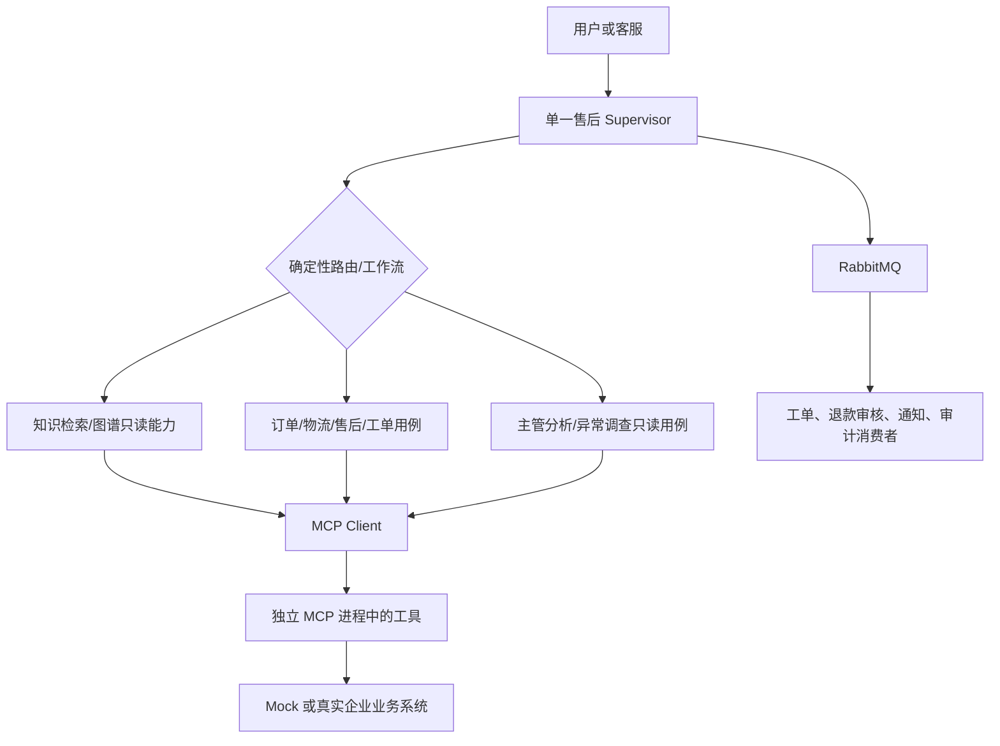
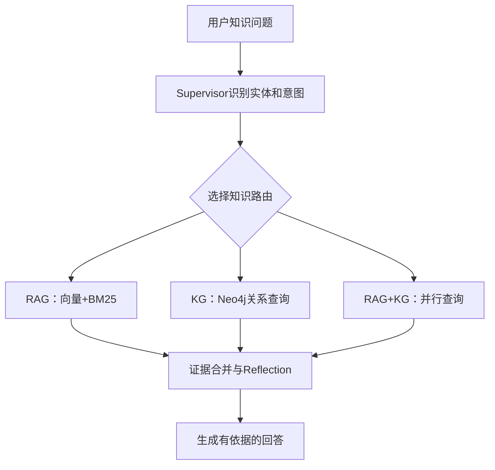

# 企业智能售后服务 Agent

> 本文是完整需求基线，保留FR/BR/TC细则；阅读入口为[需求文档摘要](需求文档.md)。全文按v1.8口径执行，历史开发记录已清理，所有FR-01～FR-24均纳入一期范围。

文档使用方式：业务与验收以本文为准；实现设计见[技术详细规格](技术详细规格.md)，架构摘要见[技术文档](技术文档.md)，完整目录见[项目目录结构](项目目录结构.md)，三段原提示词见[Prompt设计](Prompt设计.md)，环境、安装、配置、启动及排障见[开发运行指南](开发运行指南.md)。


## 一、文档信息

| 项目     | 内容                                                                                                                        |
| ------ | ------------------------------------------------------------------------------------------------------------------------- |
| 产品名称   | 企业智能售后服务 Agent                                                                                                            |
| 文档版本   | v1.8                                                                                                                      |
| 产品类型   | 企业售后服务 Agent；一期采用单Supervisor和确定性业务工作流                                                                                                    |
| 目标用户   | 客户、客服人员、售后主管、仓储员工、运维人员、系统管理员                                                                                                        |
| 技术约束   | 可替换LLM适配器（生产默认私有模型；云API仅在数据评估批准后启用）、LangGraph、MCP、Milvus/Chroma、BM25、Neo4j、Redis、MySQL、RabbitMQ；详细实现见《技术详细规格》 |
| 知识问答模式 | RAG、KG、RAG+KG三种受限路由，由Supervisor选择只读知识能力                                                                                      |
| 部署方式   | 本地模拟环境 + 企业内网私有化部署                                                                                                        |
| 当前状态   | 设计基线已形成；代码清理后待重建                                                                                                         |

## 二、项目设计前提

一期目标是完成一套可运行、可测试、可审计、可私有化部署的企业售后服务系统。开发与测试环境使用隔离的模拟业务数据；生产环境通过标准适配层接入企业商品主数据、订单、物流、售后、仓储、支付、工单和知识库系统，不改变 Agent 编排和业务契约。

本项目固定采用以下业务前提；多系统、本体、仓储、支付和追查口径以FR-20～FR-24为准，技术实现以《技术详细规格》为准：

| 项目          | 本项目决定                                                           |
| ----------- | --------------------------------------------------------------- |
| 用户入口        | Web 聊天页面；客服人员可以通过客服工作台代替客户发起请求                                  |
| 重点问题        | 订单物流、产品政策、退款退货                                                  |
| 人工处理基准      | 普通问题5分钟、复杂问题20分钟；Agent目标为普通问题P95≤5秒                             |
| 查询所需信息      | 订单查询需要服务端认证上下文及order_id；物流需要order_id或tracking_number；产品咨询需要名称或型号 |
| 默认数据        | 本地模拟数据，无需真实企业系统即可运行                                             |
| 订单查询条件      | 服务端认证上下文中的客户范围 + order_id，必须校验订单归属 |
| 高风险操作       | 退款申请创建、收货地址修改必须通过服务端验证和一次性确认；取消订单不在一期范围内                      |
| 知识库无答案      | 不编造，提示用户创建工单或转人工                                                |
| 最大 Agent 步数 | 8步                                                              |
| 工具失败重试      | 只读工具的瞬态失败最多重试1次（含首次调用最多尝试2次）；高风险写操作不盲目重试，按幂等键查询状态                            |
| 审计要求        | 记录所有 Agent 路由和 MCP 工具调用，并对敏感信息脱敏                                |

### 2.1 当前开发基线摘要

本项目的正式基线分为业务与技术两类：业务范围、业务规则、权限目标和验收口径以本文档为唯一业务权威；技术实现与运行参数以《技术详细规格》为唯一技术权威。摘要、导航页和概念说明不得覆盖这两份详细规格；本节只说明基线使用方式，不重复定义具体规则。

需求文档只规定业务目标、边界、不可违反的约束和验收结果；具体模块拆分、实现类、依赖版本、数据库字段、队列绑定、超时参数和部署参数以《技术详细规格》为唯一实现来源。《技术文档》只提供架构摘要。若详细规格间出现业务语义与实现描述冲突，先以需求详细规格确定业务语义，再由技术详细规格给出符合该语义的实现；不得用摘要或“最新设计”覆盖已批准的详细规格。批准变更时同步更新受影响的详细规格、摘要和契约版本。

当前基线的核心边界是：一期支持退款申请、审核、仓储收货验收与受控支付退款执行；高风险操作由服务端完成身份、租户、权限、归属、一次性确认和幂等校验；新增业务能力通过工具注册表和确定性用例接入，不增加自主专业Agent；本地开发使用模拟业务数据，生产接入时替换适配层而不改变业务契约。

## 三、项目背景

企业售后客服需要在知识库、订单系统、物流系统、退款系统和工单系统之间反复切换，人工处理过程存在以下问题：

- 常见问题重复处理，占用客服时间；
- 客服需要手动查询多个系统；
- 不同客服对售后政策理解不一致；
- 复杂问题需要重复向客户确认信息；
- 查询、退款和工单处理过程缺乏统一记录；
- 客服无法解决的问题缺少标准化转人工流程。

本项目建设一个企业智能售后服务 Agent，由单一Supervisor统一分析用户问题，并选择知识、订单、物流、退款、仓储、分析和工单能力。支付执行由受控服务用例负责。

单一Supervisor通过受限MCP工具访问外部业务系统；跨系统任务按确定性用例顺序执行，返回结果经过守卫后由Supervisor继续判断、询问、回答或转交人工。

## 四、项目目标

### 4.1 产品目标

| 目标            | 一期目标值  |
| ------------- | ------:|
| 常见知识问题自动回答率   | ≥80%   |
| 订单查询成功率       | ≥95%   |
| 物流查询成功率       | ≥95%   |
| 普通问题响应时间      | P95≤5秒 |
| 高风险操作误执行率     | 0      |
| 无法解决问题转人工成功率  | 100%   |
| MCP 工具调用记录完整率 | 100%   |
| 越权查询成功率       | 0      |

### 4.2 非目标

一期不包含以下内容：

- 不支持任意修改订单；一期仅开放经用户确认的收货地址修改；
- 不允许模型直接执行资金操作；审核、验收和服务端执行守卫通过后，由受控支付适配器执行退款；
- 不自动取消订单；
- 不自动替代人工客服处理所有投诉；
- 不绕过业务接口直接修改企业数据库；收货地址通过受控订单业务接口更新；
- 不建设完整 CRM 系统；
- 不自建支付清算系统；通过支付适配器接入原支付渠道的退款能力；
- 不接入未经确认的第三方 API。

## 五、用户角色

| 角色    | 使用方式                      | 权限               |
| ----- | ------------------------- | ---------------- |
| 普通客户  | 咨询产品、订单、物流、退款和售后问题        | 只能查询本人相关信息       |
| 客服人员 | 授权代客咨询、创建/补充及处理分配工单 | 仅授权客户/团队范围，不代替客户高风险确认 |
| 售后主管 | 处理复杂问题、分派工单、退款审核及产品/售后异常调查 | 团队范围及 analytics:read 等显式Scope；审核与支付执行分权 |
| 人工客服 | 接收授权转接，查看脱敏上下文并回复关联工单 | 仅授权队列及关联客户/工单 |
| 仓储员工 | 登记退货收货、检查和验收 | warehouse:receive/inspect 及指定仓库范围 |
| 运维人员 | 查看授权的服务、依赖和异常调查 | 仅 incident:read 及显式系统范围，不自动获得退款、仓储或客户数据权限 |
| 系统管理员 | 通过受控配置管理系统，查看授权脱敏技术日志 | 不自动获得代客业务写入或退款审核权限 |

## 六、一期业务范围

| 业务类型   | 是否支持 |
| ------ | ---- |
| 产品使用咨询 | 支持   |
| 售后政策查询 | 支持   |
| 订单状态查询 | 支持   |
| 支付状态查询 | 支持   |
| 物流轨迹查询 | 支持   |
| 物流异常判断 | 支持   |
| 退款资格判断 | 支持   |
| 退款金额计算 | 支持   |
| 创建售后工单 | 支持   |
| 转人工客服  | 支持   |
| 受控支付渠道退款执行 | 支持，须完成确认、审核及必要仓储验收 |
| 自动取消订单 | 暂不支持 |
| 修改收货地址 | 支持，须校验可修改状态并完成用户确认 |

## 七、当前人工业务流程

客户提问 → 客服判断类型 → 查询知识或业务系统 → 回复；无法解决时建单或转主管，再由人工处理。多系统切换、政策理解不一致和上下文缺失的问题见第三章，目标业务流程见第九章。

## 八、目标系统架构

### 8.1 总体架构

一期采用统一代码包的 Clean Architecture 四层组织，层内按业务能力划分。前端与 API、MCP、Worker 分别运行；Gateway 和单一Supervisor编排在 API 进程内，Memory为内部记忆模块，Graph为知识能力内部模块，不要求分别独立部署。具体进程通信与数据所有权以《技术详细规格》第二章为准。




### 8.2 编排和领域能力边界

| 组件 | 核心职责 | 边界 |
| --- | --- | --- |
| 单一Supervisor | 识别意图、选择受限工具/工作流、汇总证据、决定询问或转人工 | 不直接访问数据库，不拥有业务写权限 |
| 知识能力 | RAG、KG、混合检索和证据版本校验 | 只读；不能查询动态交易事实 |
| 业务用例 | 订单、物流、退款申请、工单以及状态校验 | 通过服务端授权和MCP工具调用权威系统 |
| WMS员工用例 | 收货、质检、库存处置 | 员工/服务端授权；不暴露给模型 |
| 支付协调器 | 重新校验退款审批、确认、验收、金额与幂等后执行 | 服务身份调用支付适配器；不暴露给模型 |
| 分析/调查用例 | 固定快照计算指标、质量门和原因贡献 | 只读源投影；调查不改写权威记录 |

### 8.3 Supervisor调用RAG+KG只读能力

Supervisor根据问题在RAG、KG和RAG+KG三种受限模式之间选择。Neo4j只保存稳定的产品知识和实体关系；订单、支付、物流和退款状态通过对应业务用例和MCP工具查询，禁止使用Neo4j替代动态业务主数据。



路由规则：

| 问题特征                          | 路由                          | 原因               |
| ----------------------------- | --------------------------- | ---------------- |
| 政策原文、使用说明、FAQ、保修条款            | RAG                         | 需要引用完整文本和版本信息    |
| 产品属于哪个类别、支持哪些配件、是否兼容、关联哪些故障   | KG                          | 需要查询实体属性和实体关系    |
| 产品为什么不能退款、某故障对应什么政策、产品关系加政策原文 | RAG+KG                      | 需要同时获得结构化关系和文档证据 |
| 订单状态、支付状态、物流状态、退款金额           | 业务 Agent工具                  | Neo4j不保存动态业务主数据  |
| 无法识别实体或关系                     | RAG优先；仍无结果则ask_user或handoff | 防止错误查询图谱和编造答案    |

知识库 MCP 工具增加：

```text
search_knowledge_base(query, top_k=3)                       # RAG：向量+BM25
query_knowledge_graph(entity_names, relation_types, limit=10) # KG：Neo4j
search_hybrid_knowledge(query, entity_names, relation_types)  # RAG+KG
get_policy_detail(policy_name)                               # 获取指定政策详情
```

RAG双路召回、Neo4j实体关系、证据合并、版本校验和冲突处理要求详见FR-04；具体工具参数、结果字段和验收标准以FR-04.1和FR-04.2为准。

### 8.4 Agent 运行模式

一期采用单一Supervisor、确定性业务工作流与受限工具；简单只读请求走短ReAct循环，复杂任务才生成可恢复计划。每次工具结果先经过确定性Schema、权限、业务状态和证据检查；只有冲突、低置信、异常或高风险结果才调用LLM Reflection。仓储/支付写操作串行执行，不拆分为自主写入Agent。节点、状态、步数和验收见FR-14～FR-17。

| 场景             | 使用模式                 |
| -------------- | -------------------- |
| 单一知识或订单查询      | ReAct                |
| 订单、物流、退款连续处理   | Plan-and-Execute     |
| 每次工具返回后验证事实、权限和状态 | 确定性守卫；符合触发条件时进入 Reflection |
| 连续多轮用户对话       | ReAct + Memory       |
| Agent执行中断后恢复   | LangGraph Checkpoint |

### 8.5 RabbitMQ 消息架构

一期接入 RabbitMQ；同步查询与异步业务边界、功能和验收见 FR-13。事件名、生产者、消费者、队列及必填载荷以`data/contracts/event-catalog.json`为唯一事实源，信封Schema以`data/contracts/events.schema.json`为准。消息至少一次投递、持久化幂等、死信、脱敏与审计要求保持不变。

Outbox归属于写入业务状态的业务能力服务：退款、工单、通知、知识索引任务和审计分别由对应业务模块在同一数据库事务中写入业务表与本模块Outbox；Memory Service不拥有业务Outbox。开发期Mock业务适配器的可发布写操作必须落到MySQL Mock业务表，内存或JSON fixture仅允许用于只读数据，不能作为可靠事件来源。发布任务仅轮询明确所属业务模块的Outbox，使用租约或`FOR UPDATE SKIP LOCKED`领取待发布记录，RabbitMQ发布确认成功后标记已发布，失败则保留待重试状态。

消息至少一次投递，消费者使用持久化幂等表和`event_id`/`idempotency_key`双重幂等，单条消息最多自动重试3次，失败后进入死信队列。消息不得保存完整手机号、地址、身份证号等敏感信息，退款确认必须保留完整审计记录。审计记录必须先持久化或写入审计Outbox，不能依赖尽力而为的异步消息。


### 8.6 依赖倒置与抽象接口要求

代码在src/ 源码目录下按四层组织，层内按业务模块划分，不建立每服务一套四层的目录。系统采用 Clean Architecture 四层：Interface（接口层）、Application（应用层）、Domain（领域层）、Infrastructure（基础设施层），并按业务需要采用 DDD 战术设计中的聚合、实体、值对象、领域服务、仓储和领域事件。接口层调用应用用例，应用层依赖领域层，基础设施层实现内层抽象；具体目录、模块职责及一致性边界以《技术详细规格》第三章为准。

系统必须采用依赖倒置：领域层和应用层只依赖抽象接口（Port），MySQL、Redis、Neo4j、Milvus、Chroma、模型供应商、HTTP客户端和MCP实现由基础设施适配器（Adapter）提供。

以下能力必须经过抽象接口：订单、物流、退款、工单、会话记忆、长期记忆、Checkpoint、向量检索、BM25检索和图谱查询。接口可使用Python `ABC`/`abstractmethod`或`Protocol`；Agent编排层不得直接导入具体客户端。

端口名称、具体适配器和依赖注入验收清单见《技术详细规格》附录 B；本节的抽象隔离及可替换要求不变。

### 8.7 能力注册与核心编排边界

新增业务能力通过版本化MCP工具注册表和确定性应用用例加入；不得因此增加自主专业Agent或绕过Supervisor、公共State、权限守卫和工作流。系统使用确定性路由表与统一结果汇总器。

每个工具注册项至少包含：名称、责任系统、读写类型、副作用、权限Scope、确认/幂等要求及严格输入Schema。服务端统一提供版本化响应信封、来源和证据引用。只有新增全局执行模式、公共状态类型或权限模型时，才允许修改核心编排；业务能力不得自行扩大模型权限。

### 8.8 认证、租户隔离和权限传递

Gateway负责认证并生成不可由模型修改的授权上下文，至少包含`tenant_id`、`subject_id`、角色、权限Scope、会话ID、签发时间和过期时间。Agent Service和MCP Server必须传递并验证该上下文；MCP Server必须独立执行二次授权，不能信任工具参数中的`user_id`。

所有业务数据、Redis会话、知识索引、图谱节点关系、Checkpoint、审计和幂等记录必须按`tenant_id`隔离。Redis会话Key格式为`session:{tenant_id}:{thread_id}`。本地开发使用Mock认证适配器，但认证上下文结构必须与生产一致。

### 8.9 统一结构化契约

API请求、API响应、Supervisor决策、Agent结果、Reflection决策、MCP请求、MCP响应和事件消息必须使用版本化Schema，包含`schema_version`、链路字段、状态枚举和结构化错误。默认禁止未知字段，不得输出Chain of Thought、Prompt、密钥、验证码或异常堆栈。

## 九、目标业务流程

### 9.1 Agent 总流程

```text
用户输入问题
  ↓
Supervisor读取当前State
  ↓
判断用户意图和缺失信息
  ↓
选择受限业务能力
  ↓
通过MCP Client调用授权工具
  ↓
调用独立 MCP 进程中的工具
  ↓
获得 Tool Result / Observation
  ↓
写入 Agent State
  ↓
Supervisor再次判断
  ↓
继续调用其他 Agent、转人工或生成回答
```

### 9.2 订单物流查询流程

```text
用户询问订单物流
  ↓
Supervisor
  ↓
订单查询用例
  ↓
MCP 调用 query_order
  ↓
返回订单信息
  ↓
物流查询用例
  ↓
MCP 调用 query_logistics
  ↓
返回物流信息
  ↓
Supervisor汇总结果
  ↓
生成回答
```

### 9.3 退款流程

```text
用户申请退款
  ↓
订单查询用例查询订单
  ↓
退款用例判断退款资格
  ↓
退款用例计算退款金额
  ↓
Agent 从用户当前输入中提取退款原因；原因不明确时先向用户追问，不得使用默认原因
  ↓
向用户展示退款信息
  ↓
用户确认订单、退款原因和预计退款金额，并完成必要验证
  ↓
服务端校验confirmation_id绑定的订单、退款原因、金额、币种、用户、租户、有效期和一次性状态，并校验idempotency_key
  ↓
创建退款申请，审核及必要仓储验收后受控执行支付退款
  ↓
返回refund_request_id和pending_review
  ↓
发布refund.confirmed
  ↓
异步退款审核
```

一期通过受控支付适配器执行原路退款，模型不直接持有执行工具或渠道凭证。`refund.confirmed`表示退款申请已经进入可审核状态，不表示资金已经退回。退款申请必须绑定`tenant_id`、`user_id`、`order_id`、退款原因、计算出的退款金额和币种、有效期内的一次性`confirmation_id`和`idempotency_key`。`confirmation_id`必须绑定订单、退款原因、退款金额和币种，不能只表示用户泛化地说过“确认”。

## 十、功能需求

### FR-01 用户问题接入

系统应支持客户或客服输入自然语言售后问题。

输入内容：

- 用户问题；
- Gateway 注入的可信认证上下文（tenant_id、subject_id、角色、Scope 和授权客户范围）；
- thread_id；
- 订单号【可选】；
- 联系方式【可选】。

系统输出：

- 请求编号；
- 识别后的问题；
- 当前会话状态；
- Agent 最终回答或转人工结果。

验收标准：

- 用户输入中文问题后，系统能够生成请求编号；
- 相同 thread_id 的问题可以关联上下文；
- 空问题、超长问题能够返回友好提示。

### FR-02 用户意图识别

系统应识别以下意图：

| 意图      | 示例           |
| ------- | ------------ |
| 知识咨询    | 这个产品怎么使用？    |
| 订单查询    | 我的订单到哪了？     |
| 修改收货地址 | 这个订单还没发货，帮我改一下收货地址 |
| 支付查询    | 我付款成功了吗？     |
| 物流查询    | 为什么物流三天没更新？  |
| 退款咨询    | 这个订单可以退款吗？   |
| 工单咨询    | 我的售后工单处理到哪了？ |
| 投诉或复杂问题 | 我要投诉客服       |
| 未知问题    | 无法判断的问题      |

系统还应提取：

- 订单号；
- 商品名称；
- 物流单号；
- 售后原因；
- 是否要求退款；
- 是否要求人工处理。

### FR-03 售后 Supervisor

Supervisor应完成：

1. 读取用户问题和 Agent State；
2. 判断是否需要调用业务用例或只读能力；
3. 选择单个受限工具或确定性工作流；
4. 读取工具返回的结构化事实和证据；
5. 判断是否继续调用；
6. 判断是否需要用户补充信息；
7. 判断是否需要转人工；
8. 信息足够后生成最终答复。
9. 在 `analytics:read` 和授权数据范围内查询产品售后指标；在主管授权范围内创建、查询和修订异常调查。统计和原因解释必须来自受控只读工具及带版本证据，不得自行计算或宣称因果。

Supervisor不得：

- 直接访问所有数据库；
- 绕过权限调用工具；
- 自动执行高风险操作；
- 把内部推理过程返回给用户。

### FR-04 知识检索能力

知识检索能力负责：

- 查询产品说明；
- 查询售后政策；
- 查询退换货规则；
- 查询保修规则；
- 查询常见问题；
- 在没有知识依据时明确告知。

MCP 工具：

```text
search_knowledge_base(query)
search_hybrid_knowledge(query, entity_names, relation_types)
query_knowledge_graph(entity_names, relation_types, limit=10)
get_policy_detail(policy_name)
```

知识工具职责约束：

- 对Supervisor暴露search_knowledge_base、query_knowledge_graph、search_hybrid_knowledge、get_policy_detail四个只读工具；由Supervisor在受限模式中选择。
- search_knowledge_base 内部并行执行向量与 BM25 双路召回，不将它们拆成模型可见工具，避免模型只调用一路。
- query_knowledge_graph 独立提供图谱查询；search_hybrid_knowledge 内部并行执行完整 RAG 和 KG，统一发布版本、保留分路证据并判断冲突。
- get_policy_detail 返回当前有效政策条款、适用条件、有效期及来源；歧义需澄清，无依据不得编造。内部函数、完整参数和响应字段集中定义于《技术详细规格》9.1、9.4，不在此重复维护。

#### FR-04.1 双路召回要求

知识库查询必须同时进行向量语义与 BM25 关键词召回，合并去重、融合排序并返回可追溯的来源和版本。生产/开发后端、Top-K、分数校准、阈值、函数清单和返回 JSON 统一定义于《技术详细规格》附录 A.1。

双路召回的业务边界：

- 双路召回只负责提供候选知识，不负责替代Supervisor的工具选择；
- 订单号、物流单号、商品型号和政策名称优先保留关键词召回结果；
- 同一知识片段同时被两路召回时只能保留一条；
- 两路均无结果或未达到冻结评测集校准的路由阈值时，知识能力返回“当前知识库没有足够依据”，不得编造；
- 召回结果必须携带来源和版本号，最终答复只引用必要内容，不向用户展示完整内部原文；
- 知识库更新后，必须同时更新向量索引和BM25关键词索引，任何一路更新失败都不能标记为更新成功。

验收标准：

- 用户咨询产品政策时，可以调用知识库 MCP 工具；
- `search_knowledge_base` 每次查询都能产生向量召回和BM25召回两路结果统计；
- 同义问题能够命中向量召回，包含精确政策名称、产品型号或错误码的问题能够命中BM25召回；
- 两路结果合并后能够按`chunk_id`去重，并按照融合分数排序；
- 最终交给Supervisor的候选知识不超过技术参数表1.4的融合结果Top-K，且包含来源、版本号和召回来源；
- 双路最高融合分低于技术参数表1.4的最低融合分数时，系统明确告知没有足够知识依据；
- `knowledge.updated`事件处理完成后，向量索引和BM25索引都能查询到新版本内容；
- 知识库无结果时，不得编造答案；
- 返回结果必须包含来源和知识版本号；本地模拟数据使用 mock 数据版本号。

#### FR-04.2 知识图谱要求

一期仅保存稳定产品与售后知识，不保存订单、支付、物流或退款动态业务主数据。节点、关系、必填属性、索引约束及连接配置见《技术详细规格》附录 A.2。

关系设计约束：

- 每个`Product`必须有唯一`product_id`和`version`；
- `COMPATIBLE_WITH`与`NOT_COMPATIBLE_WITH`不能对同一产品和配件同时处于有效状态；
- 政策必须包含`effective_from`和`effective_to`，查询时只允许返回当前有效版本；
- 所有关系必须携带`version`和`evidence_id`，便于回溯来源；
- `SUPPORTED_BY`的`chunk_id`必须能在RAG索引中找到对应文档切片；
- Neo4j查询只允许调用系统预定义的参数化Cypher，不允许模型直接拼接或执行任意Cypher；
- Neo4j查询结果必须返回节点ID、关系类型、属性、知识版本和证据来源。


RAG+KG 组合验收标准：

- 产品配件、产品分类和兼容性问题能够调用Neo4j查询；
- 政策原文和FAQ问题能够调用RAG双路召回；
- 同时需要关系和政策依据的问题能够并行调用RAG与Neo4j；
- KG返回的实体、关系和版本必须能追溯到`evidence_id`；
- Neo4j查询不能访问订单、支付、物流和退款主数据；
- RAG、BM25和Neo4j必须使用同一个`knowledge_release_id`。仅有一个当前有效版本时使用该版本；两个仍在有效期内的版本相互矛盾时，标记为`hard_conflict`，不得生成确定答案，必须询问用户或转人工；同一发布版本内部冲突时将知识版本标记为`indexing_failed`，不得提供半更新结果；过期版本只能作为历史证据展示，不能作为当前结论依据。
- Neo4j不可用时，RAG问题仍可继续使用RAG回答；纯KG问题必须返回无法查询关系的提示，不得伪造关系。

### FR-05 订单查询能力

订单查询能力负责：

- 查询订单状态；
- 查询支付状态；
- 查询商品信息；
- 查询发货状态；
- 按 FR-18 查询地址修改资格并修改收货地址；
- 验证当前用户是否有权限查看订单。

MCP 工具：

```text
query_order(order_id)
query_payment(order_id)
check_shipping_address_change(order_id)
update_shipping_address(order_id, address_change_id) # 确认凭证、预期版本、幂等键由服务端上下文注入
query_shipping_address_change(address_change_id)
```

改址工具参数与结果契约统一见[技术详细规格第九章](技术详细规格.md#九工具调用设计)。

订单归属校验不是模型可见工具。MCP Server在执行订单查询前，通过服务端认证上下文和内部`ownership_guard`完成租户、主体和订单归属校验；校验结果不返回给模型，未授权与不存在对外使用同一安全错误语义，避免模型据此推断订单是否存在。

工具参数中的`user_id`、`tenant_id`、角色、权限、`trace_id`和`thread_id`不由模型填写，统一由Gateway和MCP服务端根据认证上下文注入并校验。Agent只能提交业务参数，不能通过修改参数伪造身份或扩大数据范围。

验收标准：

- 用户只能查询自己的订单；
- 订单不存在与当前主体无权访问时返回相同的安全提示，不向用户泄露订单是否存在；内部审计保留具体原因。
- 用户未提供订单号时，系统要求补充订单号或进行身份验证。

### FR-06 物流查询能力

物流查询能力负责：

- 查询物流轨迹；
- 查询物流单号；
- 判断物流是否异常；
- 返回预计送达时间；
- 判断是否需要创建工单。

MCP 工具：

```text
query_logistics(order_id=null, tracking_number=null)
query_tracking(tracking_number)
check_delivery_exception(order_id)
```

`query_logistics`至少接收`order_id`或`tracking_number`之一；实际用户身份、租户和权限由服务端上下文注入，禁止由模型传入替代值。

验收标准：

- 可以查询物流最新状态；
- 物流长时间未更新时识别为异常；
- 物流系统不可用时支持重试或转人工。

### FR-07 退款业务能力

退款业务能力负责：

- 查询退款政策；
- 判断退款资格；
- 计算预计退款金额；
- 说明退款处理周期；
- 创建退款申请；
- 查询审核、仓储验收和资金执行三个独立状态，不把审核通过表述为资金已退。

MCP 工具：

```text
check_refund_policy(order_id, reason)
calculate_refund(order_id, reason)
create_refund_request(order_id, reason_code) # 确认凭证、幂等键由服务端上下文注入
query_refund_request(refund_request_id) # 未知写入恢复由服务端按原operation_id/幂等记录查询
```

退款申请及查询工具参数与结果契约统一见[技术详细规格第九章](技术详细规格.md#九工具调用设计)。

业务限制：

- 查询退款资格不需要用户确认；
- 计算退款金额不需要用户确认，但必须显式传入用户提供或确认的退款原因；
- 创建退款申请必须获得用户明确确认；
- Agent必须从用户自然语言中提取退款原因；无法确定时必须向用户追问，不得猜测或默认退款原因；
- 服务端必须校验认证身份、租户、订单归属、退款资格、退款原因、计算出的退款金额和币种、短信/一次性验证结果、未过期且绑定上述内容的`confirmation_id`和`idempotency_key`；`confirmed=true`或Prompt文本不能作为授权依据；
- 创建退款申请时成功返回`refund_request_id`和`status=pending_review`；后续审核、仓储和支付执行分别按 FR-07.2、FR-21、FR-22 推进；
- 创建申请成功后通过Outbox发布`refund.confirmed`，该事件表示“申请已进入审核”，不表示资金已退款；
- 高风险写操作禁止盲目重试，超时后必须按`idempotency_key`查询申请状态；
- 退款申请失败必须转人工或返回明确的可恢复状态。

#### FR-07.1 一期 Mock 退款资格与金额基线

以下为本项目模拟数据与测试的业务基线，不作为真实企业政策或法律规则。生产接入由企业适配器提供权威政策与业务事实，并保持相同契约；不得用模拟规则替代企业审批。客户完成绑定确认后，由受控服务身份执行退款，客户、模型和普通员工均不可绕过执行守卫。

| 条件 | 判断结果与后续动作 |
| --- | --- |
| 未认证、无权限或订单不属于当前租户/授权主体 | 拒绝访问，不向模型泄露订单是否存在 |
| 未支付、支付失败、支付状态无法核实 | 明确未支付时不符合；状态未知时返回待核实，不推算金额 |
| 已支付、待发货、未锁定履约、无活动退款申请且存在有效政策 | 符合申请条件，按当前可申请金额生成报价 |
| 已发货未签收、履约锁定、物流或支付状态矛盾 | 需人工审核；允许在有效 Mock 政策明确允许人工申请时生成报价并提交，不能承诺审核通过 |
| 已签收且完整 Mock 政策及签收时间可得 | 普通退货意愿在签收后7个自然日内允许进入人工审核；超过窗口、质量争议或退货条件不明确均转人工政策判断，不一概宣布无权退款 |
| 金额已全部退回、可申请余额为0 | 不符合新增金额申请条件，展示已有申请或已核实状态 |
| 存在 pending_review、reviewing 或 approved 申请 | 不新增申请，查询已有申请结果；即使更换幂等键也不得重复占用余额 |
| 原因缺失、政策不存在/过期、事实不完整或企业拒绝自动判断 | 先补充信息或转人工；不能默认原因、政策、资格或金额 |

资格输出为 eligible、manual_review、ineligible 或 unknown，并提供原因码、政策引用及 can_submit。manual_review 仅在政策明确允许且金额可确定时 can_submit=true；否则不创建申请。人工审核申请不表示资金可退或退货已完成。一期实现仓储收货、分行验收和支付渠道执行，分别按 FR-21、FR-22 验收。

金额规则：

- 一期 Mock 币种为 CNY，按分使用整数计算，展示时保留两位小数。实付总额取支付成功的现金金额，已扣除折扣和优惠，包含已实际支付的运费；不把优惠券、积分或赠品估值加回。
- 可申请金额上限 = 实付现金总额 − 已实际退款现金金额 − 其他活动申请占用金额；实际报价还须按下方运费规则剔除本次政策不含的金额组成。实际报价必须大于0；负数、币种不一致、未知金额或来源矛盾属于数据错误，拒绝自动计算并转人工，不将负数截断成正常结果。
- 一期支持按订单明细、数量和可核实组成申请部分退款；金额由服务端报价，不能由模型任意指定。同一订单创建阶段暂只允许一笔活动申请，申请内支持多行及分批执行，余额扣除历史已退与未结预留。
- 待发货且未履约的 Mock 订单，预计申请金额包含剩余实付运费；已发货/已签收的 Mock 普通退货报价不包含未退款的原发货运费，其组成金额必须由订单提供。质量争议、运费承担不明确或需退货费用核算时转人工，不猜测扣费。
- 金额只表示预计申请金额；政策可要求人工审核。服务端提交前重新核实实付、已退、占用金额、订单版本和政策版本；金额、原因、币种或版本变化必须重新报价和确认，不沿用旧凭证。

#### FR-07.2 申请、审核与结果查询

退款报价与确认是申请创建前的准备状态，不视为已创建退款申请。只有完成有效绑定确认和一次性验证后才创建 pending_review 申请，并同事务写入幂等、金额占用和退款 Outbox。

申请状态为 pending_review（待审核）、reviewing（审核中）、approved（审核通过但未付款）、rejected（审核拒绝）。只有受信任的 Mock 审核消费者或授权人工审核用例可以改变审核状态；Agent 不得指定 approved、rejected 或伪造审核结果。所有审核结论必须记录依据和审核主体。

- pending_review → reviewing：审核消费者成功领取任务。
- reviewing → approved：Mock 明确具备通过条件的待发货申请，或受信任的人工审核结果通过；签收退货、质量争议及条件不确定的申请不自动通过，保持审核中并提供人工处理入口。
- reviewing → rejected：有明确拒绝理由的受信任审核结果；记录拒绝原因并释放占用金额。
- approved/rejected 是审核终态，不因消息重复投递回退；approved 不是业务完成。支付成功前保持未结预留，权威成功确认后将对应预留结转已退，失败和未知状态按 FR-22 处理。
- 数据库回滚、工具超时、消息发布失败或消费者崩溃属于提交/处理故障，不伪装为申请 rejected 或已退款。原状态与占用保留，故障恢复后从真实状态继续；审核失败进入死信也不自动释放业务占用。
- 新增查询退款申请工具，支持按申请 ID 或原幂等键查询，必须校验租户、真实主体及订单归属。超时后使用同一标识查询，不生成新幂等键重发；结果未知时明确提示待核实。

### FR-08 工单业务能力

工单业务能力负责：

- 创建售后工单；
- 设置工单优先级；
- 查询工单状态；
- 更新工单信息；
- 转人工客服。

MCP 工具：

```text
query_ticket(ticket_id)
create_ticket(title, description, priority) # 确认凭证、幂等键由服务端上下文注入
update_ticket(ticket_id, content) # 确认凭证、预期版本、幂等键由服务端上下文注入
handoff_to_human(reason, summary)
```

工单写入工具参数与结果契约统一见[技术详细规格第九章](技术详细规格.md#九工具调用设计)。

工单写操作必须由服务端校验认证上下文、租户、权限和幂等键；普通工单写入与退款等高风险写入使用不同权限策略。工单必须持久化脱敏且有界的结构化上下文，包括用户原始问题、摘要、Agent结果、工具结果摘要、失败原因、关联业务ID、当前状态、优先级和下一步动作，并保留`correlation_id`、`trace_id`和`thread_id`用于链路关联。`handoff_to_human`必须携带结构化摘要、失败原因、当前状态和`correlation_id`。

验收标准：

- 工单必须包含问题摘要；
- 工单必须保留用户问题和 Agent 调用结果；
- 转人工后，人工客服可以看到完整上下文；
- 工单创建失败时返回可理解提示。

### FR-09 MCP 外部工具调用

所有MCP请求和响应必须使用版本化严格Schema，至少包含`schema_version`、`correlation_id`、`trace_id`、`agent_name`、`tool_name`、`status`、`error_code`和可审计的脱敏参数摘要。`tenant_id`、用户身份、角色和权限由Gateway/MCP服务端注入并重新校验，禁止由模型作为可信输入传递。统一错误结构为`{schema_version, error_code, message, retryable, request_id, correlation_id, trace_id, details}`；字段及空值规则以《技术详细规格》第二十六章为准；响应不得包含Prompt、思维链、密钥或未授权敏感字段。

系统必须通过 MCP Client 调用独立 MCP 进程中的工具，不允许在主管 Agent 内直接访问业务数据库。

一期 MCP 工具组划分（同一 MCP 进程注册，不分别部署）：

| 工具组               | 提供能力                            |
| -------------------- | ------------------------------- |
| knowledge（知识） | RAG双路召回、Neo4j图谱查询、RAG+KG融合和政策查询 |
| order（订单） | 订单和支付查询、收货地址资格检查/更新/结果查询                         |
| logistics（物流） | 物流查询                            |
| refund（退款） | 退款资格、金额报价、申请创建与状态查询                      |
| ticket（工单） | 工单和人工转接                         |

MCP 调用必须记录：

- trace_id；
- user_id；
- thread_id；
- Agent 名称；
- MCP Server 名称；
- 工具名称；
- 工具参数；
- 调用开始时间；
- 调用结束时间；
- 调用结果；
- 错误信息。

### FR-10 多步调用和状态流转

系统必须支持：

```text
单一Supervisor决策
  ↓
受限领域用例调用已注册的 MCP 工具
  ↓
Observation 写入 State
  ↓
Supervisor再次决策
```

系统必须具备：

- 最大循环次数：8次；
- 只读瞬态失败最多重试1次（含首次调用最多尝试2次），两次失败后停止并转人工；
- 超过最大步数自动停止；
- 连续失败后转人工；
- 避免重复调用同一个无效工具。

知识检索相关 State 必须至少保存：

```json
{
  "knowledge_route": "rag|kg|hybrid",
  "extracted_entities": ["product-A100", "accessory-B200"],
  "requested_relations": ["COMPATIBLE_WITH"],
  "rag_evidence": [],
  "kg_evidence": [],
  "knowledge_conflicts": [],
  "knowledge_confidence": 0.88
}
```

其中`knowledge_route`记录当前选择的知识路径，`extracted_entities`和`requested_relations`记录图谱查询条件，`rag_evidence`和`kg_evidence`保存两路证据，`knowledge_conflicts`保存版本或事实冲突，`knowledge_confidence`用于Reflection判断是否可以生成答案。

### FR-11 会话记忆

系统需要支持三层记忆：

| 记忆层  | 保存内容        | 一期实现                            |
| ---- | ----------- | ------------------------------- |
| 工作记忆 | 当前请求和本轮上下文  | 内存                              |
| 会话记忆 | 当前会话历史      | 一期直接接入Redis，TTL为259200秒（3天）     |
| 长期记忆 | 用户偏好、历史售后事实 | 一期直接接入MySQL；SQLite仅作为单机学习环境备用方案 |

会话标识：

- user_id：用户身份；
- thread_id：一次会话身份；
- trace_id：一次请求链路身份。

Redis会话存储要求：

- Redis连接地址通过 REDIS_URL 环境变量配置，默认值为 redis://localhost:6379/0；
- 会话Key格式为 `session:{tenant_id}:{thread_id}`；不同租户即使使用相同`thread_id`也不得共享会话；
- 会话内容以JSON格式保存用户消息、Agent结果、工具调用摘要和更新时间；
- 每次会话读写后刷新TTL为259200秒；
- 生产环境或`MEMORY_FALLBACK_ENABLED=false`时，Redis不可用必须使启动/就绪检查失败，不允许静默丢失会话；
- 开发与测试环境只有显式设置`MEMORY_FALLBACK_ENABLED=true`时才允许启动并降级到内存，健康检查必须标记`degraded`，不承诺跨重启持久性，也不能用于验证会话持久性或生产部署；
- 不得把完整身份证号、支付密码和未脱敏银行卡号写入Redis；
- Redis只保存短期会话，不承担长期用户画像和业务主数据存储职责。

工作记忆处理要求：

- 每次调用模型前，动态组装系统提示词、用户问题、必要的长期事实、最近会话和当前 State；
- 工作记忆最大控制在 32000 Token；保留既有系统提示词和工具 Schema 原文；
- 超过上限时，优先保留系统规则、当前问题、最近4轮消息和未完成任务；
- 被裁剪的旧消息不得直接拼接到当前 Prompt；
- 重要历史信息通过摘要保留，摘要内容写入当前 thread 的会话记录；
- 如果连续对话超过6轮，触发摘要压缩，将旧消息压缩为一段摘要并保留最近4轮原始消息；一轮按一次用户消息和对应助手响应计算，工具消息不单独计轮。若仍超过工作记忆上限，继续按既有 Token 裁剪规则处理；
- 摘要失败时采用 Token 裁剪作为兜底，不得因为摘要失败而中断主流程。

MySQL长期记忆要求：

- MySQL连接地址通过 MYSQL_URL 环境变量配置；
- 用户画像按 user_id 隔离；
- 长期事实至少保存事实内容、事实类型、重要性、来源、创建时间和更新时间；
- 本期自动提取的长期事实仅包括产品偏好与历史售后事实；预算、户型及联系方式偏好不自动提取或保存；
- 重要事实永久保留，普通偏好按照时间衰减策略定期清理；
- MySQL不可用时不得静默丢失长期记忆，系统应记录错误并提示管理员；
- MySQL负责长期记忆和系统数据，不替代订单、物流和退款等外部业务主系统。

长期事实提取和衰减要求：

- 每轮对话结束后，由记忆提取节点识别明确的产品偏好与历史售后事实；不得将预算、户型、联系方式偏好自动纳入长期记忆；
- 只有明确、稳定且对后续服务有价值的信息才能写入 user_memory_fact；
- 事实重要性评分范围为0到1；
- 重要性大于等于0.8的事实长期保留；
- 重要性低于0.8的普通偏好按照180天时间常数衰减；
- 事实最终得分低于0.2时进入清理候选列表；
- 记忆提取失败不得影响本轮售后回答。

LangGraph Checkpoint要求：

- 主管决策、专业工具调用、反思和结束等关键执行进度必须持久化，服务重启后能恢复未完成任务。
- 恢复必须验证租户、主体权限及会话归属；已完成调用和未提交的中间结果不能因重启丢失或重复执行。
- 相同写入重复提交应幂等；并发冲突不能覆盖历史进度；保存失败须明确记录并告警，不伪装成功。
- 生产不使用仅内存保存器，仍采用既定 MySQL 持久化方案。节点职责与恢复验收见 FR-17；存储字段、自研 Saver、接口兼容和版本/并发算法集中定义于《技术详细规格》11.1。

用户画像、长期事实、审计索引和系统配置等数据对象必须纳入数据模型，字段和存储方式见第十二章及《技术详细规格》；需求文档不重复列出示例JSON。

### FR-12 异常处理

简单只读请求应在同步时限内完成；复杂任务到期返回可查询的持久化异步任务。每个决策周期最多调用一次工具；每次结果都经过确定性守卫，符合冲突、低置信、异常或高风险条件时才进入LLM Reflection，Reflection不额外计步。达到步骤上限停止并转人工。仅只读瞬态错误可在统一预算内重试，认证、参数和业务规则错误不自动重试；退款/改址等高风险写操作只查询幂等结果。依赖故障应熔断并按状态恢复，任何降级均明确告知并审计。超时、退避、熔断、步骤及重试数值统一引用《技术详细规格》1.4，性能验收目标见本文第十四章。

系统必须处理：

- 已配置模型服务超时；
- 私有模型服务不可用或缺少服务端凭据；
- MCP Server 无法连接；
- MCP 工具执行失败；
- 订单不存在；
- 用户无权查询订单；
- 物流系统无数据；
- 退款资格判断失败；
- Agent 超过最大步数；
- 用户问题无法识别。

异常处理要求：

- 用户只能看到友好提示；
- 技术堆栈只能记录在日志中；
- 高风险操作失败时不能重复执行；
- 无法自动解决时必须支持转人工。

### FR-13 RabbitMQ 异步消息处理

系统一期必须接入 RabbitMQ，处理不适合阻塞用户请求的异步业务。

功能要求：

- Agent 完成工单创建后发布 ticket.created 事件；
- Agent 完成工单更新后发布 ticket.updated 事件；
- Agent 完成人工转接后发布 human.handoff.created 事件；
- 用户确认退款后发布 refund.confirmed 事件；
- MCP 工具失败后发布 tool.call.failed 事件；仅在仍有只读瞬态重试预算且原请求尚未终止时允许异步重试，不重置已用次数；高风险写操作和已耗尽预算的调用不得重放；
- Agent和MCP调用完成后发布 audit.record.created 事件；
- 知识库内容更新后发布 knowledge.updated 事件，必须同时触发向量索引、BM25关键词索引和Neo4j图谱索引；
- 消息处理失败最多重试3次，之后进入 after_sales.dlq；
- 消费者必须通过 event_id 实现幂等，禁止重复创建工单或重复提交退款申请。

验收标准：

- RabbitMQ服务启动后，系统可以创建交换机、队列和绑定关系；
- 创建工单后，可以在 after_sales.ticket 队列中看到 ticket.created 消息；
- 更新工单后，可以在 after_sales.ticket 队列中看到 ticket.updated 消息；
- 用户确认退款后，可以在 after_sales.refund_review 队列中看到 refund.confirmed 消息；
- 消费者处理成功后消息被确认；
- 消费者首次失败后最多重试3次（共4次处理机会），仍失败则进入 after_sales.dlq；工具执行预算不能因此重置；
- 重复投递同一个 event_id 不会重复创建业务数据。

### FR-14 ReAct Agent 模式

系统一期默认使用 ReAct 模式处理普通售后问题。

本项目将一个`agent_step`定义为一次主管或计划执行决策周期，最多包含一次MCP工具调用；每次工具返回均执行确定性守卫，只有符合冲突、低置信、异常或高风险触发条件时才调用LLM Reflection，且Reflection不额外增加`step_count`。单次用户请求最多8个周期。简单只读请求以P95≤5秒为目标并使用15秒硬超时，复杂多步骤任务使用30秒硬超时并返回`async_task_id`。

处理闭环必须包括：

1. Reason：读取用户问题、Memory 和 Agent State；
2. Act：按权限和白名单选择确定性用例或 MCP 工具；
3. Observe：接收 MCP 工具返回结果；
4. State Update：写入结果、错误、耗时和下一步动作；
5. 再次 Reason：决定继续调用、重试、转人工或生成答案。

验收标准：

- 用户查询订单时，受限路由选择订单只读用例；
- 订单结果满足条件且授权有效时，工作流可以继续查询物流只读用例；
- 信息完整后，模型可以停止调用工具并生成答案；
- 入口代码不得绕过授权和确定性路由，强行调用无关工具；
- ReAct循环最多执行8步。

### FR-15 Plan-and-Execute 复杂任务模式

系统对需要多个业务步骤的复杂问题使用 Plan-and-Execute 模式。

Planner组件负责：

- 分析用户目标；
- 识别所需的业务用例和授权只读工具；
- 生成有序任务列表；
- 标记每个任务的输入、依赖和完成条件；
- 将计划写入 Agent State。

Executor用例负责：

- 按计划顺序执行任务；
- 按顺序调用授权用例和MCP工具；
- 将每个任务结果写回 State；
- 任务失败时重试或要求 Planner 调整计划；
- 只有发现FR-16所列触发条件时才调用LLM Reflection，否则由确定性守卫结束或推进。

计划数据结构：

```json
{
  "plan_id": "plan-10001",
  "status": "running",
  "tasks": [
    {"id": "task-1", "use_case": "query_order", "status": "pending"},
    {"id": "task-2", "use_case": "query_tracking", "status": "pending"},
    {"id": "task-3", "use_case": "check_refund_prerequisites", "status": "pending"}
  ]
}
```

验收标准：

- 复杂退款问题能够先生成计划再执行；
- Executor 不得执行未授权的计划任务；
- 任务失败后可以保留已完成任务并重新规划；
- 用户确认前不得执行退款写操作。

### FR-16 Reflection 与结果守卫

每次MCP Observation必须先经过确定性Schema、权限、业务不变量、来源和状态检查；只有发现跨源冲突、低置信、异常、质量门失败或高风险操作状态不明时，才进入受限LLM Reflection。正常、结构正确且证据充分的只读结果直接交给Supervisor组织回答，避免每步增加模型成本和延迟。

Reflection 节点的输出必须是以下之一：

| 输出       | 说明                       |
| -------- | ------------------------ |
| continue | 信息不足，继续调用其他工具            |
| retry    | 仅只读瞬态失败且尚有重试预算时重试；参数错误先补充或纠正，不自动重复提交 |
| replan   | 当前计划无法完成，要求 Planner 重新规划 |
| ask_user | 缺少订单号、身份或用户确认            |
| handoff  | 转人工客服                    |
| finish   | 信息完整，可以生成最终答案            |

验收标准：

- 工具返回空结果时不会直接生成确定性答案；
- 订单权限不匹配时进入 handoff 或拒绝；
- 退款资格查询和退款申请之间必须经过用户确认；
- Reflection 的内部判断不展示给用户；
- Reflection 失败时使用安全兜底，不得无限循环。

### FR-17 LangGraph State 和 Checkpoint

系统必须使用 LangGraph StateGraph 管理 Agent 节点和状态流转。

必须定义以下节点：

| 节点         | 职责                    |
| ---------- | --------------------- |
| supervisor | 单一Supervisor决策和受限路由        |
| planner    | 复杂任务生成计划              |
| executor   | 按计划顺序调用业务用例         |
| tool       | 调用 MCP 工具             |
| reflection | 触发条件满足时检查Observation |
| memory     | 读取和提取长期记忆             |
| checkpoint | 保存和恢复任务状态             |
| finish     | 生成最终回答                |

验收标准：

- 每个节点执行后 State 都可以被记录；
- 并发执行及恢复冲突必须被检测，不能静默覆盖已完成进度；
- 服务重启后仍可恢复尚未提交的节点中间写入；
- 重复保存相同进度幂等成功，不同内容冲突不得覆盖历史版本；
- thread_id 可以恢复对应会话；
- 服务重启后可以恢复未完成任务；
- checkpoint失败时有日志和告警；
- 不允许使用全局变量代替生产状态持久化。

存储字段与具体校验算法只在《技术详细规格》11.1定义；TC-37、TC-38及TC-38A～TC-38C继续保留原验收要求。

### FR-18 修改收货地址

一期支持客户或授权客服修改尚未进入履约的订单收货地址。本地使用持久化 Mock 订单完成真实的模拟更新；真实企业接入时替换订单适配器，不增加直接修改企业数据库的能力。取消订单、修改商品、金额及已发货订单的物流改派不在本功能范围内。

业务流程：查询订单归属和可修改状态 → 收集新收件人、联系方式及完整地址 → 服务端校验并展示确认信息 → 用户在受控页面确认并完成一次性验证 → 再次校验订单状态和版本 → 幂等更新 → 返回结果并可靠发布地址已更新事件。

业务规则：

- 用户只能修改本人订单；客服代客修改必须具备明确权限和客户数据范围，审计保留客服真实主体。
- 本地 Mock 基线仅允许订单为“已支付、待发货”，且未取消、未关闭、未进入退款流程、未锁定拣货/履约时修改；其他状态拒绝并支持转人工。企业系统返回的不可修改原因具有最终约束，不得仅依据模型判断。
- 新地址必须包含收件人、联系电话、省/市/区及详细地址，并通过服务端格式和配送范围校验；配送范围由 Mock 配置或企业能力确定。缺失时追问，不猜测，不从长期记忆静默替换。新旧地址一致时返回未发生变更，不重复产生更新事件。
- 修改地址不得自动改变订单金额、运费或配送承诺；需补差价、不支持新区域或需物流改派时拒绝自动修改并转人工。
- 服务端生成短时有效、一次性且绑定租户、主体、订单、订单版本、新地址内容及操作类型的确认凭证。用户确认内容变化、订单版本变化或凭证过期后必须重新校验和确认；口头“确认”不能单独授权。
- 提交时再次检查最新状态及版本。发货、锁单等并发变化必须使更新失败，不允许覆盖；不接受“刚才还能改”作为继续执行依据。
- 使用幂等键防止重复修改；相同键与相同请求返回同一结果，相同键不同内容返回冲突。超时先按操作 ID 或幂等键查询状态，不盲目重试；状态无法确认时提示待核实，不宣称成功。
- 成功必须有真实的操作 ID 和更新后的订单版本；仅在业务更新成功后发布 `order.shipping_address.updated`。失败不发布成功事件；不承诺修改成功后的订单可撤销，后续改址必须重新走完整确认流程。
- 完整地址和联系方式仅在受控表单、授权业务接口及必要业务存储中处理，不写入 Prompt、会话、Checkpoint、日志、审计摘要或事件载荷；这些位置只保留掩码、地址引用及关联 ID。业务存储中的敏感字段加密并按最小权限访问。
- 系统提示词已同步支持一期收货地址修改；受控表单、服务端权限与绑定确认仍是强制执行条件。模型驱动的地址修改须通过端到端验收，不能仅凭工具注册视为已实现。

验收标准：

- 待发货且满足条件的本人订单，经服务端验证与用户确认后可更新；重新查询返回更新后的受控地址摘要。
- 未授权、已发货、履约锁定、配送范围外、金额会变化、字段不合法、凭证不匹配/过期/已使用、并发版本变化时均不得修改。
- 重复提交不会重复修改；超时可查询真实结果；持久化更新、幂等、Outbox 及故障恢复保持一致。
- 地址修改过程与事件可审计，所有非必要持久化及模型输入均不包含完整地址和联系方式。

### FR-19 一期最小客服工作台

一期交付可在本地 Mock 环境完成售后闭环的 Web 工作台，不建设完整 CRM、呼叫中心或企业运营后台。客户聊天/退款确认/改址表单仍按既有需求交付，工作台复用这些能力，不另建一套业务规则。

| 页面/功能 | 一期必须支持 | 明确边界 |
| --- | --- | --- |
| 身份与客户上下文 | 选择预置 Mock 客服/主管账号，展示真实角色；从服务端返回的授权客户列表选择代客对象，展示当前客户及会话 | 不能手改 customer_id 获得权限；客户切换创建/切换隔离会话，不混用前一客户消息和确认 |
| 代客咨询 | 发起 Agent 对话，查看答案、必要知识来源、追问、异步任务和真实业务结果；支持订单/物流查询及退款/改址流程引导 | 客服不能代替客户点击高风险退款/改址确认；仍由操作受益客户在受控界面确认并完成验证 |
| 工单列表与详情 | 按权限、状态、优先级和客户筛选；查看脱敏上下文及工具结果摘要；创建、补充、领取/分派、处理中、解决和关闭 | 仅操作授权客户/团队范围；分派和状态变化须有对应权限和版本检查；内部消息仅员工可见 |
| 人工接单队列 | 查看授权转接请求、明确接单，关联工单，查看脱敏会话摘要并通过客户可见工单回复继续沟通 | 不承诺即时聊天、电话或真实客服平台联通；本地模拟接入与工单回复即可验收 |
| 退款审核 | 有审核权限的主管查看 reviewing 申请、金额组成与依据，填写理由后明确通过/拒绝 | 不改变模型工具权限；支付由 FR-22 的受控服务执行；不允许审核人绕过资格/版本规则或把 approved 显示成资金到账 |
| 结果与链路查看 | 查看本授权范围内工单/转接/退款/任务真实状态、脱敏操作记录和错误提示 | 普通客服只看业务摘要；完整技术审计仅 audit:read 授权管理员可读，不显示 Prompt、验证码、密钥和完整地址 |

权限与交互：

- 普通客户只能使用客户入口查看本人业务，不得访问工作台员工列表、内部消息和审核接口。客服、人工客服、主管和管理员使用服务端角色及 Scope，前端隐藏按钮只是展示，后端逐次授权。
- 普通客服可在授权范围代客查询、建单、补充和处理被分配工单；人工客服可领取授权转接并回复；主管可分派本团队工单并在具备 refund:review 时审核本范围退款。系统管理员的配置/日志角色不自动获得客户业务操作或退款审核权限。
- 创建/更新普通工单遵守内容确认与幂等。客服明确点击提交可作为其本人对已展示内容的确认，服务端签发绑定凭证；此确认不能替代客户对退款/改址的确认，不能改变真实操作者。
- 人工接单成功后不因重复点击、刷新或重复消息再次接单/建单；冲突显示最新状态。异步任务刷新恢复按原 task_id 查询，不重新创建请求。
- 所有页面具备加载、空结果、无权限、失败、待处理和成功状态；资格检查或超时不得显示“已完成”。列表分页且服务端过滤，不先返回全租户数据再由前端筛选。

一期不包含企业 SSO、真实短信/呼叫中心接入、复杂排班与自动路由优化、客户营销、员工个人绩效报表、批量高风险操作、多租户运营后台和可视化权限编辑；账号/权限/Mock 在线状态使用预置数据及受控配置。上述排除项不取消现有客服、人工客服、主管和管理员的权限隔离验收。

### FR-20～FR-24 多系统本体与完整售后闭环

2026-10-19 起，一期包含独立订单、商品主数据、售后、仓储和支付系统的接入与模拟闭环，以及主管产品分析。业务语义说明见[多系统本体设计](多系统本体设计.md)，实现契约见《技术详细规格》第二十八章。开发环境模拟执行，生产通过真实适配器执行；不能把模拟成功展示成真实资金退款。模型不能直接执行资金操作，不等于系统不支持支付退款。

#### FR-20 多系统业务本体

统一 Product、SKU、Order、OrderLine、Payment、AfterSalesRequest、RequestLine、ReturnOrder、ReceiptLine、InspectionLine、RefundExecution、RefundAllocation、RefundTransaction、MetricDefinition、SourceMapping 的标识、关系和语义约束。映射以 tenant_id+source_system+entity_type+source_id+有效期定位，关联稳定 canonical_id；不同系统状态映射为统一语义，禁止把审核通过映射为退款成功。

本体、映射和指标均版本化，经人工审核、约束校验后原子激活；历史事实保留所用版本。编码缺失/歧义、跨租户、关系断裂或状态未知进入隔离，不能由模型猜测合并。Neo4j 保存本体元数据及稳定知识关系，动态业务主数据仍由权威系统拥有，分析使用授权只读事实投影。每条事实保留来源、源记录、版本、发生时间、采集时间与证据引用。OWL只用于跨系统词汇/模式表达，SHACL用于形状校验；不承诺OWL DL推理，不用本体推理代替业务守卫。仓储操作通过受控员工/服务用例执行；主管Agent通过受限只读工具进行指标分析和异常调查，不为仓储、支付和本体发布另建自主决策Agent。

#### FR-21 仓储退货收货与验收

支持退货授权、WMS退货单创建、退货物流关联、分批收货、按原订单明细验收、部分通过、拒收和差异复核。仓储员工凭 warehouse:receive / warehouse:inspect 及仓库数据范围登记真实记录，客户和模型不得伪造收货或验收结果。收货不等于验收通过，实收超额必须记录差异，不得增加可退件数和退款额度；完成量只取验收通过量。累计通过量不超过批准退货量及原签收可退量，冲突暂停执行并转人工。

退货退款通常先完成政策要求的验收再退款；仅退款或政策明确免退货时允许 not_required，须保留批准依据。所有写入要求幂等键、绑定内容、expected_revision、来源证据和审计；超时查询原操作，不盲目重复写入。

#### FR-22 支付渠道退款执行

支持原路退款、执行状态查询、可信回调、主动对账和异常恢复。服务端 refund:execute 服务主体在执行前校验客户确认、有效审核、必要验收、原支付、金额/币种/分摊、余额预留、版本及幂等。模型无执行工具、无支付凭证；有审核权限不等于有支付执行权限。

审核、退货和资金状态独立：review_status 为 pending_review/reviewing/approved/rejected；return_status 按退货明细聚合；funds_status 为 not_executed/queued/submitting/processing/unknown/succeeded/failed。审核通过不是资金成功。只有支付权威成功证据才能增加已退金额，并原子结转相应未结预留。unknown 不当失败、不释放余额、不换键补发。失败须由渠道明确确认；授权重试保留原执行及关联，不能因消息重投重复退款。部分退款与分批执行必须逐行分摊，商品款和运费分开；累计成功及预留不得超实付。增加金额、变更商品/币种/退款目的地或实质政策变更必须重新确认与审核。

生产渠道须具备稳定幂等、结果查询、回调验签与商户匹配能力；不具备时转人工对账，不能承诺自动执行。开发模拟系统与生产环境隔离，结果显式携带 environment，模拟执行也须产生可追溯的模拟流水。

#### FR-23 主管售后指标分析

具备 analytics:read 及业务数据范围的主管可按产品/SKU、时间、团队、渠道查询退货及退款指标与排名；聚合前落实源记录权限。默认排名口径候选为`return_passed_item_rate`（验收通过退货件数率），须经业务/财务批准后启用。`return_application_item_rate`（退货申请率）作为独立指标登记，按批准后的申请阶段口径单独查询；不得与收货或验收指标合并，批准前返回blocked且不参加计算或排名。模型不能临时创造指标公式。

指标 v1 的批次、30日观察窗、默认100件/100明细最低样本、产品归属有效期及分摊规则见《多系统本体设计》，当前是待业务/财务签字的设计基线，批准前不作为生产报表口径。`return_passed_item_rate`仅称“验收通过退货件数率”，按签收批次计算；它是主管默认产品排名的候选口径，不得代称所有阶段的笼统“产品退货率”。`return_application_item_rate`作为独立指标登记；申请数、申请行数或申请件数作为分子，以及申请日/签收批次归属方式待业务/财务书面选择。其`formula`未批准前为空，系统必须返回blocked，不得生成值或排名。退款按支付明细批次分别计算成功退款明细率和商品金额率。分子分母必须来自同批次和固定观察窗，运费单列；产品汇总先加分子分母再相除，分母为0返回 null。长尾退货、跨月退款、部分验收和迟到更正的归属规则也须经业务/财务确认。

每次结果必须包含分子分母、数据范围、阈值、窗口、as_of、各源水位、本体/映射/指标/投影版本、对账批次和下钻证据。未成熟显示 provisional；缺源、缺映射、币种/分摊异常、对账未平显示 partial/blocked，受影响产品不参加全范围排名，缺数不当0。模型只解释受控统计工具的真实结果。

四项指标的设计选择、批准责任与生产启用状态统一记录在`data/contracts/metric-approval-register.json`。机器记录必须与本节口径一致；业务和财务均未留存具名审批证据时，生产排名保持禁用。

#### FR-20～FR-23 验收

| 编号 | 场景 | 必须满足 |
| --- | --- | --- |
| TC-95 | 各系统商品异码、同名不同SKU、映射缺失 | 显式版本映射；同名不误合并，缺失隔离并影响完整性 |
| TC-96 | 跨租户相同ID、映射歧义、状态无法识别 | 拒绝跨租户；歧义/未知不能作为成功事实 |
| TC-97 | 分批收货、部分验收、超收、重复登记 | 记录真实实收与差异，只累计合法通过数量，幂等无重复 |
| TC-98 | 需要退货但未验收、政策允许仅退款 | 前者禁止支付，后者凭授权依据允许进入执行 |
| TC-99 | 审核通过、受控退款提交、渠道成功 | 三阶段分别断言；仅成功证据触发已退记账与预留结转 |
| TC-100 | 提交超时、服务重启、重复事件 | 使用稳定执行ID查询恢复，不重付、不错误释放预留 |
| TC-101 | 伪造/重放/乱序回调、错金额或商户 | 验签与匹配拒绝异常，成功不回退，主动查询核实 |
| TC-102 | 部分退款、多明细、多支付及并发执行 | 分摊守恒、余额不超实付、成功流水唯一入账 |
| TC-103 | 旧批准版本、无执行权限、金额增大 | 服务端拒绝，必要时重新报价确认审核 |
| TC-104 | 跨月退款、分批签收、观察窗未结束 | 同批次固定窗口，未成熟不参加默认排名 |
| TC-105 | 重复退款流水、SKU汇总、零分母、小样本 | 去重、加权汇总、null和阈值正确，展示分子分母 |
| TC-106 | 缺源、映射缺失、对账差异、源水位滞后 | 不伪造0或全范围最高，明确质量与覆盖范围 |
| TC-107 | 主管跨团队分析、仓储/审核/支付越权 | 分别验证Scope与数据范围，聚合和下钻均不可越权 |
| TC-108 | 版本升级、迟到/更正事件、重建投影 | 版本可追溯，历史快照可复现，更正可重算且不重复计数 |
| TC-109 | 独立模拟WMS/支付和生产适配验收 | 模拟数据显式标识；生产凭证隔离，真实接入单独验收 |

#### FR-24 全业务异常发现与原因追查

售后主管或具备 incident:read 的运维人员在各自授权范围内可调查业务指标异常（退货率/退款/验收差异/物流/工单/检索）、跨系统状态或金额不一致，以及技术运行异常（错误、超时、积压、索引失败）。系统先检查源水位、映射、重复数据、分摊、对账、迟到/更正事件和版本，再进入领域下钻；数据质量或遥测不足时不能排名原因，须说明受影响范围及缺失证据。

异常判断需明确比较窗口、基准窗口、成熟观察窗、指标版本、最低样本量、分子分母、绝对率差/百分点差。系统/依赖异常需引用已批准阈值和时间基准；未配置阈值时只报告现象，不自动宣布异常。小样本或未成熟产品标记观察信号，不声称显著异常。原因下钻只允许已定义的授权维度：产品/SKU、渠道、区域、订单批次/时间、结构化退货原因、质量分类、审核结论和仓储验收/检测结果。各组用原始分子分母重算，并报告对整体差异的贡献度，不能平均分组百分比。

调查需要关联源记录引用：订单明细、申请行、退货/收货/验收行、支付执行和退款分摊、证据/质量结论及对应系统版本。访问逐条记录时重新校验调用者范围并脱敏；查询投影必须是同一固定快照。调查记录 investigation_id、操作者、权限范围、指标/本体/映射/投影版本、查询条件、快照水位、质量状态、候选因素、贡献和证据引用、结论/修订、时间及访问审计，可复现、不可覆盖历史。

系统仅提供相关因素和候选解释；退货率分组相关性不得自动表述为因果根因。自由文本原因只有经授权人工确认后才成为统计原因标签，未结构化/未知原因保持 unknown。结论不得超出证据；证据不足、基准分母为0或源数据不完整时返回“原因未确认”及下一步核查建议。运行异常沿 correlation_id/trace_id/span_id/parent_span_id、operation_id、causation_id、事件和重试关联到首个失败环节；跨系统业务不一致沿canonical_id、source_record_id、映射版本追踪。源事实只能由其权威所有系统修订，分析服务不能直接修数。

#### FR-24 验收

| 编号 | 场景 | 必须满足 |
| --- | --- | --- |
| TC-110 | 某产品退货率突增、数据完整且样本达标 | 同口径比较当前/基准窗口，返回百分点差、分子分母、快照及可追溯因素 |
| TC-111 | SKU/渠道/区域/批次结构差异 | 授权维度分组重算并列出贡献，不能用组率排序替代贡献 |
| TC-112 | 多条退货原因为同一根因/自由文本猜测 | 只使用人工确认的结构化标签；未确认保持unknown |
| TC-113 | 源水位落后、映射歧义、对账差异或分摊不平 | 阻止根因排名，定位到数据源/记录/失败校验并报告受影响范围 |
| TC-114 | 样本不足、基准为空或观察窗未成熟 | 显示低置信观察信号或不可比较，不声称显著异常/根因 |
| TC-115 | 调查结果下钻、越权记录或旧投影重放 | 逐条授权脱敏；investigation可由固定快照及版本复现，越权拒绝 |
| TC-116 | 源事实修正及调查结论更新 | 仅权威源可修正；生成新投影/调查修订，旧结论、证据和审计保留 |
| TC-117 | API/MCP外部依赖超时、错误率突增 | 用trace/span与依赖健康证据定位首个失败环节，区分超时与业务拒绝 |
| TC-118 | 消息积压、重复消费或死信增多 | 沿event_id/causation_id/Outbox/Inbox/重试关联生产者和消费者及首个失败点 |
| TC-119 | OMS、WMS、支付/物流状态或金额不一致 | 沿canonical_id与各source_record_id、源版本和映射时效列出冲突事实及权威所有者 |
| TC-120 | 知识索引部分失败或检索质量突变 | 追查release manifest、三路索引任务、source document及激活状态，禁止把局部失败说成模型根因 |
| TC-121 | 运行遥测缺失、trace采样遗漏或日志脱敏 | 标明调查证据覆盖缺口和不可定位范围，不编造根因 |
| TC-122 | 调查跨团队/租户访问源记录 | 聚合前和下钻时均执行权限过滤，访问审计脱敏且不可越权 |
| TC-123 | 同一问题多次调查及结论修订 | investigation_id与revision可追溯，快照/证据/结论历史不可覆盖 |
| TC-124 | 用商品别名或常见拼写错误检索知识 | 命中规范商品文档，返回来源证据；拼写测试别名不改变商品身份 |
| TC-125 | 查询产品、故障和配件之间的多跳关系 | 按同租户图谱路径返回关系及来源证据；任一边缺证据则拒绝作为结论 |
| TC-126 | 当前发布政策与过期版本、未发布草稿冲突 | 只使用当前有效发布版本；历史版本仅供历史时点查询，草稿不得用于客户答复 |
| TC-127 | 跨租户存在同名知识文档 | 召回在租户过滤后执行，不返回其他租户的文档、实体或证据 |
| TC-128 | 知识库无足够依据回答 | 明确返回无证据，不编造，支持追问或转人工 |

## 十一、业务规则

| 编号    | 规则                                                                                                      |
| ----- | ------------------------------------------------------------------------------------------------------- |
| BR-01 | Supervisor根据问题选择最少必要的授权业务能力，不强制调用无关工具                                                                    |
| BR-02 | 没有知识或业务数据时不得编造                                                                                          |
| BR-03 | 用户只能查询自己有权限查看的数据                                                                                        |
| BR-04 | 退款申请创建必须经过服务端身份、租户、权限、订单归属、退款原因、退款金额、币种、一次性验证、`confirmation_id`和`idempotency_key`校验；`confirmation_id`必须绑定订单、退款原因、退款金额和币种；一期按 FR-21/FR-22 执行仓储与支付闭环，不支持取消订单；修改收货地址按 FR-18 执行 |
| BR-05 | 只读MCP工具的瞬态失败最多自动重试1次（含首次调用最多尝试2次）；高风险写操作不自动重试，按幂等键查询状态                                                               |
| BR-06 | Agent 最多执行8步，超过后转人工                                                                                     |
| BR-07 | 无法解决的问题必须说明原因并支持创建工单                                                                                    |
| BR-08 | 不向用户展示 Prompt、内部推理、工具参数和系统堆栈                                                                            |
| BR-09 | 每个业务用例只能调用被授权的MCP工具                                                                                |
| BR-10 | 所有外部工具调用必须记录审计日志                                                                                        |
| BR-11 | 普通问题默认使用 ReAct，复杂多步骤问题使用 Plan-and-Execute                                                               |
| BR-12 | 每次 MCP Observation 后必须经过确定性结果守卫；仅在定义的触发条件下调用 LLM Reflection                                |
| BR-13 | Agent State 必须按 thread_id 保存 checkpoint                                                                 |
| BR-14 | 工作记忆超过 32000 Token 时必须裁剪或摘要压缩                                                                             |
| BR-15 | 重要性大于等于0.8的长期事实长期保留，低于0.2的事实进入清理候选                                                                      |
| BR-16 | 计划任务必须经过权限校验，不能执行未授权工具                                                                                  |
| BR-17 | 知识库查询必须执行向量语义召回和BM25关键词召回，合并去重、分数融合和重排序后才能交给生成节点                                                        |
| BR-18 | Supervisor根据问题类型选择RAG、KG或RAG+KG；订单、支付、物流和退款动态数据不得由Neo4j替代                                             |
| BR-19 | Neo4j查询必须使用预定义参数化Cypher，模型不得直接生成和执行任意Cypher                                                             |
| BR-20 | RAG与KG证据冲突时必须进入Reflection，不得直接生成确定性答案                                                                   |
| BR-21 | 收货地址修改必须符合 FR-18 的状态、权限、一次性确认、版本、幂等和隐私约束；不得修改已进入履约或已发货订单，不自动改变金额与运费 |

## 十二、数据需求

### 12.1 核心数据对象

| 数据对象             | 主要字段                                                                    |
| ---------------- | ----------------------------------------------------------------------- |
| 用户               | user_id、姓名、联系方式、权限                                                      |
| 订单               | order_id、user_id、商品、金额、状态                                               |
| 物流               | tracking_number、订单号、节点、异常状态                                             |
| 地址修改操作 | 操作 ID、租户、主体、订单、预期版本、地址引用、确认绑定、幂等键、状态和结果版本；原始敏感字段仅限必要业务存储 |
| 退款               | 订单号、原因、金额、资格、状态                                                         |
| 工单               | ticket_id、问题、优先级、处理人、状态                                                 |
| 会话               | thread_id、用户、消息历史、创建时间                                                  |
| 工具调用             | trace_id、工具名、参数、结果、耗时                                                   |
| 消息事件             | 版本化事件Schema、请求/聚合/租户/主体/线程链路字段、生产者、幂等键、业务载荷和创建时间；字段定义以《技术详细规格》8.3为准         |
| 长期记忆事实           | user_id、fact_type、fact_key、fact_value、importance、source、更新时间            |
| Agent计划          | plan_id、thread_id、任务列表、任务状态、创建时间                                        |
| Agent摘要          | thread_id、摘要内容、覆盖消息范围、更新时间                                              |
| Agent checkpoint | tenant_id、thread_id、checkpoint_ns、checkpoint_id、parent_checkpoint_id、revision、当前节点、State、metadata、pending_writes、未完成任务、保存时间                                         |
| 知识库切片            | chunk_id、document_id、content、source、version、更新时间                        |
| 向量索引             | chunk_id、embedding、document_id、version、更新时间                             |
| BM25索引           | chunk_id、分词结果、关键词权重、document_id、version、更新时间                            |
| Neo4j实体节点        | node_id、label、业务ID、name、属性、version、更新时间                                 |
| Neo4j实体关系        | relation_id、source_id、relation_type、target_id、evidence_id、version、有效期   |
| 知识证据             | evidence_id、evidence_type、source_id、content、confidence、version、trace_id |

### 12.2 数据权限

- 普通客户只能查询本人订单；
- 客服只能查询授权范围内的订单；
- 售后主管可以查看团队工单；
- 管理员可以查看系统日志；
- MCP Server 不得向 Agent 返回不必要的敏感字段。
- 向量索引和BM25索引必须使用同一批`chunk_id`和`version`；任一路索引缺失时，该知识版本不得标记为可检索。
- 每次知识更新必须记录向量索引状态和BM25索引状态，支持按`document_id`和`version`回溯。
- RAG切片和Neo4j实体关系必须通过`evidence_id`关联，确保回答可以追溯到原始文档。
- Neo4j节点和关系的有效版本必须与RAG文档版本保持一致；版本不一致时，Reflection不得合并为确定性答案。

### 12.3 知识库双路索引构建与更新流程

原始文档经清洗、切片后生成唯一 `chunk_id`，同一批切片同时写入向量索引和BM25索引；两路索引以相同的 `document_id`、`chunk_id`、`version` 对齐，校验通过后才标记为可检索。

新增、修改或删除知识必须同时更新两路索引；任一路失败，版本状态为 `indexing_failed`，不得提供半更新结果。`knowledge.updated`必须包含 `event_id`、`document_id`、`version` 和变更类型；任务必须幂等，重复事件不得重复写入；成功后60秒内完成可检索性检查并记录状态和耗时。

开发与测试环境可以使用Python BM25索引实现，生产环境关键词索引服务使用OpenSearch或Elasticsearch BM25；无论采用哪种实现，MCP工具对主管 Agent 的接口保持不变。

### 12.4 Neo4j图谱构建与更新流程

产品、配件、政策和售后文档经过实体关系抽取、人工或规则校验后，生成 `node_id`、`relation_id`、`evidence_id` 和 `version`，再写入Neo4j并发布 `knowledge.updated`。

自动抽取结果必须先审核；节点使用稳定业务ID，关系必须有方向、版本和 `evidence_id`；关系修改采用新版本；删除知识时同步处理RAG、向量、BM25和图谱数据；图谱更新失败进入重试，不能只更新其中一路；写入必须使用参数化Cypher和独立服务账号，模型不得获得Neo4j凭证。

### 12.5 数据与契约落地约束

退款与改址专属表分别见《技术详细规格》第二十五、二十四章；工单/转接、任务、工具执行记录、知识发布/索引任务、通知、审计、幂等和可靠消息表集中定义于第二十六章。数据隔离必须同时落实到主键、索引、唯一约束、查询和状态更新，不能仅在应用内声明 tenant_id。

普通工单创建/补充在提交前绑定具体内容并获得明确确认；同一事件或同一业务键不得重复建单。对话、API、Agent、MCP、事件的输入输出使用明确的版本、状态和严格字段契约，正常空结果、部分成功、未知结果和错误须区分。工程 Schema 与 DDL 文件在开发时创建，文档定义不表示已经有可运行实现。

## 十三、安全要求

系统必须具备：

- API Key 不得硬编码；
- MCP Server 凭证使用环境变量或密钥管理系统；
- RabbitMQ 连接地址、用户名和密码不得硬编码，必须使用环境变量或密钥管理系统；
- Redis 连接地址、用户名和密码不得硬编码，必须使用 REDIS_URL 或密钥管理系统；
- MySQL 连接地址、用户名和密码不得硬编码，必须使用 MYSQL_URL 或密钥管理系统；
- Neo4j 连接地址、用户名和密码不得硬编码，必须使用 NEO4J_URI、NEO4J_USERNAME、NEO4J_PASSWORD 或密钥管理系统；
- 用户身份认证；
- 角色权限控制；
- 订单数据隔离；
- Prompt 注入防护；
- 敏感信息脱敏；
- 工具调用审计；
- 高风险操作确认；
- Neo4j图谱查询使用只读账号；图谱写入使用独立服务账号；
- Neo4j不得保存完整身份证号、支付密码、银行卡号和未经授权的订单敏感字段；
- 本地与生产默认通过 HTTP 访问独立 MCP 进程；API 与 Worker 连接同一个服务地址。生产使用服务令牌或企业认证，并逐次校验最终用户授权上下文。STDIO 仅作为隔离测试的可选传输，不作为默认多进程部署方式。

## 十四、非功能需求

| 类型        | 要求                                                                          |
| --------- | --------------------------------------------------------------------------- |
| 性能        | 普通问题 P95≤5秒                                                                 |
| 可用性       | 服务可用率≥99.5%                                                                 |
| 并发        | 支持至少100个并发会话                                                                |
| 可维护性      | Agent、MCP Server和业务适配层分离；领域层和应用层依赖抽象接口，基础设施层通过适配器实现                         |
| 可扩展性      | 可以通过确定性用例和版本化MCP工具注册表增加业务能力                                                          |
| 可观测性      | 记录完整调用链                                                                     |
| 安全性       | 高风险操作误执行率为0                                                                 |
| 容错性       | MCP Server故障时支持重试和转人工                                                       |
| 消息可靠性     | RabbitMQ消息至少一次投递，失败消息进入死信队列                                                 |
| 异步处理      | 工单、退款审核、通知和审计事件不得因消费者异常而丢失                                                  |
| 会话持久性     | Redis重启或服务切换后，会话数据在TTL范围内仍可被读取                                              |
| 会话过期      | 会话写入后259200秒自动过期                                                            |
| 长期记忆持久性   | MySQL重启后用户画像和长期事实不丢失                                                        |
| 数据隔离      | 不同 tenant_id 的业务数据、会话、长期记忆、checkpoint、审计和幂等记录不可互相读取；同租户内仍按 subject_id 和权限隔离 |
| 状态恢复      | 服务重启后可以通过 thread_id 恢复未完成任务                                                 |
| 工作记忆      | 模型上下文不得超过 32000 Token，超限必须裁剪或摘要                                              |
| 检索覆盖      | 双路召回评测集 Recall@10≥0.85                                                      |
| 检索排序      | 融合结果 MRR@3≥0.75；最终Top-3必须包含正确知识片段                                           |
| 检索一致性     | 同一`chunk_id`在向量索引和BM25索引中的版本一致率为100%                                        |
| 检索延迟      | 双路召回、融合和重排序P95≤800毫秒，不包含大模型生成时间                                             |
| 索引更新      | `knowledge.updated`处理成功后，向量索引和BM25索引均在60秒内可查询                               |
| 图谱查询延迟    | Neo4j常规实体关系查询P95≤500毫秒                                                      |
| 图谱准确性     | 已审核实体关系命中率≥95%；无证据关系不得进入可用图谱                                                |
| RAG+KG一致性 | RAG文档版本与Neo4j证据版本一致率为100%                                                   |
| 图谱安全      | 任意用户输入不得直接执行Cypher；越权图谱查询成功率为0                                              |
| 部署        | 支持本地、测试环境和生产环境配置隔离                                                          |

### 14.1 指标分类与测量口径

所有指标必须在固定评测集版本、`knowledge_release_id`、Prompt版本、模型版本和工具Schema版本下测量，并在报告中同时记录分子、分母、统计窗口和测量方法：

| 分类       | 指标与口径                                                                                                                           |
| -------- | ------------------------------------------------------------------------------------------------------------------------------- |
| 硬指标/安全门槛 | 高风险误执行率=误执行次数/高风险操作总次数，目标为0；越权成功率=越权成功次数/越权测试用例数，目标为0；审计完整率=有完整审计记录的受测调用数/受测调用总数，目标为100%。任一安全门槛失败即不得发布。                         |
| 目标值/功能   | 自动回答率=满足验收标准且无需人工介入的可回答用例数/可回答用例总数，目标≥80%；订单/物流查询成功率=返回正确业务结果的用例数/有效查询用例总数，目标≥95%；需要人工的问题转人工结果率=成功创建转人工或工单的用例数/应转人工用例总数，目标100%。 |
| 目标值/性能   | 在预热后100并发持续30分钟窗口统计；普通只读请求P95≤5秒、P99≤10秒，检索P95≤800毫秒，Neo4j查询P95≤500毫秒，可用性≥99.5%。                                                |
| 初始目标/待验证 | Recall@10≥0.85、MRR@3≥0.75、事实一致性和相关性≥90%、无依据拒答率≥90%；分母分别为固定标注评测集中的问题数、含正确证据的问题数和应拒答问题数，需在评测集冻结后回填，当前均标记为“待评测集验证”。                |

## 十五、验收用例

| 编号    | 测试输入                       | 预期结果                                                                                          |
| ----- | -------------------------- | --------------------------------------------------------------------------------------------- |
| TC-01 | 这个产品怎么使用？                  | 调用知识检索能力并返回有证据的政策说明                                                                            |
| TC-02 | 我的订单到哪了？                   | 要求订单号或调用订单查询用例                                                                              |
| TC-03 | 订单 A10001 到哪了？             | 依序调用订单查询和物流查询用例                                                                           |
| TC-04 | 物流三天没更新怎么办？                | 识别物流异常并给出处理建议                                                                                 |
| TC-05 | 我想退款                       | 提取或询问退款原因，查询订单并判断退款资格                                                                        |
| TC-06 | 符合退款条件，帮我提交                | 必须先展示退款金额并要求确认                                                                                |
| TC-07 | 用户确认退款 | 仅在可信身份、订单归属、原因/金额/币种/版本绑定确认及一次性验证全部通过后创建 pending_review 申请，否则不执行 |
| TC-08 | 我要投诉客服                     | 创建工单或转人工                                                                                      |
| TC-09 | 查询其他人的订单                   | 拒绝越权查询                                                                                        |
| TC-10 | 知识库没有答案的问题                 | 明确告知无法确认，不得编造                                                                                 |
| TC-11 | 只读 MCP 调用持续瞬态失败 | 含首次调用最多尝试2次；仍失败则停止并转人工；认证、参数和业务规则错误不自动重试 |
| TC-12 | 连续调用超过8步                   | 停止循环并转人工                                                                                      |
| TC-13 | 配置的模型服务超时            | 记录异常，不向用户展示堆栈                                                                                 |
| TC-14 | 空问题                        | 提示用户输入具体问题                                                                                    |
| TC-15 | 超长问题                       | 截断或提示重新描述                                                                                     |
| TC-16 | 创建售后工单                     | 发布 ticket.created 消息并由工单消费者处理                                                                 |
| TC-17 | 用户确认退款                     | 发布 refund.confirmed 消息，不直接在对话线程中阻塞等待退款系统                                                      |
| TC-18 | RabbitMQ首次处理失败且3次重试仍失败 | 总计4次处理机会后进入 after_sales.dlq，保留原事件和业务幂等键；不重置工具调用预算 |
| TC-19 | 重复消费同一个 event_id           | 不重复创建工单或退款申请                                                                                  |
| TC-20 | MCP 工具调用失败并产生 tool.call.failed 事件 | 仅使用原调用剩余只读重试预算；消息重投、服务恢复及重复分发不得重置计数，高风险写操作不得重放 |
| TC-21 | 新建会话并发送消息                  | 会话内容写入 Redis 的 `session:{tenant_id}:{thread_id}` Key                                          |
| TC-22 | 读取同一个 thread_id            | 可以读取之前的会话历史和 Agent 结果                                                                         |
| TC-23 | 会话写入后超过259200秒             | Redis自动删除该会话数据                                                                                |
| TC-24 | 同一租户的多个应用实例使用同一个 thread_id | 可以读取同一份Redis会话数据；跨租户相同`thread_id`必须隔离                                                         |
| TC-25 | Redis服务不可用                 | 生产或`MEMORY_FALLBACK_ENABLED=false`时启动/就绪检查失败；开发/测试显式设为`true`时允许启动但健康状态为`degraded`，且不得声称会话已持久化 |
| TC-26 | 写入用户长期事实                   | 数据写入 MySQL 的 user_memory_fact 表                                                               |
| TC-27 | 新会话读取同一 user_id            | 可以从 MySQL 读取历史用户画像和长期偏好                                                                       |
| TC-28 | 服务重启后读取用户画像                | 用户长期事实仍然存在                                                                                    |
| TC-29 | user_id A 查询 user_id B 的记忆 | 拒绝访问并记录安全日志                                                                                   |
| TC-30 | MySQL服务不可用                 | 记录错误并提示管理员，不得伪造长期记忆结果                                                                         |
| TC-31 | 普通订单查询                     | 使用 ReAct 完成“决策→工具→Observation→再次决策”                                                           |
| TC-32 | 订单物流退款组合问题                 | 复杂度达到门槛时Planner生成可恢复计划，Executor按授权顺序调用用例；写操作串行 |
| TC-33 | MCP返回空结果                   | 确定性守卫区分正常空结果与依赖故障；需要补参时ask_user，业务未满足时handoff，不盲目重试且不编造答案 |
| TC-34 | 对话超过6轮                     | 触发摘要压缩，保留摘要和最近4轮原始消息                                                                          |
| TC-35 | 工作记忆超过 32000 Token        | 裁剪旧消息或使用摘要，不超过上下文上限                                                                           |
| TC-36 | 提取用户售后偏好                   | 写入 MySQL 的 user_memory_fact 表并记录重要性                                                           |
| TC-37 | Agent中途服务重启                | 使用 thread_id 从 MySQL checkpoint 恢复任务                                                          |
| TC-38 | checkpoint保存失败             | 记录告警，不将任务标记为已持久化                                                                              |
| TC-38A | 相同 checkpoint_id 重复写入 | 相同内容幂等成功，不新增或覆盖历史版本 |
| TC-38B | checkpoint 版本并发冲突 | revision 或 parent_checkpoint_id 过期时返回冲突，旧版本不得覆盖新版本 |
| TC-38C | pending_writes 中断恢复 | 服务重启后仍可读取同一线程、命名空间下的待写入内容 |
| TC-39 | 低重要性记忆衰减                   | 重要性低于0.2的事实进入清理候选列表                                                                           |
| TC-40 | “退货政策是什么？”等同义表达            | 向量召回能够命中相关知识片段                                                                                |
| TC-41 | 输入精确政策名称、商品型号或错误码          | BM25关键词召回能够命中相关知识片段                                                                           |
| TC-42 | 同一片段同时被两路召回                | 合并后只保留一个`chunk_id`，并保留两路分数和召回来源                                                               |
| TC-43 | 双路结果混合排序                   | 按冻结开发集校准并版本化的分数映射、权重及路由规则排序，最终候选数不超过技术参数表1.4的融合Top-K |
| TC-44 | 双路最高融合分低于已校准阈值        | 知识库Agent不得编造，提示无足够知识依据并支持工单或转人工；阈值按路由校准并版本化 |
| TC-45 | 发布`knowledge.updated`事件    | 向量索引和BM25索引均更新，且新版本内容在60秒内可检索                                                                 |
| TC-46 | 任一路索引更新失败                  | 知识版本不标记为可检索，并记录告警，不能只更新另一条索引                                                                  |
| TC-47 | “产品A支持哪些配件？”               | Supervisor在受限路由中选择KG工具，返回有来源证据的`COMPATIBLE_WITH`关系                                                 |
| TC-48 | “退货政策是什么？”                 | Supervisor在受限路由中选择RAG工具，返回文档片段、来源和版本                                                                 |
| TC-49 | “产品A为什么不能退款？”              | Supervisor选择RAG+KG或退款只读用例，返回关系证据和政策证据                                                    |
| TC-50 | RAG与KG返回同一政策的不同版本          | Reflection识别版本冲突，不直接生成确定答案                                                                    |
| TC-51 | Neo4j不可用但问题是政策原文           | 继续使用RAG回答，并记录Neo4j异常                                                                          |
| TC-52 | Neo4j不可用且问题只要求产品兼容关系       | 返回无法查询关系的友好提示，不得伪造兼容结果                                                                        |
| TC-53 | 用户输入任意Cypher语句             | 系统不执行原始Cypher，只允许调用预定义参数化查询                                                                   |
| TC-54 | 查询订单、支付或物流状态               | 不访问Neo4j，分别调用订单、物流或退款业务 Agent                                                                 |
| TC-55 | 新增一个产品兼容关系                 | Neo4j写入关系，关联`evidence_id`和`version`，并能通过KG工具查询                                                |
| TC-56 | 图谱关系没有evidence_id          | 拒绝进入可用图谱并记录校验失败                                                                               |
| TC-57 | 待发货本人订单提交新地址并完成绑定确认 | 更新成功，返回操作 ID 和新订单版本，发布地址更新事件 |
| TC-58 | 未确认、确认过期或地址与确认绑定内容不同 | 不执行更新，要求重新确认 |
| TC-59 | 越权订单、已发货或履约锁定订单 | 拒绝修改，越权情况不泄露订单存在性 |
| TC-60 | 同一幂等键重复提交或使用不同地址重用 | 相同请求返回原结果，不重复发布；不同请求返回冲突 |
| TC-61 | 展示确认后订单发货或版本变化 | 提交时拒绝，不覆盖新状态 |
| TC-62 | 地址缺字段、不支持配送或需改变运费 | 不自动修改，返回补充信息或转人工结果 |
| TC-63 | 地址更新超时、进程重启或发布失败 | 按操作 ID/幂等键恢复查询，Outbox 可重发，不重复修改 |
| TC-64 | 检查 Prompt、会话、Checkpoint、日志、审计和事件 | 不含完整地址/联系方式，保留必要掩码与关联 ID |

| TC-65 | 发现知识工具注册表 | 对Supervisor提供四个约定只读工具；向量及 BM25 内部检索函数不作为模型工具暴露 |
| TC-66 | 调用 search_knowledge_base | 向量和 BM25 并行执行，分别记录状态和耗时；去重后保留两路分数、来源、版本和证据 |
| TC-67 | 调用 search_hybrid_knowledge | RAG 完整双路与 KG 并行执行，固定同一发布版本；冲突或故障不伪装成完整成功 |
| TC-68 | 查询指定政策或同名歧义政策 | 返回有效条款、条件、有效期及来源；歧义先澄清，无结果不编造 |
| TC-69 | 已支付100元商品款和10元运费的未履约订单，无已退或活动申请 | 可申请金额110.00 CNY，用户确认前不创建申请 |
| TC-70 | 商品实付100元、运费10元，已实际退20元商品款，订单已签收且政策允许申请 | 无活动申请时预计剩余商品申请金额80.00 CNY，未退运费10元不计入普通已签收退货报价；进入人工审核 |
| TC-71 | 未支付、全额已退、原因缺失或金额来源矛盾 | 不创建申请；分别返回不符合、追问或人工核实，不猜测金额 |
| TC-72 | 报价后订单、政策、原因、币种或可申请金额变化 | 原确认不可执行，重新报价并确认 |
| TC-73 | 同幂等键同请求重复提交，或换键提交同订单活动申请 | 返回原申请或活动申请引用，不重复占用金额或发布创建事件；同键不同请求返回冲突 |
| TC-74 | 用户确认后待发货 Mock 审核通过 | pending_review → reviewing → approved；仅退款满足执行守卫后调用支付适配器，权威成功后结转已退，审核时不提前记账 |
| TC-75 | 需要退货/质量争议或审核消费者故障 | 不自动批准；业务状态与占用可恢复，不因故障伪造拒绝或退款成功 |
| TC-76 | 授权审核拒绝、消息重复和查询越权 | 拒绝仅释放一次占用，终态不回退；越权不得查看申请或存在性 |
| TC-77 | 创建超时后按原幂等键查询 | 返回真实申请/待核实结果，不盲目重建；确认重复消费不得产生第二笔申请 |
| TC-78 | API/Agent/MCP/事件出现未知字段、缺失必填字段或不支持的版本 | 返回结构化校验错误；未知数据不得进入领域执行 |
| TC-79 | 不同租户使用相同客户、工单、任务或事件 ID | 联合主键和租户过滤保持隔离，不读取/更新他人记录 |
| TC-80 | 工单已确认内容被修改、版本过期或重复提交 | 绑定校验/版本守卫生效，同键同请求返回已有结果；不同内容冲突 |
| TC-81 | 转接不可用并重复触发兜底建单 | 返回真实不可用/建单结果，关联幂等保证只生成一张兜底工单 |
| TC-82 | Worker租约过期后旧执行者尝试提交 | fencing_token 拒绝旧提交，任务从同一Checkpoint恢复，不增加工具预算 |
| TC-83 | 相同事件重投或不同event_id携带同一业务幂等键 | Inbox与业务guard去重，业务结果只提交一次，提交后ACK丢失可安全重投 |
| TC-84 | 知识三路索引完成顺序不同或任一路失败 | 同一发布manifest全部校验成功才激活，失败不破坏旧可用版本 |
| TC-85 | 消息已发布未标记、通知超时或审计故障 | Outbox可重发、消费去重；通知待核实不伪造成功，审计补写不重复业务操作 |
| TC-86 | 客服代客查询、内部工单消息和异步任务查询 | 按真实客服主体及客户范围授权；客户看不到内部消息和他人任务 |
| TC-87 | 客服进入工作台并切换授权客户 | 身份由服务端校验；仅返回授权客户，客户会话/确认相互隔离 |
| TC-88 | 代客咨询、查看来源或异步任务后刷新页面 | 恢复原会话和任务，展示真实结果，不重新执行业务写操作 |
| TC-89 | 工单筛选、内容确认、补充、领取/分派及状态操作 | 分页与范围过滤有效，确认/幂等/版本生效，内部消息不返回客户 |
| TC-90 | 两名人工客服并发接收同一转接 | 仅一人成功接单，另一人获得冲突，重复点击不再建单 |
| TC-91 | 客服尝试代替客户完成退款或改址确认 | 服务端拒绝跨主体确认，只有受益客户完成绑定确认才允许提交 |
| TC-92 | 主管模拟审核与普通客服/管理员尝试越权审核 | 仅具备审核Scope和客户/团队范围的主体可处理 reviewing 申请，approved 不显示为已退款 |
| TC-93 | 客户访问员工接口、其他团队工单或技术审计 | 返回安全拒绝；前端改路由/按钮/参数不能越权 |
| TC-94 | 工作台依赖不可用、无数据或操作结果未知 | 显示对应状态，不伪造成功；刷新结果查询不新增业务操作 |
验收统一使用固定评测集版本、`knowledge_release_id`、Prompt版本、模型版本和工具Schema版本；指标分类、分子分母、统计窗口、测量方法和“硬指标/目标值/待评测集验证”标记统一以14.1为准。测试必须覆盖单元、契约、集成、端到端、故障注入、性能、安全和AI回归；发布前不得存在未处理的P0，P1必须关闭或获得书面豁免。

## 十六、第一期交付范围

### 必须交付

- 单一售后 Supervisor；
- 知识检索与图谱查询作为只读能力模块，不独立运行自主写入Agent；
- 知识库双路召回模块，包括向量召回、BM25召回、结果融合、去重、重排序和低置信度拒答；
- 向量索引和BM25索引构建、更新、状态校验和幂等消费；
- Neo4j知识图谱数据库、实体节点、关系模型、约束索引和参数化查询；
- RAG、KG、RAG+KG三种知识路由和证据合并Reflection；
- 订单、物流、退款、工单领域用例及对应受限工具；
- MCP Client；
- 1 个独立 MCP 服务进程，完整注册知识、订单、物流、退款和工单五类工具组；
- 本地模拟业务数据；
- 可替换LLM适配器；生产默认私有模型；
- tool_choice=auto；
- 多步 Agent 循环；
- ReAct决策、行动、观察和再次决策闭环；
- Planner、Executor和复杂任务计划；
- 工具结果确定性守卫和按条件触发的Reflection节点；
- Agent State；
- LangGraph Checkpoint和thread_id恢复；
- 工作记忆裁剪和摘要压缩；
- 长期事实提取、重要性评分和时间衰减；
- 最大步数控制；
- 工具失败重试；
- RabbitMQ交换机、队列、消费者和死信队列；
- Redis会话存储、3天TTL和多轮会话读取；
- MySQL数据库、初始化脚本、长期用户画像和事实提取；
- MySQL表结构、初始化脚本和本地Docker启动配置；
- 工单、退款、转人工和审计事件的消息发布；
- 地址修改资格查询、一次性确认、幂等更新、结果查询和 `order.shipping_address.updated` 事件；
- 消息消费者幂等处理和失败重试；
- 人工转接模拟；
- FR-19 定义的最小客服工作台，包括代客咨询、工单处理、人工接单和授权退款审核；
- 单元测试和端到端测试；
- README 运行说明。
- FR-20：跨系统本体、canonical_id、版本化源映射、SHACL校验与发布。
- FR-21：独立模拟WMS及生产适配器契约，覆盖退货授权、分批收货、验收和差异处理。
- FR-22：受控支付退款执行、状态查询、可信回调、账本、对账与恢复；开发验收使用隔离模拟渠道。
- FR-23：版本化指标字典、只读分析投影、退货/退款率计算、权限过滤和证据下钻。
- FR-24：业务、跨系统数据和运行技术异常调查，包含快照、证据、修订及追查验收。
- FR-20～FR-24对应的本体/SHACL与映射资产、模拟系统契约及TC场景夹具；场景包含验收标准，运行断言和应用测试须在代码实现阶段逐项补齐。具体追溯关系由FR↔TC↔case_id矩阵维护。
- 生产适配器接口与模拟闭环；具体生产系统/渠道接入须按目标厂商配置并单独验收。

| 新增需求 | 一期交付与验收重点 | 验收用例 | 数据基线 | v2 case_id | 业务责任角色 |
| --- | --- | --- | --- | --- | --- |
| FR-20 本体与映射 | OWL词汇/模式、SHACL校验、版本化跨系统映射和发布 | TC-95、96、108 | v2本体与多系统映射 | v2-tc-95、v2-tc-96、v2-tc-108 | 商品/数据负责人 |
| FR-21 仓储 | 独立WMS适配；退货授权、分批收货、质检与差异处理 | TC-97、98 | v2 WMS场景 | v2-tc-97、v2-tc-98 | 仓储负责人 |
| FR-22 支付退款执行 | 隔离模拟渠道的受控执行、查询、回调、对账和恢复 | TC-99～103、109 | v2支付流水场景 | v2-tc-99～v2-tc-103、v2-tc-109 | 财务/支付负责人 |
| FR-23 主管分析 | 版本化指标、权限过滤、质量门、可复算分子分母和证据下钻 | TC-104～108 | v2分析期望值 | v2-tc-104～v2-tc-108 | 售后主管/数据负责人 |
| FR-24 异常调查 | 业务、数据和运行异常快照、证据链、原因定位与重放 | TC-110～123 | v2异常注入场景 | v2-tc-110～v2-tc-123 | 售后/运维负责人 |
| FR-02、FR-03、FR-14～FR-16 覆盖补齐 | 意图识别、主管路由、ReAct、计划执行与Reflection轨迹 | TC-02、03、31～33 | v2轨迹场景 | v2-tc-02、v2-tc-03、v2-tc-31～v2-tc-33 | Agent负责人 |

以上业务责任角色须由项目负责人落实到具体人员。v2场景采用稳定ID `v2-tc-{TC编号}`，每条记录必须同时声明FR、TC、Schema版本和数据版本；数据静态校验通过后仍须由评测执行器运行，并经人工复核后才能计入发布门槛。

### 暂不交付

- 针对特定企业厂商的生产订单/物流连接器；一期必须完成独立模拟系统和可替换适配器契约，具体生产系统接通按目标厂商单独验收；
- 自建支付清算系统；一期交付支付适配和执行能力，具体生产渠道须配置及独立验收；
- 未经目标企业和渠道安全验收的真实生产系统直连；一期仍须通过独立模拟系统验证完整仓储和支付执行流程；
- 企业 SSO；
- 生产级 Redis；
- 生产级 MySQL；
- 超出 FR-19 最小工作台的完整客服平台：呼叫中心、全渠道接入、智能排班、绩效报表、客户营销及可视化权限配置后台；
- 模型直接执行资金退款或绕过确认、审核、验收；
- 多租户运营后台。

## 十七、实施阶段

| 阶段   | 内容                                                           | 结果                                     |
| ---- | ------------------------------------------------------------ | -------------------------------------- |
| 第一阶段 | 完成业务流程、验收问题集和需求基线                                            | 需求文档冻结                                 |
| 第二阶段 | 搭建 MCP Server、RabbitMQ、Redis、MySQL、Neo4j、模拟业务数据、知识库双路索引和图谱数据 | MCP、消息队列、会话存储、长期记忆、向量索引、BM25索引和Neo4j跑通 |
| 第三阶段 | 实现单一Supervisor、领域用例、ReAct循环和确定性结果守卫                 | 有界工具闭环跑通                      |
| 第四阶段 | 接入复杂任务Planner/Executor和可替换模型适配器；冲突/低置信时触发Reflection | 可恢复跨系统工作流和成本/延迟基线跑通                      |
| 第五阶段 | 加入权限、Redis会话记忆、MySQL长期记忆、Checkpoint、RabbitMQ消费者和审计           | 企业能力补齐                                 |
| 第六阶段 | 在目标企业提供厂商、测试环境、凭据和业务责任人后，开展真实订单/物流/WMS/支付渠道联调；否则本阶段保持待排期 | 生产适配器按目标系统单独验收，不作为本地模拟验收的已完成结论 |
| 第七阶段 | 通过安全、法务、业务与运维审批后灰度上线和效果评估                                      | 按批准的灰度门槛逐级发布，未获批准不得接真实流量 |

## 十八、项目设计决策与未来替换项

| 编号 | 当前项目决定 | 后续接入真实企业时的替换内容 |
|---|---|---|---|
| 1 | 订单工具组使用本地持久化模拟订单，支持查询和受控地址修改 | 替换为企业订单中心 API 或数据库适配器 |
| 2 | 物流工具组使用本地模拟物流数据 | 替换为物流供应商或企业物流 API |
| 3 | 退款工具组与服务端协调器支持资格、报价、申请、审核及仓储/支付闭环 | 替换为企业审批、WMS和支付渠道适配器并验收 |
| 4 | 工单工具组只模拟工单和人工转接 | 对接企业客服、CRM或工单系统 |
| 5 | 一期使用 Gateway 签发的 AuthContext 与 order_id 校验订单归属 | 接入企业统一认证和真实权限系统 |
| 6 | 退款申请及收货地址修改必须用户确认；取消订单不在一期范围内 | 根据企业审批制度增加主管审批 |
| 7 | 生产默认私有模型；开发可选云API且只接合成数据 | 生产启用云模型前完成数据/跨境评估、DPA和安全审批 |
| 8 | 本地开发使用Docker运行Redis、RabbitMQ和MySQL | 根据企业基础设施增加容器化、主从和高可用部署 |
| 9 | 按100并发会话和每日10000次请求设计 | 上线前根据真实压测结果调整 |
| 10 | 普通只读请求P95≤5秒为性能目标；知识质量以冻结评测集分别测量召回与答案正确性 | 以需求第十四章目标及《技术详细规格》校准流程为准，不预设未经验证的固定准确率 |
| 11 | 本地使用BM25关键词索引，生产环境采用OpenSearch或Elasticsearch | 根据企业搜索基础设施确定最终关键词检索服务 |
| 12 | Neo4j保存已审核的产品、配件、政策和售后关系 | 根据企业主数据和知识治理流程接入真实图谱数据 |

本项目一期不采用 SQLite 作为默认数据库。SQLite 只作为单机学习环境的可选替代方案；正式一期环境统一使用 MySQL，以支持多实例部署、并发访问、权限隔离和数据持久化。

## 十九、开发准入标准

需求基线、设计规格、机器可读契约及 v2 静态验收数据已具备，可基于合成数据和隔离模拟系统开始本地应用开发。业务/财务指标批准、目标支付与WMS厂商契约、安全与生产部署基线、企业身份及数据保留政策是生产集成或上线门槛，不阻止本地模拟开发；进入相应生产阶段前须由责任人批准并版本化。默认主管排名候选及各指标审批状态见`data/contracts/metric-approval-register.json`。本文与《技术详细规格》规定多系统本体、订单/物流/工单、仓储收货与验收、支付退款执行、分析和全域异常调查均为一期能力；当前仓库只有 `docs/` 与 `data/`，尚无应用、独立模拟系统进程或可执行运行时Harness。

开发目标目录见《项目目录结构》，接口和事件合同以 `data/contracts/` 为机器可读基线。开发验收必须执行独立系统集成、运行时契约、故障注入、安全、业务评测和恢复测试；离线资产校验不能代替这些验收。
